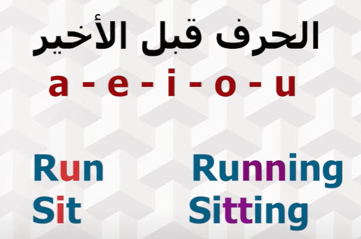

# EN

## a an the _

- a →النكرة : الاسم المفرد الي بيتكرر
- an  , followed by (a , e, , i , o , u, silent H) النكرة : الاسم المفرد الي بيتكرر
- the -> المعرفة المفرد  :مش بيتكرر
- 
- _ لاسم الجمع مش بنحط حاجة
- uncountable nouns —> _

## in on at

for place 

- in —>  مش محددبالظبط المكان زي البلد او القارة
- on —> محدد شوية زي الشارع
- at —> مكان متحدد بدقة

for time 

- in —>  مش محددبالظبط الوقت زي 2009
- on —> محدد شوية زي الايام
- at —> الوقت  متحدد بدقة زي الساعة 4  مثلا

# الازمنة

## simple present

صفة او حاجة بتتكرر 

- في حالة المضارع البسيط للشئ الي بيتكرر نضيف للفعل صوت السيييين اذا كان الفاعل مفرد
    - المفرد هنا الفاعل (he ,she ,it )
    - مش بضيف صوت السين للفعل doesفي حالة تأكيد الفعل ب
    - everybody بتاخد صوت السين
    

## continuous  present

الحاجة الي بتحصل في نفس وقت الكلام 

- ing لازم يكون معاها فعل مساعد (am is are )
    - عند اضافة ال ing لفعل اخره e هنحذف ال
    - 
    
    
    

## simple past

حاجة حصلت في الماضي في وقت معين في زمن محدد 

- مينفعش did معاها فعل ماضي لانها ماضي اصلا

## continuous past

- حصل في الماضي وخد وقت في حدوثة
- عند وجود عندما في الجملة

## complete present

- شئ بدأ حدوثة في الماضي و لم ينتهي بعد
- حدث لسه حاصل حالا
- شئ حدث لم يذكر وقت حدوثة
- الاستخدام
    - 
    
    
    

## Difference between complete present and past simple

## perfect continuous  present

have , has + been + third verb

- كنت بعمل ده في الماضي
- لسه بعمله في الحاضر
- هكمل في المستقبل فيه

## complete past

- يكون الماضي التام في اول حذ من حدذين حصلوا في الماضي
    - 
    
    
    

## will, going to

- will
    - 
    
    
    
- going to
    - 
    
    
    

## If rule

- if + simple present verb , simple future

- imaginary if
    - 
        
        
        
        
        
- third if
    - حدثين في الماضي
    
    
    
    - 
    
    
    

## Modal verbs

- 

- shall بتجيي بس في السؤال الاقطراح
- 

خخ*

- 

- 

## do make

## while when

- while , as , just as
    - while + continuous past + , + simple past
    - while + continuous past + , + continuous past
- when simple past , + continuous past

## for , to

- to + verb
    - to + reason
- for + noun
    - for + purpose

## since , for

