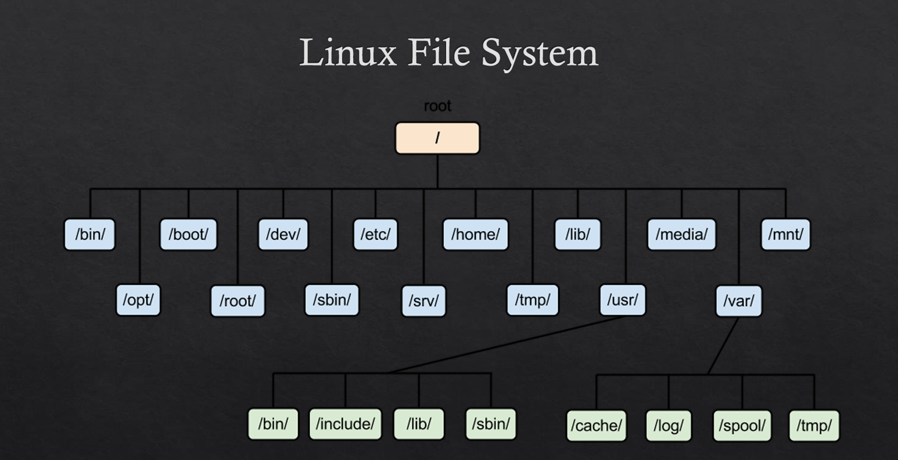

# Linux

## Linux file system  structure

### Study Notes: CH03 - Managing Files From the Command Line (Red Hat Administration)

---

### 1. **CH03 Intro**

- **Definition**: Overview of Linux file management via CLI.
- **Key Concepts**: Importance of command-line efficiency for admins.
- **Tie-In**: Sets foundation for file ops in Red Hat environments.

---

### 2. **CH03_VID01_Access Linux File System**

- **Definition**: Accessing and navigating the hierarchical file system.
- **Key Commands**: `pwd`, `cd`, `ls`.
- **Tie-In**: Root directory (/) as starting point; permissions affect access.

---

### 3. **CH03_VID02_Major Directories**

- **Definition**: Standard directories in the Filesystem Hierarchy Standard (FHS).
- **Key Dirs**: /bin, /etc, /home, /var, /tmp, /usr, /proc.
- **Tie-In**: Purpose-based organization (e.g., /etc for configs).

---

### 4. **CH03_VID03_Linux File Types**

- **Definition**: Types of files in Linux (everything is a file).
- **Key Types**: Regular (-), directory (d), symlink (l), block (b), character (c), socket (s), pipe (p).
- **Tie-In**: Identified via `ls -l` or `file` command.

---

### 5. **CH03_VID04_Rules for Naming Linux Files**

- **Definition**: Naming conventions and restrictions.
- **Key Rules**: Case-sensitive, no spaces (use - or _), max 255 chars, avoid special chars like / \ : * ? " < > |.
- **Tie-In**: UTF-8 support; hidden files start with . (dot).

---

### 6. **CH03_VID05_Absolute Path vs Relative Path in Linux**

- **Definition**: Ways to specify file locations.
- **Absolute**: Starts from / (e.g., /home/user/file.txt).
- **Relative**: From current dir (e.g., ./file.txt or ../parent/file.txt).
- **Tie-In**: Use `pwd` to confirm current path.

---

### 7. **CH03_VID06_LS Command**

- **Definition**: Lists directory contents.
- **Key Options**: `ls -l` (detailed), `a` (all, including hidden), `h` (human-readable sizes), `R` (recursive).
- **Tie-In**: Combines with paths for navigation.

---

### 8. **CH03_VID07_Managing Files Using the Command Line**

- **Definition**: CLI tools for file ops.
- **Key Commands**: `touch`, `mkdir`, `cp`, `mv`, `rm`, `ln`.
- **Tie-In**: Safe practices (e.g., `rm -i` for interactive).

---

### 9. **CH03_VID08_Create & Copy Files and Directories**

- **Definition**: Creating and duplicating items.
- **Commands**: `touch file` (create empty), `mkdir dir` (-p for parents), `cp src dest` (-r for recursive, -p preserve attributes).
- **Tie-In**: Overwrite prompts with -f; use for backups.

---

### 10. **CH03_VID09_Move & Remove Files and Directories**

- **Definition**: Relocating and deleting.
- **Commands**: `mv src dest` (rename/move), `rm file` (-r recursive, -f force).
- **Tie-In**: No recycle bin—use aliases for safety.

---

### 11. **CH03_VID10_Hard Links vs Soft Links**

- **Definition**: Pointers to files.
- **Hard**: Multiple names for same inode (can't cross filesystems).
- **Soft (Symlink)**: Pointer to path (can dangle if target deleted).
- **Tie-In**: Use `ln` command.

---

### 12. **CH03_VID11_Linux Inodes**

- **Definition**: Data structures storing file metadata.
- **Key Info**: Inode number unique per filesystem; tracks permissions, timestamps, but not name.
- **Tie-In**: `ls -i` shows inodes; hard links share inodes.

---

### 13. **CH03_VID12_Creating Hard Links and Soft Links (Part 1)**

- **Definition**: Basics of `ln` command.
- **Commands**: `ln target linkname` (hard), `ln -s target linkname` (soft).
- **Tie-In**: Examples for versioning or shortcuts.

---

### 14. **CH03_VID13_Creating Hard Links and Soft Links (Part 2)**

- **Definition**: Advanced usage and differences.
- **Key**: Hard links increment link count; soft can link dirs/cross filesystems.
- **Tie-In**: Troubleshooting dangling symlinks.

---

### 15. **CH03_VID14_Pattern Matching**

- **Definition**: Wildcards for file selection.
- **Key Patterns**: * (any chars), ? (single char), [abc] (match a/b/c), [!abc] (not a/b/c).
- **Tie-In**: Used in commands like `ls`, `rm`.

---

### 16. **CH03_VID15_Grep Command**

- **Definition**: Searches text patterns.
- **Key Options**: `grep pattern file` (-i case-insensitive, -v invert, -r recursive, -n line numbers).
- **Tie-In**: Pipes with other commands (e.g., `ls | grep txt`).

---

### 17. **CH03_VID16_Using Regular Expressions with Grep**

- **Definition**: Advanced patterns with regex.
- **Key Regex**: ^ (start), $ (end), . (any char), * (zero+), + (one+), \d (digit), -E for extended.
- **Tie-In**: `grep -E` or `egrep` for complex searches.

---

### 18. **CH03_VID17_Cut and Tr Commands**

- **Definition**: Text manipulation tools.
- **Cut**: Extracts fields (e.g., `cut -d: -f1 /etc/passwd`).
- **Tr**: Translates chars (e.g., `tr 'a-z' 'A-Z'` for uppercase).
- **Tie-In**: Often piped (e.g., `cat file | tr -d '\\n'`).

---

### 19. **CH03 Summary**

- **Definition**: Recap of chapter.
- **Key Points**: CLI mastery for file ops, paths, links, searching.
- **Tie-In**: Prep for labs/exams in Red Hat.

---

### Study Check-In (01:22 AM EEST, August 17, 2025)

- **Key Takeaway**: This chapter builds CLI skills for Red Hat—focus on paths, links, and patterns for efficient admin work.
- **Quiz Mode?**: E.g., “What's the difference between hard and soft links?” or “Give an example of grep with regex.”
- **Deeper Dive?**: The full explanations below include examples!
- **Next Topic?**: Ready for CH04 or a review?

What’s our next study move? 🚀

---

### Deep Dive: Detailed Explanations of CH03 - Managing Files From the Command Line (Red Hat Administration)

### 1. **CH03 Intro**

- **Definition**: Introduction to managing files/directories via the Bash shell in Linux, emphasizing CLI over GUI for automation and remote admin in Red Hat environments.
- **How It Works in Detail**: Covers why CLI is preferred (scriptable, lightweight). Sets context for FHS, paths, and tools. In Red Hat, use `bash` as default shell; commands are POSIX-compliant.
- **Key Commands/Concepts**: None specific—overview of upcoming vids.
- **Examples**: Starting a terminal: `Ctrl+Alt+T` or `ssh user@host`. Output: Welcome to bash.
- **Advantages/Limitations**: Advantages: Precise control. Limitations: Steep learning curve for beginners.
- **Real-World Example**: As a sysadmin, use CLI to manage server files remotely via SSH.
- **Tie to Other Topics**: Foundation for all vids; links to networking (e.g., managing /etc/network files).

### 2. **CH03_VID01_Access Linux File System**

- **Definition**: Navigating the unified file system tree starting from root (/), where everything (devices, processes) is treated as a file.
- **How It Works in Detail**: Use `cd` to change dirs, `pwd` to print working dir, `ls` to list. Permissions (rwx) via `chmod` affect access; root (/) is mount point.
- **Key Commands**: `cd /path`, `pwd`, `ls`, `cd ~` (home), `cd -` (previous).
- **Examples**: `pwd` → /home/user. `cd /etc` → Navigate to configs. `ls` → List files.
- **Advantages/Limitations**: Advantages: Hierarchical for organization. Limitations: Permission denied if not root (use sudo).
- **Real-World Example**: Access logs: `cd /var/log; ls`.
- **Tie to Other Topics**: Preps for major dirs; like accessing network mounts (e.g., /mnt/nfs).

### 3. **CH03_VID02_Major Directories**

- **Definition**: Core dirs per FHS for standard layout in Red Hat.
- **How It Works in Detail**: / (root), /bin (binaries), /boot (bootloader), /dev (devices), /etc (configs), /home (user data), /lib (libraries), /media (removable), /mnt (temp mounts), /opt (add-ons), /proc (processes), /root (root home), /run (runtime), /sbin (system bins), /srv (services), /sys (sysfs), /tmp (temp), /usr (user programs), /var (variable data like logs).
- **Key Commands**: `ls /dir` to explore.
- **Examples**: `ls /etc` → configs like passwd. `ls /var/log` → audit.log.
- **Advantages/Limitations**: Advantages: Predictable structure. Limitations: /var can fill up (monitor with df).
- **Real-World Example**: Edit network configs: `cd /etc/sysconfig/network-scripts`.
- **Tie to Other Topics**: File types in these dirs; absolute paths reference them.

### 4. **CH03_VID03_Linux File Types**

- **Definition**: Linux classifies files by type, viewable in `ls -l` first char.
- **How It Works in Detail**: Regular (-) text/binaries, dir (d) containers, symlink (l) pointers, block (b) buffered devices (e.g., disks), char (c) unbuffered (e.g., terminals), socket (s) inter-process comm, pipe (p) FIFO.
- **Key Commands**: `ls -l`, `file filename`.
- **Examples**: `ls -l /dev/sda` → b (block). `file /bin/ls` → executable.
- **Advantages/Limitations**: Advantages: Unified model. Limitations: Type mismatches cause errors.
- **Real-World Example**: /dev/null (c) for discarding output.
- **Tie to Other Topics**: Links (l type); inodes store type info.

### 5. **CH03_VID04_Rules for Naming Linux Files**

- **Definition**: Guidelines for valid filenames in ext4/XFS filesystems.
- **How It Works in Detail**: Case-sensitive, 1-255 chars, allowed: alphanum, . - _ (avoid specials). Hidden: .prefix. Red Hat uses UTF-8 for international chars.
- **Key Commands**: `touch valid-file.txt`, not `touch invalid/file.txt` (fails).
- **Examples**: Good: config_v1.conf. Bad: config? (special char).
- **Advantages/Limitations**: Advantages: Flexible. Limitations: No spaces without quotes.
- **Real-World Example**: Script names: [backup-script.sh](http://backup-script.sh/).
- **Tie to Other Topics**: Affects paths; pattern matching uses names.

### 6. **CH03_VID05_Absolute Path vs Relative Path in Linux**

- **Definition**: Absolute: Full from / (invariant). Relative: From cwd (contextual).
- **How It Works in Detail**: Absolute: /usr/bin/ls. Relative: bin/ls (if in /usr). Special: . (current), .. (parent), ~ (home).
- **Key Commands**: `cd /absolute/path`, `cd relative/path`.
- **Examples**: Absolute: `ls /etc/passwd`. Relative: From /home: `ls ../etc` (fails, as etc not sibling).
- **Advantages/Limitations**: Absolute: Unambiguous. Relative: Shorter for local ops.
- **Real-World Example**: Script: `cp ./file /backup`.
- **Tie to Other Topics**: Used in ls, cp; symlinks can alter relative.

### 7. **CH03_VID06_LS Command**

- **Definition**: Lists files/dirs with details.
- **How It Works in Detail**: Default: alphabetical. Options: -l (long: permissions, owner, size, time), -a (hidden), -h (KB/MB), -t (time sort), -r (reverse), -R (recursive), -i (inodes).
- **Key Commands**: `ls -lah /dir`.
- **Examples**: `ls -l` → drwxr-xr-x 2 user group 4096 Aug 17 file.
- **Advantages/Limitations**: Advantages: Versatile. Limitations: No search (use find).
- **Real-World Example**: Check logs: `ls -lt /var/log` (newest first).
- **Tie to Other Topics**: Shows file types, inodes; patterns with *.

### 8. **CH03_VID07_Managing Files Using the Command Line**

- **Definition**: Overview of CRUD ops via CLI.
- **How It Works in Detail**: Safe flags (e.g., -i interactive). Wildcards for batch.
- **Key Commands**: Covered in next vids.
- **Examples**: Batch: `rm *.tmp`.
- **Advantages/Limitations**: Advantages: Automatable. Limitations: Irreversible (no undo).
- **Real-World Example**: Clean temp: `rm -rf /tmp/*` (careful!).
- **Tie to Other Topics**: Builds on paths; ties to links, patterns.

### 9. **CH03_VID08_Create & Copy Files and Directories**

- **Definition**: Making new items and duplicates.
- **How It Works in Detail**: `touch` updates timestamps too. `mkdir -p` creates parents. `cp -r` for dirs, -u (update only newer), -v (verbose).
- **Key Commands**: `touch file`, `mkdir -p dir/subdir`, `cp -rp src dest`.
- **Examples**: `touch log.txt; cp log.txt backup/`.
- **Advantages/Limitations**: Advantages: Fast. Limitations: Overwrites without -i.
- **Real-World Example**: Backup configs: `cp -r /etc /backup/etc`.
- **Tie to Other Topics**: Creates for links; mv/rm next.

### 10. **CH03_VID09_Move & Remove Files and Directories**

- **Definition**: Renaming/relocating and deleting.
- **How It Works in Detail**: `mv` atomic (no copy-delete). `rm -rf` dangerous (force recursive).
- **Key Commands**: `mv old new`, `rm -ri dir`.
- **Examples**: `mv file.txt /new/path/`, `rm -r olddir`.
- **Advantages/Limitations**: Advantages: Efficient. Limitations: Permanent—use trash-cli alias.
- **Real-World Example**: Organize: `mv *.log /var/log`.
- **Tie to Other Topics**: Affects links (dangling if removed).

### 11. **CH03_VID10_Hard Links vs Soft Links**

- **Definition**: Hard: Same inode, multiple names. Soft: Separate file pointing to path.
- **How It Works in Detail**: Hard: Can't to dirs/cross FS, survives target delete. Soft: Can to dirs/FS, dangles if target gone.
- **Key Commands**: `ln` (hard), `ln -s` (soft).
- **Examples**: Hard: Same data. Soft: Shortcut.
- **Advantages/Limitations**: Hard: Space-efficient. Soft: Flexible but fragile.
- **Real-World Example**: Hard for backups, soft for /etc/alternatives.
- **Tie to Other Topics**: Inodes explain hard links.

### 12. **CH03_VID11_Linux Inodes**

- **Definition**: Metadata blocks (index nodes) for files.
- **How It Works in Detail**: Stores owner, perms, timestamps, pointers to data blocks. Name in dir entry. `df -i` shows usage.
- **Key Commands**: `ls -i`, `stat file`.
- **Examples**: `ls -i file` → 123456 file.txt.
- **Advantages/Limitations**: Advantages: Efficient lookup. Limitations: Finite per FS.
- **Real-World Example**: `find -inum 123456` locates hard links.
- **Tie to Other Topics**: Hard links share inodes; types in metadata.

### 13. **CH03_VID12_Creating Hard Links and Soft Links (Part 1)**

- **Definition**: Basic creation with `ln`.
- **How It Works in Detail**: `ln target link` (hard: increments link count in `ls -l`). Check with `ls -li`.
- **Key Commands/Examples**: `ln file hardlink`, `ln -s /path/to/file symlink`.
- **Advantages/Limitations**: As above.
- **Real-World Example**: `ln config.prod config` for versioning.
- **Tie to Other Topics**: Part 2 for advanced.

### 14. **CH03_VID13_Creating Hard Links and Soft Links (Part 2)**

- **Definition**: Differences in behavior (e.g., delete effects).
- **How It Works in Detail**: Hard: Data persists until all links gone. Soft: `readlink` shows target; -f force overwrite.
- **Key Commands/Examples**: `rm target` (hard survives, soft dangles).
- **Advantages/Limitations**: Soft for remote FS.
- **Real-World Example**: Symlink /var/www to /home/site.
- **Tie to Other Topics**: Use patterns to link multiple.

### 15. **CH03_VID14_Pattern Matching**

- **Definition**: Shell globbing for file ops.
- **How It Works in Detail**: Bash expands before command. {} for braces (e.g., file{1,2}).
- **Key Patterns/Examples**: `ls *.txt` (all txt), `ls file?` (file1/fileA), `ls [a-c]*` (a-c start).
- **Advantages/Limitations**: Advantages: Quick batch. Limitations: No regex (use find).
- **Real-World Example**: `rm log-2025-*.gz`.
- **Tie to Other Topics**: Enhances grep, cp.

### 16. **CH03_VID15_Grep Command**

- **Definition**: Global Regular Expression Print—searches lines.
- **How It Works in Detail**: Matches patterns; -c count, -l files only, -w words.
- **Key Commands/Examples**: `grep error /var/log/messages` (-i: case-insens).
- **Advantages/Limitations**: Advantages: Fast. Limitations: Basic patterns (use -E).
- **Real-World Example**: `ps aux | grep httpd`.
- **Tie to Other Topics**: Pipes with ls; regex next.

### 17. **CH03_VID16_Using Regular Expressions with Grep**

- **Definition**: Extended patterns for complex searches.
- **How It Works in Detail**: -E/-P for Perl. Anchors, quantifiers, groups.
- **Key Regex/Examples**: `grep -E '^root' /etc/passwd` (starts with root), `grep -E '[0-9]{3}' file` (3 digits).
- **Advantages/Limitations**: Advantages: Powerful. Limitations: Syntax errors common.
- **Real-World Example**: Extract IPs: `grep -oE '\\b([0-9]{1,3}\\.){3}[0-9]{1,3}\\b' log`.
- **Tie to Other Topics**: With cut/tr for processing.

### 18. **CH03_VID17_Cut and Tr Commands**

- **Definition**: Cut: Field extraction. Tr: Char translation/deletion.
- **How It Works in Detail**: Cut: -d delim, -f fields. Tr: Sets (e.g., tr -d ' ' removes spaces), -s squeeze.
- **Key Commands/Examples**: `cut -d: -f1,3 /etc/passwd` (user:uid), `echo "hello" | tr 'h' 'H'`.
- **Advantages/Limitations**: Advantages: Simple parsing. Limitations: Cut no regex; tr no fields.
- **Real-World Example**: Uppercase logs: `cat file | tr a-z A-Z`.
- **Tie to Other Topics**: Pipe with grep for filtering.

### 19. **CH03 Summary**

- **Definition**: Chapter recap and best practices.
- **How It Works in Detail**: Emphasizes man pages (`man ls`), aliases, and scripting.
- **Key Points/Examples**: Review commands; lab: Create dir, copy files, grep contents.
- **Advantages/Limitations**: Solidifies skills.
- **Real-World Example**: Daily admin tasks in Red Hat servers.
- **Tie to Other Topics**: Integrates all—e.g., use paths/links in scripts.