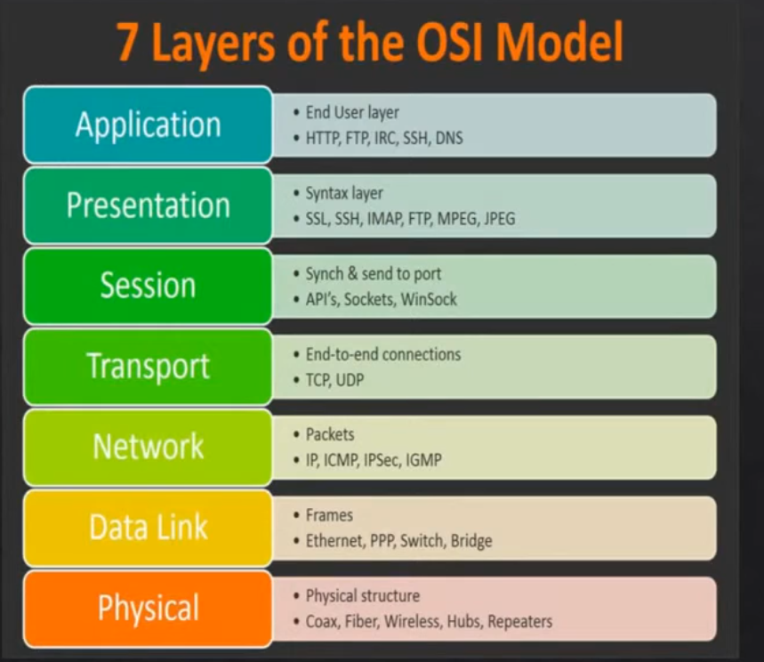

# Networking

### 1. **OSI Layers**

- **Definition**: A 7-layer model standardizing network functions.
- **Layers and Protocols**:
    - **Layer 7 (Application)**: HTTP, FTP, DNS (user interaction).
    - **Layer 6 (Presentation)**: SSL/TLS (encryption).
    - **Layer 5 (Session)**: TCP session setup (connection management).
    - **Layer 4 (Transport)**: TCP, UDP (data segmentation).
    - **Layer 3 (Network)**: IP, ICMP ( Packet , routing, addressing).
    - **Layer 2 (Data Link)**: Ethernet, 802.11, ARP (framing, MAC).
    - **Layer 1 (Physical)**: Physical media (bits over cable/Wi-Fi).
- **How It Works**: Data encapsulates down (e.g., HTTP → TCP → IP → Ethernet) and decapsulates up at the destination.
- **Tie-In**: Your Facebook request flowed through all layers, with packets at Layer 3 and frames at Layer 2.
- info graph
    
    
    

---

### 2. **VLAN (Virtual Local Area Network) & Switching**

- **Definition**: A logical grouping of devices within a physical LAN, operating at **Layer 2 (Data Link)**, segmented for security or traffic management.
- **Key Features**:
    - Uses **IEEE 802.1Q** protocol to tag frames with VLAN IDs.
    - Isolates traffic (e.g., separate VLAN for guests vs. employees).
- **How It Works**: Switches assign ports to VLANs; frames are tagged and filtered based on VLAN ID, not just MAC.
- **Benefits**: Reduces broadcast domains, enhances security.
- **Tie-In**: Extends switching (Ethernet) in local networks, complementing MAC-based delivery.
- multi layer switch
    
    it act like switch and router at the same time 
    
    
    
- Vlan
    
    every vlan has it’s broadcast domain and separate subnet 
    
    - to make vlans communicate with each other it should be through router
    - every vlan have it’s ports or interfaces so each vlan have it’s specific interfaces or ports
    - every vlan has it’s id
    - it is possible to implement the same vlan on different switches and it can communicate together
- switch & vlan
    
    every switch has tow type of ports (access port , trunk port)
    
    - access port to link devices to switch
    - trunk port : to link switch to switch
    - default native vlan has id  = 1
- trunk port
    
    
    

native vlan

- switching & building the mac address table
    
    
    

- Stp
    
    
    

---

### 3. **Subnetting & IP**

- **Definition**: Dividing a large network into smaller subnetworks at **Layer 3 (Network)** using subnet masks.
- **Key Concepts**:
    - **Subnet Mask**: Defines network vs. host bits (e.g., 255.255.255.0 /24).
    - **CIDR**: Classless Inter-Domain Routing (e.g., /26) replaces old class system.
    - **Calculation**: Hosts = 2^(32 - mask bits) - 2 (subtract network/broadcast).
- **How It Works**: Splits an IP range (e.g., 192.168.1.0/24 into 192.168.1.0/26 and 192.168.1.64/26), each with its own subnet.
- **Example**: /24 (256 addresses) → /26 (64 addresses per subnet, 4 subnets).
- **Tie-In**: Used in routing tables (e.g., BGP) to manage WAN traffic efficiently.
- subnetting —> slicing one network into many networks
    
    
    
- network address comes with subnet mask  to define the network part and hosts part
    
    
    
- SDN
    - it act like  a brain of network of switches and control them (APIC) —> SDN controller
    - sdn can managed by rest api
        
        
        
- 

---

### 4. **Application Protocols**

- **Definition**: Protocols at **Layer 7 (Application)** enabling user-level communication (e.g., web browsing, email).
- **Key Protocols**:
    - **HTTP/HTTPS**: HyperText Transfer Protocol (secure with SSL/TLS) for web pages.
    - **FTP**: File Transfer Protocol for file transfers.
    - **SMTP/POP3/IMAP**: Simple Mail Transfer Protocol, Post Office Protocol, Internet Message Access Protocol for email.
    - **DNS**: Domain Name System translates domain names (e.g., [google.com](http://google.com/)) to IP addresses.
- **How It Works**: Data starts here, passed down OSI layers for transmission (e.g., HTTP request in your Facebook example).
- **Tie-In**: Relies on lower layers (TCP/UDP, IP) for delivery.
- Ports ssh telnet
    
    
    

---

### 5. **TCP and UDP**

- **Definition**: Transport layer (**Layer 4**) protocols for data delivery.
- **TCP (Transmission Control Protocol)**:
    - **Features**: Connection-oriented, reliable (acknowledgments, retransmissions), ordered delivery.
    - **Use**: Web (HTTP), email (SMTP).
    - make segmentation and sequencing
    - **How**: Three-way handshake (SYN, SYN-ACK, ACK) establishes connection.
- **UDP (User Datagram Protocol)**:
    - **Features**: Connectionless, faster, no reliability (best-effort).
    - **Use**: Streaming (e.g., video), DNS queries.
    - **How**: Sends datagrams without confirmation.
- **Tie-In**: TCP ensured your Facebook page loaded reliably; UDP might handle live video.
- transport & session layer
    - session make connection establishing and flow control
    - TCP make
        - session establishing —> 3 way hand shake
        - session management —> window sizing
- TCP 4 way handshake for session termination
    - —> fin
    - ←- ack
    - ←-fin
    - —> ack

---

### 6. **Port Numbers**

- **Definition**: 16-bit numbers (**Layer 4**) identifying specific services or applications on a device.
- **Ranges**:
    - **0-1023**: Well-known ports (e.g., 80 for HTTP, 443 for HTTPS).
    - **1024-49151**: Registered ports (e.g., 3306 for MySQL).
    - **49152-65535**: Dynamic/private ports (ephemeral, assigned temporarily).
- **How It Works**: Paired with IP addresses (e.g., 192.168.1.1:80) to direct traffic to the right app.
- **Tie-In**: In your Facebook request, port 443 (HTTPS) directed the packet to the web server.

---

### 7. **DHCP (Dynamic Host Configuration Protocol)**

- **Definition**: A **Layer 3/7** protocol automating IP address assignment.
- **How It Works**:
    - Client broadcasts a **DHCP Discover** message.
    - Server responds with **DHCP Offer** (IP, subnet mask, gateway).
    - Client requests with **DHCP Request**, server acknowledges with **DHCP Ack**.
- **Benefits**: Simplifies network setup (e.g., your home router assigns 192.168.1.x).
- **Protocols Involved**: Uses UDP ports 67 (server) and 68 (client).
- **Tie-In**: DHCP configured your device’s IPv4 address for the Facebook request.
    
    
    

---

### 8. **Routing Protocol Types**

- **Definition**: Protocols at **Layer 3 (Network)** dynamically building routing tables.
- **Types**:
    - **RIP (Routing Information Protocol)**: Distance-vector, hop count metric (max 15), simple for small networks.
    - **OSPF (Open Shortest Path First)**: Link-state, uses bandwidth/delay, fast convergence for larger networks.
    - **BGP (Border Gateway Protocol)**: Path-vector, routes between ASes (e.g., ISPs), used in WAN/internet.
- **How It Works**: Routers exchange route info (e.g., OSPF’s link-state updates) to optimize paths.
- **Tie-In**: BGP routed your Facebook packet across the internet.
- Virtual Routing Forwarding (VRF)
    
    
    

---

### 9. **VPN (Virtual Private Network)**

- **Definition**: A secure **Layer 3** tunnel extending a private network over public infrastructure (e.g., the internet).
- **Key Features**:
    - **Encryption**: Uses **IPsec** or **OpenVPN** for security.
    - **Tunneling**: Encapsulates packets (e.g., your traffic inside an encrypted IPsec packet).
- **How It Works**: Connects remote users to a corporate network, hiding IP addresses (e.g., masking 192.168.1.10 as a VPN server IP).
- **Benefits**: Privacy, remote access.
- **Tie-In**: A VPN could secure your Facebook request over public Wi-Fi.

---

### 10. **Network Devices and Which Layer They Operate In**

- **Definition**: Hardware/software handling network traffic at specific OSI layers.
- **Key Devices**:
    - **Hub**: Layer 1 (Physical)—dumb repeater.
    - **Switch**: Layer 2 (Data Link)—MAC-based forwarding.
    - **Router**: Layer 3 (Network)—IP routing.
    - **Bridge**: Layer 2—connects LAN segments.
    - **Firewall**: Layers 3-7—packet inspection.
    - **Access Point (AP)**: Layer 2—wireless extension.
    - **Modem**: Layer 1—modulates signals.
    - **Layer 3 Switch**: Layers 2-3—switching + routing.
    - **Gateway**: Layers 3-7—protocol translation.
    - **Repeater/Extender**: Layer 1—signal amplification.
- **How It Works**: Devices process data at their layer (e.g., router strips Layer 2, routes Layer 3).
- **Tie-In**: Switches for VLANs, routers for subnetting/routing protocols.

---

### 11.  NAT & PAT

- static NAT —> one to one mapping means translate one private ip to one public ip
- dynamic nat
    - translate the private ips in my network to public ip since the router has pool of public ips not only one
    
    
    
- PAT —> many devices can access internet using same public ip address but in different ports
    
    
    
- Casting
    
    
    

---

---

---

# In details

### Deep Dive: Detailed Explanations of Networking Topics

### 1. **OSI Layers**

The OSI (Open Systems Interconnection) model is a conceptual framework with 7 layers for understanding network communication. Each layer provides services to the one above and uses the one below.

- **How It Works in Detail** (Encapsulation/Decapsulation)**:
    - Data flows down the stack on sender (adding headers/trailers) and up on receiver (removing them).
    - **PDUs (Protocol Data Units)**: Layer 7 (Data) → Layer 4 (Segments) → Layer 3 (Packets) → Layer 2 (Frames) → Layer 1 (Bits).
- **Layers in Depth**:
    - **Layer 7 (Application)**: User interface (e.g., browser). Protocols: HTTP, FTP, DNS. Handles file transfers, authentication.
    - **Layer 6 (Presentation)**: Data translation (e.g., ASCII to EBCDIC), compression (ZIP), encryption (SSL/TLS). Ensures syntax/semantics match.
    - **Layer 5 (Session)**: Manages connections (establish, maintain, terminate). Handles checkpoints for recovery (e.g., NetBIOS).
    - **Layer 4 (Transport)**: End-to-end delivery. TCP (reliable), UDP (fast). Flow control (windowing), error recovery.
    - **Layer 3 (Network)**: Logical addressing (IP), routing. Protocols: IP, ICMP. Path determination, fragmentation.
    - **Layer 2 (Data Link)**: Physical addressing (MAC), framing, error detection (FCS). Sublayers: LLC (logical control), MAC (media access). Protocols: Ethernet, PPP.
    - **Layer 1 (Physical)**: Bit transmission over media (cables, wireless). Defines voltages, timing. Protocols: RS-232, 802.11 PHY.
- **Advantages/Limitations**: Advantages: Modular (troubleshoot by layer). Limitations: Theoretical (real stacks like TCP/IP merge layers).
- **Real-World Example**: Facebook request: Layer 7 (HTTPS) → Layer 4 (TCP segment) → Layer 3 (IP packet) → Layer 2 (Ethernet frame) → Layer 1 (Wi-Fi bits).
- **Tie to Other Topics**: TCP/UDP at Layer 4, ports here too. Routing protocols at Layer 3. VLANs at Layer 2.

---

### 2. **VLAN (Virtual Local Area Network)**

VLANs logically segment a physical LAN into multiple isolated networks at **Layer 2 (Data Link Layer)**, improving security, performance, and manageability without needing separate hardware.

- **How It Works in Detail**:
    - **Tagging Mechanism**: Uses IEEE 802.1Q protocol to insert a 4-byte VLAN tag into Ethernet frames (between source MAC and EtherType). The tag includes a 12-bit VLAN ID (VID, 1-4094), priority bits (PCP for QoS), and CFI (for compatibility).
    - **Switch Configuration**: Ports are assigned as access (untagged, one VLAN) or trunk (tagged, multiple VLANs). Switches maintain a VLAN database (e.g., via VTP—VLAN Trunking Protocol).
    - **Frame Handling**: When a frame enters a switch, it's tagged with the port's VLAN ID (if untagged). The switch forwards based on MAC table per VLAN (separate forwarding databases). Inter-VLAN routing requires a Layer 3 device (router or Layer 3 switch) to connect VLANs.
    - **Subtypes**: Native VLAN (untagged traffic on trunks), voice VLAN (for VoIP), private VLAN (isolates devices within a VLAN).
- **Protocols Involved**:
    - **IEEE 802.1Q**: Core tagging standard.
    - **VTP (VLAN Trunking Protocol)**: Cisco-proprietary for propagating VLAN configs across switches.
    - **ISL (Inter-Switch Link)**: Older Cisco alternative to 802.1Q.
- **Advantages/Limitations**: Advantages: Reduces broadcast storms (smaller domains), enhances security (e.g., separate HR and finance VLANs), scalable. Limitations: Requires compatible switches; misconfiguration can cause loops (mitigated by STP from our switching discussion).
- **Real-World Example**: In a corporate network, VLAN 10 for employees, VLAN 20 for guests—prevents guests from accessing internal servers.
- **Tie to Other Topics**: VLANs interact with subnetting (each VLAN often gets a subnet, e.g., 192.168.10.0/24 for VLAN 10). Routing protocols (e.g., OSPF) handle inter-VLAN traffic. Ties to OSI Layer 2 (Ethernet frames) and Layer 3 (IP routing between VLANs).

---

### 3. **Subnetting**

Subnetting divides an IP network into smaller subnetworks at **Layer 3 (Network Layer)**, optimizing address usage and improving routing efficiency. It's evolved from classful (IPv4 classes) to classless (CIDR).

- **How It Works in Detail**:
    - **Subnet Mask**: A 32-bit mask (e.g., 255.255.255.0 or /24) distinguishes network bits (1s) from host bits (0s). ANDed with IP to find network ID.
    - **Borrowing Bits**: From host portion to create subnets. E.g., /24 (8 host bits) borrowed 2 bits → /26 (4 subnets, 64 addresses each: 2 subnets = 2², hosts = 2^(32-26)-2 = 62).
    - **CIDR Notation**: Variable-length masks (e.g., 10.0.0.0/16). Supernetting aggregates (e.g., /23 combines two /24s).
    - **VLSM (Variable-Length Subnet Masking)**: Allocates different mask lengths (e.g., /30 for point-to-point links, /24 for LANs).
    - **Process**: Identify base network → Borrow bits → Calculate new masks, network IDs, broadcast addresses, usable hosts.
- **Protocols Involved**:
    - **IP**: Core for addressing.
    - **ICMP**: Tests connectivity in subnets (e.g., ping).
- **Advantages/Limitations**: Advantages: Reduces waste (e.g., Class C /24 has 254 hosts; subnet to /30 for 2 hosts). Improves security (isolated subnets). Limitations: Complex calculations; errors cause overlaps.
- **Real-World Example**: Your home network: 192.168.1.0/24 subnetted to 192.168.1.0/26 (first 64 addresses for devices) and 192.168.1.64/26 (for IoT).
- **Tie to Other Topics**: Essential for routing tables (e.g., OSPF advertises subnets). Ties to VLANs (one subnet per VLAN) and DHCP (assigns from subnet pools). In IPv4 classes, Class C starts at /24.

---

### 4. **Application Protocols**

Application protocols operate at the highest level of the OSI model (**Layer 7: Application Layer**), where they provide the interface for end-user applications to interact with the network. They handle the creation, formatting, and exchange of data specific to services like web browsing or email. Unlike lower-layer protocols (e.g., IP at Layer 3), these are user-facing and often involve human-readable formats.

- **How They Work in Detail**:
    - Data originates here from user actions (e.g., typing a URL in a browser). The protocol formats the data into a message (e.g., an HTTP request header with method, URI, and headers like User-Agent).
    - The message is passed down the OSI stack: encrypted at Layer 6 (if needed), session-managed at Layer 5, segmented at Layer 4 (TCP/UDP), packetized at Layer 3 (IP), framed at Layer 2 (Ethernet), and transmitted as bits at Layer 1.23
    - On the receiving end, the process reverses: data is decapsulated up to Layer 7, where the application protocol interprets it (e.g., a server parses an HTTP request and responds with HTML).
    - **Key Mechanisms**: Many use request-response models (client-server). For example, HTTP is stateless (each request is independent), while others like FTP maintain state for file transfers.
- **Key Protocols in Depth**:
    - **HTTP/HTTPS**: HTTP (HyperText Transfer Protocol) uses TCP port 80 for unencrypted web traffic; HTTPS adds SSL/TLS encryption on port 443. Methods include GET (fetch data), POST (send data), PUT (update), DELETE. Headers carry metadata (e.g., Content-Type: text/html). Version 1.1 added persistent connections; HTTP/2 enables multiplexing (multiple requests over one TCP connection); HTTP/3 uses UDP (QUIC) for faster performance. In your Facebook example, HTTPS handles the GET request for your feed, with TLS ensuring encryption at Layer 6.
    - **FTP (File Transfer Protocol)**: Uses TCP ports 20 (data) and 21 (control). Active mode (server initiates data connection) vs. passive mode (client does, better for firewalls). Supports commands like LIST (directory), RETR (download), STOR (upload). Limitations: No built-in encryption (use FTPS or SFTP).
    - **SMTP/POP3/IMAP**: SMTP (port 25/587) sends emails (e.g., MAIL FROM, RCPT TO commands). POP3 (port 110) downloads emails to clients (deletes from server). IMAP (port 143) syncs emails across devices (folders, flags). All use TCP; MIME extensions handle attachments.`
    - **DNS (Domain Name System)**: UDP/TCP port 53. Hierarchical (root servers → TLD → authoritative). Queries: A (IPv4), AAAA (IPv6), MX (mail). Caching reduces latency; DNSSEC adds security against spoofing.
- **Real-World Example**: When you load Facebook, DNS resolves "[facebook.com](http://facebook.com/)" to an IP, then HTTPS fetches the page.
- **Tie to Other Topics**: Relies on TCP/UDP (Layer 4) for transport, ports for identification, and DHCP for IP assignment. In routing, application data is carried in packets across WANs.

---

### 5. **TCP and UDP**

TCP and UDP are **Layer 4 (Transport Layer)** protocols providing multiplexing and reliability (or not) for data delivery.

- **TCP in Depth**:
    - **Connection-Oriented**: Three-way handshake (SYN → SYN-ACK → ACK). Teardown with FIN-ACK.
    - **Reliability**: Sequence numbers for ordering, ACKs for confirmation, retransmission on timeout (RTO calculated via RTT). Windowing for flow control (advertised window size).
    - **Error Handling**: Checksum in header; congestion control (e.g., Tahoe/Reno algorithms: slow start, AIMD).
    - **Header**: 20-60 bytes (source/dest ports, sequence/ACK numbers, flags like SYN/URG/PSH).
- **UDP in Depth**:
    - **Connectionless**: No handshake; just sends datagrams.
    - **Best-Effort**: No ACKs, ordering, or retransmission. Checksum optional.
    - **Header**: 8 bytes (source/dest ports, length, checksum). Low overhead for speed.
    - **Use Cases**: Where loss is tolerable (e.g., DNS queries—retransmit if needed).
- **Advantages/Limitations**: TCP: Reliable but slower (overhead). UDP: Fast but unreliable.
- **Real-World Example**: TCP for Facebook page load (reliable); UDP for video call audio (tolerate drops).
- **Tie to Other Topics**: Use ports for identification. Carry application data (e.g., HTTP over TCP). In OSI, segments become IP packets at Layer 3.

---

### 6. **Port Numbers**

Port numbers are **Layer 4 (Transport Layer)** identifiers allowing multiple applications on one device to share the network stack.

- **How It Works in Detail**:
    - **Socket Concept**: IP + Port (e.g., 192.168.1.1:80). Source port (ephemeral, >1023) random; dest port fixed for services.
    - **NAT/PAT**: Routers map internal ports for multiple devices (Port Address Translation).
    - **Firewall Rules**: Block/allow based on ports (e.g., open 443 for HTTPS).
- **Ranges in Depth**:
    - Well-Known (0-1023): Assigned by IANA (e.g., 22 SSH, 25 SMTP).
    - Registered (1024-49151): Vendor-specific (e.g., 1433 MS SQL).
    - Dynamic (49152-65535): Temporary for clients.
- **Advantages/Limitations**: Advantages: Multiplexing (one IP, many apps). Limitations: Port exhaustion in NAT; security risks (open ports vulnerable).
- **Real-World Example**: Facebook uses port 443; your browser picks ~50000 as source.
- **Tie to Other Topics**: TCP/UDP headers include ports. DHCP uses ports 67/68. Application protocols bind to specific ports.

---

### 7. **DHCP (Dynamic Host Configuration Protocol)**

DHCP automates IP configuration at **Layers 3/7**, reducing manual setup errors.

- **How It Works in Detail** (DORA Process)**:
    - **Discover**: Client broadcasts UDP packet (src 0.0.0.0:68, dest 255.255.255.255:67) seeking servers.
    - **Offer**: Servers respond with available IP, mask, gateway, DNS (from pool).
    - **Request**: Client broadcasts acceptance of an offer.
    - **Acknowledge**: Server confirms lease (time-bound, e.g., 24 hours; renew via T1/T2 timers).
    - **BOOTP Relay**: Agents forward across subnets.
- **Protocols Involved**: UDP (ports 67/68). Options field carries extras (e.g., Option 3: Gateway).
- **Advantages/Limitations**: Advantages: Scalable, central management. Limitations: Single point of failure (use failover); security risks (rogue servers—use DHCP snooping).
- **Real-World Example**: Your phone joins Wi-Fi; router (DHCP server) assigns 192.168.1.100.
- **Tie to Other Topics**: Assigns IPs for subnetting. Works over UDP. Ties to routing (gateway option points to router).

---

### 8. **Routing Protocols Types**

Routing protocols dynamically share route info at **Layer 3 (Network Layer)** to build tables.

- **Types in Depth**:
    - **Distance-Vector (e.g., RIP)**: Shares full tables periodically (every 30s in RIP). Metric: Hops (max 15). Bellman-Ford algorithm. Slow convergence; split-horizon/poison-reverse prevent loops.
    - **Link-State (e.g., OSPF)**: Floods link-state advertisements (LSAs) to build topology map. Dijkstra's SPF for shortest path. Areas for scalability (backbone Area 0). Hello packets for neighbor discovery.
    - **Path-Vector (e.g., BGP)**: For inter-AS routing. Attributes: AS-Path (loop prevention), Next-Hop, MED. eBGP (external peers), iBGP (internal). Policies for path selection.
- **How It Works**: Routers advertise routes; calculate best paths; converge on changes.
- **Advantages/Limitations**: Distance-Vector: Simple but slow. Link-State: Fast but CPU-intensive. Path-Vector: Scalable for internet but complex.
- **Real-World Example**: BGP routes your Facebook packet across ISPs.
- **Tie to Other Topics**: Use IP for addressing. Integrate with subnetting (advertise subnets). OSPF areas like VLAN segmentation.

---

### 9. **VPN (Virtual Private Network)**

VPN creates a secure, encrypted tunnel over public networks at **Layer 3 (Network Layer)**, simulating a private LAN.

- **How It Works in Detail**:
    - **Tunneling**: Encapsulates original packets in new IP headers (e.g., GRE for basic, IPsec for secure).
    - **Modes**: Site-to-Site (connects offices), Remote Access (user to network). Transport mode (encrypt payload only), Tunnel mode (encrypt entire packet).
    - **Authentication/Encryption**: IKE (Internet Key Exchange) negotiates keys. ESP (Encapsulating Security Payload) for confidentiality/integrity.
    - **Split vs. Full Tunnel**: Split routes only corporate traffic through VPN; full routes all.
- **Protocols Involved**:
    - **IPsec**: AH (authentication), ESP (encryption). Uses IKEv2 for key exchange.
    - **OpenVPN**: UDP/TCP-based, uses SSL/TLS.
    - **PPTP/L2TP**: Older; L2TP often over IPsec.
- **Advantages/Limitations**: Advantages: Secure remote work, bypass geo-blocks. Limitations: Overhead slows speed; complex setup.
- **Real-World Example**: Connect to office VPN; access internal files as if on LAN.
- **Tie to Other Topics**: Uses IPsec (Layer 3), ports (e.g., UDP 500 for IKE). Routes via tunnels (affects routing tables). Encrypts application data.

---

### 10. **Network Devices and Which Layer They Operate In**

Network devices are the hardware (or software-emulated) components that facilitate data transmission, processing, and management across networks. Each operates primarily at specific OSI layers, determining what part of the data unit (e.g., frame, packet) they inspect and modify. Some devices are multi-layer (e.g., inspecting higher layers for advanced features). Understanding this helps troubleshoot and design networks—e.g., a Layer 2 issue might involve switches, while Layer 3 points to routers.

- **How They Work in Detail**:
    - Devices receive data, process it at their layer(s), and forward or drop it. For example, lower-layer devices (1-2) deal with physical signals and local addressing, while higher ones (3+) handle logical routing and application-aware decisions.
    - **Encapsulation Impact**: As data moves down OSI layers, devices add/remove headers at their level (e.g., a router adds a new IP header if NATing).
    - **Hybrid Devices**: Modern ones like Layer 3 switches combine functions for efficiency.
    - **Management**: Many support protocols like SNMP (Simple Network Management Protocol) for monitoring at Layer 7.
- **Key Devices in Depth (with Primary OSI Layer)**:
    - **Hub (Layer 1: Physical Layer)**: A basic repeater that broadcasts incoming signals to all ports without intelligence. Regenerates bits to extend cable length but causes collisions (half-duplex). No addressing—treats the network as one collision domain. Protocols: None specific (just electrical standards like RJ-45). Limitations: Inefficient, obsolete (replaced by switches). Example: Old Ethernet hubs connecting 10 devices in a star topology.
    - **Switch (Layer 2: Data Link Layer)**: Forwards frames based on MAC addresses using a CAM (Content Addressable Memory) table learned dynamically (via source MACs). Supports full-duplex, reduces collisions by creating micro-segments. Advanced features: VLAN tagging (802.1Q), QoS, PoE (Power over Ethernet). Protocols: Ethernet, STP (Spanning Tree Protocol) to prevent loops, LLDP (Link Layer Discovery Protocol). Limitations: Doesn't route between networks (needs a router for that). Example: In your home, a switch connects your PC, printer, and router, forwarding frames locally without broadcasting.
    - **Router (Layer 3: Network Layer)**: Routes packets between networks using IP addresses and routing tables (static or dynamic via RIP/OSPF/BGP). Strips Layer 2 headers, inspects/modifies Layer 3 (e.g., TTL decrement), and re-encapsulates in new frames. Features: NAT, ACLs (Access Control Lists), VPN termination. Protocols: IP, ICMP, routing protocols. Limitations: Slower than switches due to processing overhead. Example: Your home router routes packets from your LAN (192.168.1.0/24) to the internet (WAN), using BGP for ISP handoff in our Facebook scenario.
    - **Bridge (Layer 2: Data Link Layer)**: Connects two LAN segments, filtering traffic based on MAC addresses (similar to a simple switch). Transparent bridging learns MACs and forwards only necessary frames. Protocols: Ethernet, STP. Limitations: Less scalable than switches (fewer ports). Example: Bridging two Ethernet segments in an old office to extend the network without a switch.
    - **Firewall (Layers 3-7: Network to Application Layers)**: Inspects and filters traffic based on rules (e.g., IP, ports, application signatures). Stateful (tracks connections), next-gen (NGFW) adds intrusion prevention. Protocols: IPsec for VPN, deep packet inspection for HTTP. Limitations: Can introduce latency if over-configured. Example: A firewall blocks unauthorized ports (e.g., drops incoming port 80 traffic) while allowing your HTTPS request to Facebook on port 443.
    - **Access Point (AP) (Layer 2: Data Link Layer)**: Extends wired networks wirelessly, handling MAC associations and frame forwarding. Manages SSIDs, authentication (WPA3). Protocols: 802.11 (Wi-Fi standards like ac/ax), CAPWAP for controller management. Limitations: Range-limited; interference-prone. Example: Your Wi-Fi router's AP connects your phone wirelessly, forwarding frames to the wired switch/router.
    - **Modem (Layer 1: Physical Layer)**: Modulates/demodulates signals between analog (e.g., cable/DSL) and digital (Ethernet). Converts bits to/from carrier waves. Protocols: DOCSIS (cable), VDSL (DSL). Limitations: No intelligence—just signal conversion. Example: Your cable modem translates ISP signals to Ethernet for your router.
    - **Layer 3 Switch (Layers 2-3: Data Link and Network Layers)**: Combines switch speed with router functions (e.g., inter-VLAN routing via IP). Uses ASICs for fast forwarding. Protocols: Ethernet (Layer 2), IP/OSPF (Layer 3). Limitations: More expensive than basic switches. Example: In a data center, routes between VLANs without a separate router.
    - **Gateway (Layers 3-7: Network to Application Layers)**: Translates between protocols/networks (e.g., LAN to WAN, IPv4 to IPv6). Can be a router with added functions like proxying. Protocols: NAT (Layer 3), HTTP proxy (Layer 7). Limitations: Potential bottleneck. Example: A default gateway (your router's IP) directs traffic out of your subnet.
    - **Repeater/Extender (Layer 1: Physical Layer)**: Amplifies/regenerates signals to extend range (e.g., Wi-Fi extender). No addressing—just boosts bits. Protocols: None (physical standards only). Limitations: Adds noise/latency. Example: A Wi-Fi repeater boosts signal in a large home, extending Layer 1 connectivity.
- **Advantages/Limitations (Overall)**: Advantages: Specialization optimizes performance (e.g., switches for speed, routers for intelligence). Limitations: Single-layer devices can't handle higher functions (e.g., a hub can't route); complexity in multi-device setups.
- **Real-World Example**: In your Facebook request: Modem (Layer 1) receives internet signals → Switch/AP (Layer 2) forwards frames locally → Router (Layer 3) routes packets to ISP → Firewall (Layers 3-7) inspects for security → Gateway (if NAT) translates to public IP.
- **Tie to Other Topics**: Switches enable VLANs (Layer 2), routers run routing protocols/subnetting (Layer 3), firewalls use ports (Layer 4), gateways support VPN/DHCP. All align with OSI: e.g., hubs at Physical for bit transmission, routers at Network for IP packets.

---

### 11. top Ports in network

Below is a summary of the top 30 network ports and their associated services, kept concise (under 4 lines each). These are based on common usage in TCP/UDP protocols, relevant to networking, security, and development contexts we've explored.

1. **Port 20 (TCP)** - FTP Data: Used for file transfer data in FTP, active mode.
2. **Port 21 (TCP)** - FTP Control: Handles FTP command and control connections.
3. **Port 22 (TCP/UDP)** - SSH: Secures remote access and file transfers (e.g., SFTP).
4. **Port 23 (TCP)** - Telnet: Provides unencrypted remote terminal access.
5. **Port 25 (TCP)** - SMTP: Manages email sending between mail servers.
6. **Port 53 (TCP/UDP)** - DNS: Resolves domain names to IP addresses.
7. **Port 67 (UDP)** - DHCP Server: Assigns IP addresses to clients dynamically.
8. **Port 68 (UDP)** - DHCP Client: Receives IP configurations from DHCP servers.
9. **Port 69 (UDP)** - TFTP: Enables simple file transfers without authentication.
10. **Port 80 (TCP)** - HTTP: Serves unencrypted web pages and content.
11. **Port 88 (TCP/UDP)** - Kerberos: Authenticates users in Active Directory.
12. **Port 110 (TCP)** - POP3: Downloads email from servers to clients.
13. **Port 123 (UDP)** - NTP: Synchronizes time across network devices.
14. **Port 137 (UDP)** - NetBIOS Name: Resolves NetBIOS names in Windows networks.
15. **Port 138 (UDP)** - NetBIOS Datagram: Handles datagram services in Windows.
16. **Port 139 (TCP)** - NetBIOS Session: Manages session services in Windows.
17. **Port 143 (TCP)** - IMAP: Syncs email across multiple devices securely.
18. **Port 161 (UDP)** - SNMP: Monitors and manages network devices.
19. **Port 162 (UDP)** - SNMP Trap: Receives alerts from network devices.
20. **Port 179 (TCP)** - BGP: Routes data between autonomous systems.
21. **Port 389 (TCP/UDP)** - LDAP: Queries and modifies directory services like AD.
22. **Port 443 (TCP)** - HTTPS: Secures web traffic with SSL/TLS.
23. **Port 445 (TCP)** - SMB: Enables file and printer sharing in Windows.
24. **Port 514 (UDP)** - Syslog: Logs system messages from devices.
25. **Port 515 (TCP)** - LPD: Manages print jobs on network printers.
26. **Port 548 (TCP)** - AFP: Supports file services on macOS.
27. **Port 636 (TCP)** - LDAPS: Secures LDAP traffic with SSL.
28. **Port 993 (TCP)** - IMAP4S: Secures IMAP with SSL/TLS.
29. **Port 995 (TCP)** - POP3S: Secures POP3 with SSL/TLS.
30. **Port 3389 (TCP)** - RDP: Enables remote desktop access in Windows.

---

### 12.Symmetric and Asymmetric Encryption: Overview

Cryptography is essential for securing communications over networks, such as in HTTPS connections, VPNs, or secure messaging. It involves algorithms that protect data by transforming it into an unreadable form (encryption) and then reversing it (decryption). There are two primary types of encryption: **symmetric** and **asymmetric**. These differ fundamentally in how keys—the secret pieces of information used to encrypt and decrypt—are managed and shared. I'll explain each in detail, including their keys, strengths, weaknesses, and how they work together in real-world connections. Then, I'll cover key exchange mechanisms, focusing on private and public keys.

### 1. Symmetric Encryption

Symmetric encryption uses the **same single key** for both encrypting the data (plaintext) and decrypting it back to its original form (ciphertext). This key must be kept secret by all parties involved in the communication.

- **How it Works**:
    - The sender uses the shared secret key and an encryption algorithm (e.g., AES - Advanced Encryption Standard) to scramble the data.
    - The receiver uses the exact same key and algorithm to unscramble it.
    - Example: If Alice wants to send a message "Hello" to Bob, she encrypts it with the key "Secret123" to get something like "Xj9kPq". Bob, who also knows "Secret123", decrypts it back to "Hello".
- **Types of Keys**:
    - Only one key type: a **symmetric key** (also called a session key or shared secret). It's typically 128–256 bits long for security (e.g., AES-256 uses a 256-bit key).
    - No distinction between "private" or "public"—it's just a single secret shared between parties.
- **Common Algorithms**:
    - AES (widely used in modern systems like Wi-Fi WPA3 or disk encryption).
    - DES (older, now insecure; 56-bit key).
    - ChaCha20 (a stream cipher, fast for mobile devices).
- **Pros**:
    - **Speed and Efficiency**: Very fast for large amounts of data, as the math is simpler. Ideal for encrypting files, streams, or real-time video.
    - **Low Computational Overhead**: Requires less processing power, making it suitable for resource-constrained devices.
- **Cons**:
    - **Key Distribution Problem**: How do you securely share the symmetric key with the other party without it being intercepted? If an attacker (e.g., Eve) gets the key during exchange, all future communications are compromised.
    - **Scalability Issues**: In group communications (e.g., a chat with 10 people), everyone needs the same key, which is hard to manage securely.
    - **No Built-in Authentication**: It doesn't inherently verify the sender's identity; you need additional mechanisms.

Symmetric encryption is like a shared lock and key: both parties use the same key to lock/unlock a box, but getting the key to each other safely is the challenge.

### 2. Asymmetric Encryption (Public-Key Cryptography)

Asymmetric encryption, also known as public-key cryptography, uses a pair of related but mathematically distinct keys: a **public key** (shared openly) and a **private key** (kept secret). This eliminates the need for a shared secret key upfront. It was invented in the 1970s by researchers like Whitfield Diffie and Martin Hellman, and popularized by RSA (named after Rivest, Shamir, Adleman).

- **How it Works**:
    - The public key encrypts the data, but only the corresponding private key can decrypt it (or vice versa for signing).
    - Anyone can encrypt a message using the recipient's public key, but only the recipient (with their private key) can read it.
    - Example: Alice wants to send "Hello" to Bob. She gets Bob's public key (which he shares freely) and encrypts "Hello" to "Y7mZx". Bob uses his private key to decrypt it. Even if Eve intercepts "Y7mZx", she can't decrypt without Bob's private key.
    - Mathematically, this relies on "trapdoor functions"—easy to compute one way (e.g., multiplying large primes) but hard to reverse (factoring them). Common bases include prime factorization (RSA) or elliptic curves (ECC for faster performance).
- **Types of Keys**:
    - **Public Key**: Freely distributed (e.g., via email, websites, or certificates). Used for encryption or verifying signatures. Typically 2048–4096 bits for RSA.
    - **Private Key**: Never shared; stored securely (e.g., on a hardware token or encrypted file). Used for decryption or creating signatures.
    - Key Pair Generation: Created together using a random seed. If you lose the private key, the public key becomes useless.
- **Common Algorithms**:
    - RSA: Based on prime factorization; versatile for encryption and digital signatures.
    - ECC (Elliptic Curve Cryptography): Uses smaller keys (e.g., 256-bit for equivalent security to 3072-bit RSA) and is faster; used in Bitcoin and modern TLS.
    - DSA/ECDSA: Primarily for digital signatures (proving authenticity), not encryption.
- **Pros**:
    - **Secure Key Exchange**: No need to secretly share keys—public keys can be sent over insecure channels.
    - **Built-in Authentication and Non-Repudiation**: Private keys can sign messages, proving the sender's identity (e.g., "This message is from Bob, and he can't deny it").
    - **Scalability**: Works well for one-to-many (e.g., a server sharing its public key with many clients).
- **Cons**:
    - **Slower Performance**: Computationally intensive (e.g., RSA is 100–1000x slower than AES for large data), so not ideal for bulk encryption.
    - **Key Management Complexity**: Public keys must be verified (e.g., via certificates) to prevent "man-in-the-middle" attacks where Eve swaps Bob's public key with hers.
    - **Vulnerability to Quantum Computing**: Algorithms like RSA could be broken by future quantum computers (e.g., Shor's algorithm), leading to post-quantum alternatives like lattice-based crypto.

Asymmetric encryption is like a mailbox: Anyone can drop a letter in (using the public slot), but only the owner (with the private key) can open it.

### 3. Symmetric vs. Asymmetric: When and Why Use Each?

- **Pure Symmetric**: Best for encrypting data already shared securely (e.g., local file encryption). But alone, it's impractical for initial connections due to key sharing risks.
- **Pure Asymmetric**: Great for short messages or key exchange but too slow for large data (e.g., streaming video).
- **Hybrid Approach (Most Common in Practice)**: Combine both for efficiency and security. Use asymmetric to securely exchange a symmetric key, then switch to symmetric for the actual data transfer. This is how protocols like TLS (used in HTTPS) work:
    - Asymmetric handles the "handshake" (initial setup and authentication).
    - Symmetric encrypts the bulk data session.

| Aspect | Symmetric Encryption | Asymmetric Encryption |
| --- | --- | --- |
| **Key Type** | Single shared key | Public-private key pair |
| **Speed** | Fast (e.g., for GBs of data) | Slow (e.g., for KB of data) |
| **Key Exchange** | Difficult (must be secret) | Easy (public key shared openly) |
| **Use Cases** | Data at rest, bulk transfer | Key exchange, signatures, authentication |
| **Security Basis** | Key secrecy | Mathematical hardness (one-way functions) |
| **Examples** | AES in VPN tunnels | RSA in SSH logins |

### How Keys Are Exchanged During a Connection

In a secure connection (e.g., establishing an encrypted session like in web browsing or email), keys aren't just "sent"—they're exchanged via protocols that prevent eavesdropping. The process involves both symmetric and asymmetric elements, with private keys never leaving their owner. Here's a step-by-step breakdown, focusing on a typical TLS 1.3 handshake (the standard for secure web connections as of 2025):

### Key Concepts in Key Exchange

- **Private Keys**: Always private; used only by the owner for decryption/signing. Never exchanged.
- **Public Keys**: Exchanged openly but verified for authenticity (e.g., via digital certificates from trusted authorities like Let's Encrypt).
- **Session Keys**: Temporary symmetric keys generated for each connection, derived from the exchange.
- **Goal**: Establish a shared symmetric key without ever sending it directly, resisting interception.

### Common Key Exchange Methods

1. **Direct Public-Key Exchange (e.g., RSA Encryption)**:
    - Alice generates a random symmetric session key (e.g., for AES).
    - She encrypts this session key using Bob's public key (obtained from a certificate).
    - Alice sends the encrypted session key to Bob.
    - Bob decrypts it with his private key, now both share the symmetric key.
    - **Pros**: Simple. **Cons**: If Bob's private key is compromised later, past sessions could be decrypted (no "forward secrecy").
    - Used in older systems but phased out for better methods.
2. **Diffie-Hellman (DH) Key Exchange (for Symmetric Keys)**:
    - This is a pure key agreement protocol (symmetric-focused but can use asymmetric elements). Invented by Diffie and Hellman in 1976.
    - **Steps** (Simplified Math):
        - Agree on public parameters: A large prime number `p` and a base `g` (shared openly).
        - Alice picks a private random number `a` (her private key), computes `A = g^a mod p` (her public value), and sends `A` to Bob.
        - Bob picks a private `b`, computes `B = g^b mod p`, sends `B` to Alice.
        - Alice computes the shared secret: `S = B^a mod p = (g^b)^a mod p = g^(b*a) mod p`.
        - Bob computes `S = A^b mod p = (g^a)^b mod p = g^(a*b) mod p`.
        - Now both have `S` (the symmetric key base), from which they derive the session key (e.g., via hashing).
    - **Elliptic Curve Diffie-Hellman (ECDH)**: A faster variant using elliptic curves; standard in modern TLS.
    - **Pros**: Provides **Perfect Forward Secrecy (PFS)**—even if long-term private keys are compromised, past session keys remain secure. No direct exchange of secrets.
    - **Cons**: Vulnerable to "man-in-the-middle" if public values aren't authenticated (hence paired with asymmetric signatures).
    - Private keys (`a` and `b`) are never exchanged; only public values (`A` and `B`) are.
3. **Hybrid Key Exchange in TLS/SSL Connections**:
    - **Step 1: Handshake Initiation** (Asymmetric Phase):
        - Client (e.g., your browser) connects to server (e.g., a website).
        - Server sends its public key (in a certificate signed by a Certificate Authority—CA—to prove it's genuine).
        - Client verifies the certificate (checks CA signature using pre-trusted CA public keys).
    - **Step 2: Key Exchange** (Using DH or ECDH):
        - Client and server perform Diffie-Hellman: Exchange public values (e.g., `A` and `B`).
        - Both derive the shared symmetric session key from the secret `S`.
        - Optionally, client signs its part with its private key (if it has one) for mutual authentication.
    - **Step 3: Symmetric Phase**:
        - Once the session key is shared, all further data (e.g., web pages) is encrypted symmetrically with AES.
        - The connection closes after a timeout, discarding the session key.
    - **Private Key Role**: Server's private key decrypts/ verifies during handshake but isn't sent. Client may not even have a private key (one-way auth).
    - **Security Features**:
        - **Ephemeral Keys**: Temporary DH keys (not long-term) ensure PFS.
        - **No Plaintext Secrets**: The symmetric key is never transmitted; it's computed independently.
        - **Quantum Resistance**: Emerging standards (e.g., TLS 1.3 with Kyber) use post-quantum algorithms for future-proofing.

### Potential Attacks and Mitigations

- **Man-in-the-Middle (MitM)**: Eve impersonates Bob. Mitigated by certificate validation.
- **Key Reuse**: Using the same key multiple times weakens security. Solution: Ephemeral keys per session.
- **Side-Channel Attacks**: Timing/power analysis on private keys. Mitigated by secure hardware (e.g., TPM chips).

In summary, symmetric encryption is efficient but needs help with key sharing, while asymmetric provides secure exchange via public-private pairs. Real connections hybridize them: Asymmetric (with public keys exchanged via certificates) bootstraps symmetric session keys (via DH), ensuring fast, secure data transfer. Private keys stay local, powering the math without ever being shared. This balance powers the internet's security today. If you have a specific protocol or example in mind, I can dive deeper!