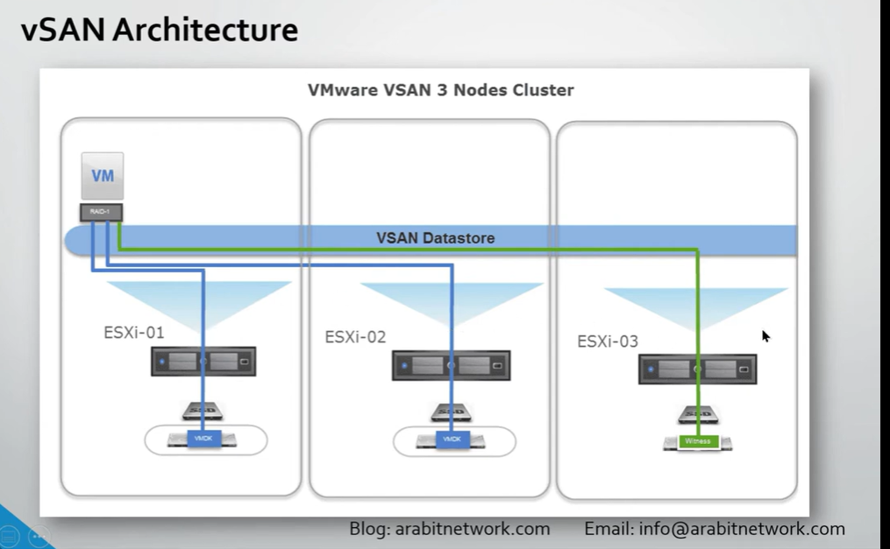

# Storage

### Study Notes: Storage and File System Topics

---

### 1. **Definitions of Storage Types (SAN Storage, NAS, Object Storage)**

- **Definition**: Different architectures for storing and accessing data.
- **Types**: SAN (Storage Area Network), NAS (Network Attached Storage), Object Storage.
- **Tie-In**: Used in virtualization (e.g., VM disks) and cloud setups.

---

### 2. **Block Level - File Level**

- **Definition**: Methods of data access and organization.
- **Block Level**: Raw data blocks for direct access.
- **File Level**: Structured files via protocols.
- **Tie-In**: Impacts storage type choice (e.g., SAN uses block).

---

### 3. **RAID Types**

- **Definition**: Redundant Array of Independent Disks for data protection and performance.
- **Key Types**: RAID 0, 1, 5, 6, 10.
- **Tie-In**: Enhances reliability in SAN/NAS.

---

### 4. **SMP, NFS**

- **Definition**: Storage management protocols and file sharing systems.
- **SMP**: Storage Management Protocols (e.g., SMI-S).
- **NFS**: Network File System for file sharing.
- **Tie-In**: NFS integrates with virtualization; SMP aids management.

---

### Study Check-In (04:30 PM EEST, August 17, 2025)

- **Key Takeaway**: Storage types and protocols define how data is stored, accessed, and managed—crucial for VMs, cloud, and enterprise setups.
- **Quiz Mode?**: E.g., “What’s the difference between SAN and NAS?” or “Name a RAID type with parity.”
- **Deeper Dive?**: Full explanations below with examples!
- **Next Topic?**: More storage (e.g., iSCSI) or cloud storage?

What’s our next study move? 🚀

---

### Deep Dive: Detailed Explanations of Storage and File System Topics

### 1. **Definitions of Storage Types (SAN Storage, NAS, Object Storage)**

- **Definition**: Storage types define how data is stored, accessed, and managed, each suited to different use cases.
- **How It Works in Detail**:
    - **SAN (Storage Area Network)**: A dedicated high-speed network (e.g., Fibre Channel, iSCSI) connecting servers to centralized storage arrays. Uses block-level access, appearing as local disks. Managed via SAN switches or fabric (e.g., Brocade).
    - **NAS (Network Attached Storage)**: A file-level storage device connected via Ethernet, using protocols like NFS or SMB. Acts as a shared file server, accessible over a network. Typically appliances (e.g., Synology, QNAP).
    - **Object Storage**: A scalable, flat storage system storing data as objects (data + metadata + unique ID) in buckets, optimized for cloud (e.g., Amazon S3). Accessed via HTTP/REST APIs.
- **Key Tools/Commands**: SAN: `iscsiadm -m discovery` (Linux), Hyper-V Manager (attach LUN). NAS: `mount -t nfs` (Linux), Windows Explorer. Object: AWS CLI `aws s3 ls`.
- **Examples**: SAN: VM disks on EMC VMAX. NAS: Share /home on NetApp. Object: Store backups in S3 bucket "backup-2025".
- **Advantages/Limitations**: SAN: High performance, complex. NAS: Easy file sharing, slower. Object: Scalable, not suited for DBs.
- **Real-World Example**: Enterprise uses SAN for VMs, NAS for file shares, Object for archival in AWS.
- **Tie to Other Topics**: SAN integrates with virtualization (VMware vSAN); NAS uses NFS/SMB (like Red Hat mounts); Object ties to cloud (e.g., Azure Blob).

### 2. **Block Level - File Level**

- **Definition**: Refers to how data is presented and accessed—block-level as raw storage, file-level as structured files.
- **How It Works in Detail**:
    - **Block Level**: Data is stored and accessed as fixed-size blocks (e.g., 512 bytes) without a file system. OS or hypervisor manages it (e.g., NTFS on a LUN). Used in SANs, databases, or VMs for direct control.
    - **File Level**: Data organized into files and folders, accessed via protocols (e.g., NFS, SMB). Managed by NAS or file servers, with metadata (permissions, timestamps). User-friendly but adds overhead.
- **Key Tools/Commands**: Block: `fdisk -l` (Linux), Disk Management (Windows). File: `ls -l` (Linux), `dir` (Windows).
- **Examples**: Block: Mount iSCSI LUN as /dev/sdb. File: Access /mnt/nas/share via NFS.
- **Advantages/Limitations**: Block: High performance, complex setup. File: Easy access, less efficient for raw data.
- **Real-World Example**: SAN provides block storage for a VM’s disk; NAS offers file storage for user documents.
- **Tie to Other Topics**: Block used in SAN/virtualization; file via NFS/NAS; RAID protects both; contrasts Red Hat file types.

### 3. **RAID Types**

- **Definition**: RAID (Redundant Array of Independent Disks) combines multiple disks for performance, redundancy, or both, implemented in hardware (controllers) or software (OS).
- **How It Works in Detail**:
    - **RAID 0 (Striping)**: Data split across disks (no redundancy). Speed boost, no fault tolerance. Min: 2 disks.
    - **RAID 1 (Mirroring)**: Data duplicated on two disks. Full redundancy, slower writes. Min: 2 disks.
    - **RAID 5 (Striping with Parity)**: Data + parity across 3+ disks. Survives one disk failure, good balance. Min: 3 disks.
    - **RAID 6 (Dual Parity)**: Like RAID 5 but with two parity blocks. Survives two failures. Min: 4 disks.
    - **RAID 10 (1+0)**: Mirrored sets striped. High performance + redundancy. Min: 4 disks.
- **Key Tools/Commands**: Linux: `mdadm --create /dev/md0 --level=5`. Windows: Server Manager > Storage Pools.
- **Examples**: RAID 0: Fast media server (2x1TB). RAID 1: Critical DB (2x500GB mirror). RAID 5: File server (3x2TB).
- **Advantages/Limitations**: RAID 0: Fast, no redundancy. RAID 1: Safe, costly. RAID 5: Efficient, rebuild slow. RAID 6: Double safety, more disks. RAID 10: Best of both, expensive.
- **Real-World Example**: Data center uses RAID 10 for VM storage, RAID 5 for backups.
- **Tie to Other Topics**: Enhances SAN/NAS reliability; virtualization uses RAID for VM disks; like Red Hat LVM but hardware-focused.

### 4. **SMP, NFS**

- **Definition**: SMP refers to Storage Management Protocols (e.g., SMI-S, SNMP) for managing storage devices. NFS (Network File System) is a protocol for sharing files over a network.
- **How It Works in Detail**:
    - **SMP (Storage Management Protocol)**: Standards like SMI-S (Storage Management Initiative Specification) enable centralized monitoring/control of storage (e.g., capacity, health) via APIs or tools. Used with SAN/NAS for automation.
    - **NFS**: A file-level protocol (NFSv3, v4) mounts remote directories as local. Server exports via /etc/exports; client mounts with `mount -t nfs`. Supports locking, security (Kerberos in v4).
- **Key Tools/Commands**: SMP: `smispy` (Python library), HPE OneView. NFS: `exportfs -a` (server), `showmount -e` (exports), `mount -t nfs server:/share /mnt` (client).
- **Examples**: SMP: Monitor EMC array via SMI-S. NFS: Mount /data on client: `mount 192.168.1.10:/data /mnt/data`.
- **Advantages/Limitations**: SMP: Centralized, complex setup. NFS: Cross-platform, latency over WAN.
- **Real-World Example**: Enterprise uses SMP to manage SAN, NFS to share home dirs across Linux/Windows.
- **Tie to Other Topics**: SMP manages SAN/storage virtualization; NFS used in NAS, Red Hat file sharing; contrasts Windows SMB.

