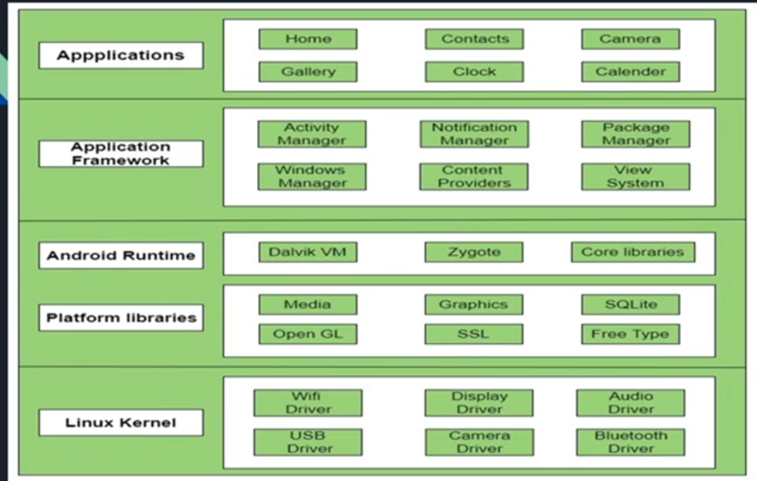

# Daoud youssef android course

## Android Architecture



### Application Layer

it have the application which we will doing pentest on it

* **it have tow types**
  * Pre-Installed application
    * it run within android run time such (camera , gallery , etc )
  * Third party application
    * applications installed from google play such (Facebook , twitter , etc )

### Application Framework

It is a key layer of the Android architecture, sitting between the operating system's core libraries and the actual applications that users interact with. It provides the necessary services, tools, and APIs for app developers to build their applications without needing to interact with the underlying hardware or system components directly.

Examples → (activity manager, Resource manager , notification manager, package manager , etc)

### **Android Runtime (ART)**

manages how applications are executed. It serves as the runtime environment for Android apps and is responsible for translating the app’s code (typically written in Java or Kotlin) into `dex` format to enable Kernel dealing with the application.

it also have (java libraries and android libraries)

### Platform Libraries

provide a rich set of APIs, libraries and tools that developers use to create applications such

(java.util , java.io , java.lang , openSSl , OpenGl )

### Linux Kernel

Linux Kernel is heart of the android architecture. It manages all the available drivers such as display drivers, camera drivers, Bluetooth drivers, audio drivers, memory drivers, etc. which are required during the runtime

## Application Journey

1. the developer has written the application code in (java or kotlin ) and add some (libraries and resources )
2. compile code to get app in `dex` format
3. build `dex` file + (libraries and resources ) to get **APK**
4. APK + sign —> signed APK , “sign” is certificate the point to that the app is belongs to the developer
5. lunch the APK on google play

***

## Android Security Layers

Android applies tow security models —>

### Linux security models (DAC - Discretionary Access Control )’

in linux Kernel the OS differentiate the permissions base on user type and groups for example

if you have root user then you have the most permissions that any user can had and if you have normal user then you have more restrictions and low permissions compared to root user

### SELinux security model (MAC - Mandatory Access Control )

It consider as the secondary layer after (DAC) layer, it based on (principle of Default denied) which means that every process haven’t the direct permissions to done then it denied

**SElinux History**

before android version 4.2.2 this model wasn’t exist and starting from android version 4.3 it started to used but with (permissive) SElinux state which have low restrictions and starting from 4.5 version it became with (enforce) SElinux state witch is more secure

**SElinux Types** :

* Default : the default type on devices
* multi layer security : more secure
* SRC : the custom type which (phone manufactory companies ) and (Rom developers ) the can make the policy and rules of SElinux

**How Android Security Models works**

.png>)

### Security application permissions categories

1- Normal Permissions ( vibrate - access-network-state) 2- Dangerous Permissions ( gallery- contacts - camera 3- Signature Permissions 4- signature Or System ( deprecated in API 23 )

## Application Component

### Main components

* **Activity**
  * it the used interface that showed to user and also it is single screen
* **Services**
  * They handle background processing associated with an application
* **Broadcast receiver**
  * is a component that allows the system or other applications to send and receive broadcast messages (or events) to your app. These messages can come from the Android system (such as when the device is charging or when a new SMS is received), or from other applications.
*   Local storage

    how data stored on android device

    1.  shared preferences

        storing data or sensitive data that can Speed up the process
    2.  Databases

        where the application store data in Sqlite database and it can data through (Content provider)
    3.  Files

        storing application data in isolated files with various formats

### Additional Components

1. Fragments 2- Views 3- Layouts 4- Intents 5- Resources 6- Manifest

💡

Note: every component should written is Manifest file

## Decompile Android Applications

converting the compiled bytecode of an Android app (APK file) back into a human-readable form

### Why decompiling form security perspective

* To know if it is a malware or not
* To detect vulnerability in the application itself
* To get more details about backend apis endpoints
* To unlock paid feature for free

### Decompile for modifying

here we can use such “APK Tool ” to turn APK into readable format of (`dex`) file so we turn it into “SMALI” format which is close to assembly code trying to modify the application

.png>)

### Decompile for analyzing

here we trying to turn APK to approximately code of application source code to identify vulnerabilities

.png>)

### How we could get the APK file ?

**1-Uploaded by the program itself.**

**2- the program give only the package name :**

1. Extract from mobile after install ( adb)

```bash
adb shell pm list packages | findstr /I App_Name # to get package name 
adb shell pm path Package_name ## to get package path on device 
adb pull Package_path App_name.apk
```

1. using (apk extractor )
2. chrome extension (apk downloader) by giving package name

## Android debug bride (adb) sheet cheat

```bash
adb devices # get connected emulators to my host (windows)
adb root # when running emultor it will be runned as root user 
adb install apk_name # to install apk stored on my host on emultor 
adb uninstall package_name # to uninstall app on emulator 
adb push File_name /Path_on_emulator # to transfare files from host to emulator 
adb pull /File_path_on_emulator /Path_on_host #to transfare file from emulator to host 
adb shell ps -A  # to get all running services on emulator 
adb shell pm list packages #to list all installed packages on emultor 
adb shell pm list packages -s #to list all system installed packages on emultor 
adb shell pm list packages -f #to list all installed packages with it's path on emultor 
adb shell pm list packages -3 #to list all third party packages installed on emultor 
adb shell screencap -p /Path_on_emulator.png   # got screenshot of emulator 
adb backup -apk -all -f backup.ab # to get backup from emulator 
adb logcat --pid  Proces_id # to get logs of specific application 
```

## Intents In Android Application

Is the components that facilitate communication between different components of an Android application (e.g., activities, services) or between different applications. They are a messaging object you can use to request an action from another app component

we can use it for

1- Starting an activity 2- Starting service 3- Delivering a broadcast

## Types of Intents

we have tow types

1. Explicit Intent
2. Implicit Intent

### Explicit Intent

Used to launch a specific component (activity, service, etc.) within app, hence we know the targeted component before hand

Example

```java
Intent intent = new Intent(CurrentActivity.this, TargetActivity.class);
startActivity(intent);
```

### Implicit Intent

Used when you don’t specify the exact component but declare a general action that any app can handle , Android matches this request to an appropriate component (e.g., sharing a file, opening a webpage), usually used to deal with another applications

Example

```java
Intent intent = new Intent(Intent.ACTION_VIEW);
intent.setData(Uri.parse("http://www.example.com"));
startActivity(intent);
```

### Intent Components

1. **Name** ( optional but critical )
2. **Action**
   1. “system action” which make a predefined actions on system
   2. “Custom”
3. **Data**
   1. URI
   2. MIME type
   3. URI and MIME type
4. category
5. Extras (sending data with intent )
   1. “putExtra” method to send data in key pair value format
   2. “putExtras” method to send bundle (object) of data

### Intent Filters

An **Intent Filter** in Android defines the conditions under which a component like an ( `Activity`, `Service`, or `BroadcastReceiver`) can respond to an `Intent`. It is used for **implicit intents**, allowing the system to match the intent with the appropriate component based on specified **actions**, **categories**, and **data** ( URI schemes or MIME types). Intent filters are declared in the app's `AndroidManifest.xml` and allow apps to handle various tasks like opening URLs, sharing content, or launching activities.

Sending Intent via ADB

```java
	adb shell am start -a android.intent.VIEW -d "https://www.google.com"
```
