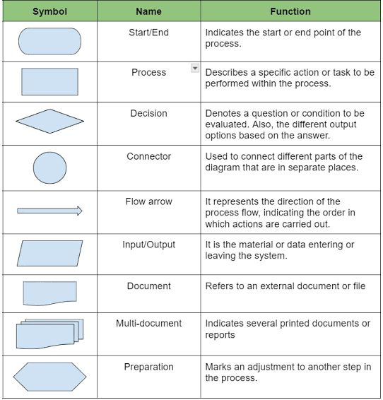

# Software 2523c74efb3c8066ae75d62a9774b188

## Software

## flow chart



## C language

```c
#include <stdio.h>   // add lib 
							---------------------------------

// Create variables
int myNum = 15;            // Integer (whole number)
float myFloatNum = 5.99;   // Floating point number
char myLetter = 'D';       // Character

// Print variables
printf("%d\n", myNum);
printf("%f\n", myFloatNum);
printf("%c\n", myLetter);
```

*   ### If you try to store more than a single character, it will only print the last character:

    ```c
    char myText = 'Hello';
    printf("%c", myText);   /// o

    ```
*   ### If you want to remove the extra zeros (set decimal precision), you can use a dot (`.`) followed by a number that specifies how many digits that should be shown after the decimal point

    ```c
    float myFloatNum = 3.5;

    printf("%f\n", myFloatNum);   // Default will show 6 digits after the decimal point
    printf("%.1f\n", myFloatNum); // Only show 1 digit
    printf("%.2f\n", myFloatNum); // Only show 2 digits
    printf("%.4f", myFloatNum);   // Only show 4 digits
    ```
*   ### the way you print different data types

    ```c
    // Create variables of different data types
    int items = 50;
    float cost_per_item = 9.99;
    float total_cost = items * cost_per_item;
    char currency = '$';

    // Print variables
    printf("Number of items: %d\n", items);
    printf("Cost per item: %.2f %c\n", cost_per_item, currency);
    printf("Total cost = %.2f %c\n", total_cost, currency);

    ```
*   ### CONSTANT

    ```c
    //When you declare a constant variable, it must be assigned with a value:
    const int minutesPerHour = 60;

     -----------
    const int minutesPerHour;
    minutesPerHour = 60; // error
    ```
*   boolen

    ```c

    printf("%d", 10 > 9);  // Returns 1 (true) because 10 is greater than 9

    printf("%d", 10 == 10); // Returns 1 (true), because 10 is equal to 10
    printf("%d", 10 == 15); // Returns 0 (false), because 10 is not equal to 15
    printf("%d", 5 == 55);  // Returns 0 (false) because 5 is not equal to 55
    ```
*   **Short Hand If...Else (Ternary Operator)**

    ```c
    // variable = (condition) ? expressionTrue : expressionFalse;

    int time = 20;
    (time < 18) ? printf("Good day.") : printf("Good evening.");

    ```
*   ### Note that we have to use the `%c` format specifier to print a **single character**.

    ```c

    char greetings[] = "Hello World!";
    printf("%c", greetings[0]);

    -       -- - - - -- - - - -
    // print all string 
    char greetings[] = "Hello World!";
    greetings[0] = 'J';
    printf("%s", greetings);
    // Outputs Jello World! instead of Hello World!

    ```

.png>)

.png>)

.png>)

.png>)

*   ### To concatenate (combine) two strings, you can use the `strcat()` function:

    ```cpp
    char str1[20] = "Hello ";
    char str2[] = "World!";

    // Concatenate str2 to str1 (result is stored in str1)
    strcat(str1, str2);

    // Print str1
    printf("%s", str1);
    ```
*   ### Copy data from one string to another:

    ```cpp
    char str1[] = "Hello World!";
    char str2[30];
    strcpy(str2, str1);
    printf("%s\n", str1);
    printf("%s\n", str2);

    ```
*   ### To compare two strings, you can use the `strcmp()` function.

    ```cpp
    char str1[] = "Hello";
    char str2[] = "Hello";
    char str3[] = "Hi";

    // Compare str1 and str2, and print the result
    printf("%d\n", strcmp(str1, str2));  // Returns 0 (the strings are equal)

    // Compare str1 and str3, and print the result
    printf("%d\n", strcmp(str1, str3));  // Returns -4 (the strings are not equal)
    ```

## C++

*   ### If you try to add a number to a string, an error occurs:

    ```cpp
    string x = "10";
    int y = 20;
    string z = x + y;
    ```
*   ### The `<string>` library also has an `at()` function that can be used to access characters in a string:

    ```cpp
    string myString = "Hello";
    cout << myString; // Outputs Hello

    cout << myString.at(0);  // First character
    cout << myString.at(1);  // Second character
    cout << myString.at(myString.length() - 1);  // Last character

    myString.at(0) = 'J';
    cout << myString;  // Outputs Jello
    ```
*   ### That's why, when working with strings, we often use the `getline()` function to read a line of text. It takes `cin` as the first parameter, and the string variable as second:

    ```cpp
    string fullName;
    cout << "Type your full name: ";
    getline (cin, fullName);
    cout << "Your name is: " << fullName;

    // Type your full name: John Doe
    // Your name is: John Do
    ```
*   ### for each syntax

    ```cpp
    for (type variableName : arrayName) {
      // code block to be executed
    }
    ----------------------------------
    int myNumbers[5] = {10, 20, 30, 40, 50};
    for (int i : myNumbers) {
      cout << i << "\n";
    }

    -----------------------
    string word = "Hello";
    for (char c : word) {
      cout << c << "\n";
    }
    ```
*   ### In C++, you don't have to specify the size of the array. The compiler is smart enough to determine the size of the array based on the number of inserted values:

    ```cpp
    string cars[] = {"Volvo", "BMW", "Ford"}; // Three array elements
    ===========
    string cars[3] = {"Volvo", "BMW", "Ford"}; // Also three array elements

    ```
* **Loop Through an Array with sizeof()**
*   Create a Structure

    To create a structure, use the `struct` keyword and declare each of its members inside curly braces.

    After the declaration, specify the name of the structure variable (**myStructure** in the example below):

    ```cpp
    struct {             // Structure declaration
      int myNum;         // Member (int variable)
      string myString;   // Member (string variable)
    } myStructure;       // Structure variable
    ```

## algorithms

Below are summaries of how each algorithm works, limited to a maximum of 10 lines per algorithm, including their time complexity. These cover only the algorithms you specified starting from the prompt "extract '-Bubble Sort: قارن كل عنصر باللي بعده، وبدّلهم لو مش بالترتيب، وكرر لحد ما يبقوا كلهم مظبوط etc'":

* **Bubble Sort**:
  1. Compare each pair of adjacent elements.
  2. Swap them if they are out of order.
  3. Move to the next pair, pushing the largest to the end.
  4. Repeat until no more swaps are needed.
  5. Continue for all elements until fully sorted.
  6. Time Complexity: O(n²) in worst and average cases, O(n) in best case.
* **Quick Sort**:
  1. Select a pivot element from the array.
  2. Partition the array into elements less than and greater than the pivot.
  3. Recursively apply the same process to the sub-arrays.
  4. Continue until all sub-arrays are sorted.
  5. Combine the results into a fully sorted array.
  6. Time Complexity: O(n log n) average, O(n²) worst case.
* **Merge Sort**:
  1. Divide the array into two halves.
  2. Recursively sort each half.
  3. Merge the sorted halves into a single sorted array.
  4. Repeat until the entire array is merged.
  5. Ensure the final merge completes the sort.
  6. Time Complexity: O(n log n) in all cases.
* **Linear Search**:
  1. Start from the first element of the data.
  2. Compare it with the target value.
  3. Move to the next element and repeat comparison.
  4. Continue until the target is found or the end is reached.
  5. Time Complexity: O(n) in worst and average cases.
* **Binary Search**:
  1. Ensure the data is sorted.
  2. Compare the target with the middle element.
  3. If not found, search the left or right half based on comparison.
  4. Repeat until the target is found or the range is empty.
  5. Time Complexity: O(log n) in worst and average cases.
* **Dijkstra’s Algorithm**:
  1. Start with a source node and set its distance to 0.
  2. Initialize distances to all other nodes as infinity.
  3. Pick the unvisited node with the smallest distance.
  4. Update distances to neighboring nodes if a shorter path is found.
  5. Repeat until all nodes are visited.
  6. Time Complexity: O((V + E) log V) with a priority queue.
* **DFS (Depth-First Search)**:
  1. Start at a node and explore as far as possible along one branch.
  2. Mark the current node as visited.
  3. Recurse on the next unvisited adjacent node.
  4. Backtrack when no unvisited nodes remain.
  5. Continue until all nodes are explored.
  6. Time Complexity: O(V + E), where V is vertices and E is edges.
* **BFS (Breadth-First Search)**:
  1. Start at the root node and add it to a queue.
  2. Dequeue a node, mark it visited, and enqueue its unvisited neighbors.
  3. Repeat until the queue is empty.
  4. Process all nodes level by level from nearest to farthest.
  5. Stop when the target is found or all are visited.
  6. Time Complexity: O(V + E), where V is vertices and E is edges.
* **Dynamic Programming (Fibonacci Example)**:
  1. Identify the problem (e.g., compute Fibonacci number).
  2. Break it into smaller subproblems (e.g., F(n-1), F(n-2)).
  3. Store results of subproblems in a table or array.
  4. Build the solution by reusing stored values.
  5. Return the final result efficiently.
  6. Time Complexity: O(n) with memoization, O(2^n) without.
* **Greedy Algorithms (Coin Change Example)**:
  1. Start with the target amount to change.
  2. Select the largest denomination that doesn’t exceed the amount.
  3. Subtract that denomination and repeat with the remainder.
  4. Continue until the amount is reduced to zero.
  5. Output the combination of coins used.
  6. Time Complexity: O(n) where n is the number of denominations.
* **Selection Sort**:
  1. Divide the array into a sorted (left) and unsorted (right) portion.
  2. Find the minimum element in the unsorted portion.
  3. Swap it with the first element of the unsorted portion.
  4. Repeat the process for the remaining unsorted portion.
  5. Continue until the sorted portion includes all elements.
  6. Time Complexity: O(n²) in worst and average cases.
* **Insertion Sort**:
  1. Start with the second element, considering the first as sorted.
  2. Take the current element and compare with sorted portion.
  3. Shift larger elements right to insert the current one.
  4. Move to the next unsorted element and repeat.
  5. Continue until all elements are sorted.
  6. Time Complexity: O(n²) in worst and average cases, O(n) in best case.

These summaries provide a step-by-step breakdown of each algorithm’s operation, including time complexity, aligning with your request. Let me know if you’d like code implementations or further analysis!

***

***

***

***

***

***

—

#### Summary of How Each Algorithm Works

*
* **Selection Sort**:
  1. Divide the array into a sorted (left) and unsorted (right) portion, initially empty and full respectively.
  2. Find the minimum element in the unsorted portion.
  3. Swap it with the first element of the unsorted portion, moving it to the sorted portion.
  4. Repeat the process for the remaining unsorted portion until the entire array is sorted.
  5. Continue until the sorted portion includes all elements.
  6. The array is fully sorted after the last swap.

This algorithm works by iteratively selecting the smallest element from the unsorted section and placing it at the beginning of the sorted section, making it efficient for small datasets but less so for large ones due to its O(n²) time complexity. Let me know if you'd like a code example or comparison with other sorting algorithms!

It seems you’ve listed "Depth-First Search (DFS)" twice, likely a typo. I’ll provide summaries for **Insertion Sort** and **Depth-First Search (DFS)**, assuming the second DFS was intended to be a different algorithm or a request for more detail. If you meant another algorithm (e.g., Breadth-First Search), please let me know! Each summary is kept to a maximum of 10 lines.

#### Summary of How Insertion Sort Works

* **Insertion Sort**:
  1. Start with the second element of the array, considering the first element as an initial sorted portion.
  2. Take the current element and compare it with the elements in the sorted portion.
  3. Shift larger elements in the sorted portion one position right to make space.
  4. Insert the current element into its correct position within the sorted portion.
  5. Move to the next unsorted element and repeat the comparison and insertion process.
  6. Continue until all elements are processed and the entire array is sorted.
  7. The algorithm builds the sorted array incrementally from left to right.
  8. Works well for small or nearly sorted datasets with O(n²) time complexity.

#### Summary of How Depth-First Search (DFS) Works

* **Depth-First Search (DFS)**:
  1. Start at a chosen node (root) in a graph or tree and mark it as visited.
  2. Explore the first unvisited adjacent node as deeply as possible along that path.
  3. Recursively continue this process on the next unvisited neighbor of the current node.
  4. Backtrack to the previous node when no unvisited neighbors remain.
  5. Repeat the exploration and backtracking until all nodes are visited.
  6. Uses a stack (explicit or recursive call stack) to track the path.
  7. Suitable for detecting cycles or connected components in graphs.
  8. Has a time complexity of O(V + E), where V is vertices and E is edges.

Let me know if you’d like a code example, a comparison, or details on another algorithm (e.g., to replace the second DFS)!

* **Bubble Sort**:
  1. Compare each pair of adjacent elements.
  2. Swap them if they are out of order.
  3. Move to the next pair, pushing the largest to the end.
  4. Repeat until no more swaps are needed.
  5. Continue for all elements until fully sorted.
* **Quick Sort**:
  1. Select a pivot element from the array.
  2. Partition the array into elements less than and greater than the pivot.
  3. Recursively apply the same process to the sub-arrays.
  4. Continue until all sub-arrays are sorted.
  5. Combine the results into a fully sorted array.
* **Merge Sort**:
  1. Divide the array into two halves.
  2. Recursively sort each half.
  3. Merge the sorted halves into a single sorted array.
  4. Repeat until the entire array is merged.
  5. Ensure the final merge completes the sort.
* **Linear Search**:
  1. Start from the first element of the data.
  2. Compare it with the target value.
  3. Move to the next element and repeat comparison.
  4. Continue until the target is found or the end is reached.
* **Binary Search**:
  1. Ensure the data is sorted.
  2. Compare the target with the middle element.
  3. If not found, search the left or right half based on comparison.
  4. Repeat until the target is found or the range is empty.
* **Dijkstra’s Algorithm**:
  1. Start with a source node and set its distance to 0.
  2. Initialize distances to all other nodes as infinity.
  3. Pick the unvisited node with the smallest distance.
  4. Update distances to neighboring nodes if a shorter path is found.
  5. Repeat until all nodes are visited.
* **DFS (Depth-First Search)**:
  1. Start at a node and explore as far as possible along one branch.
  2. Mark the current node as visited.
  3. Recurse on the next unvisited adjacent node.
  4. Backtrack when no unvisited nodes remain.
  5. Continue until all nodes are explored.
* **BFS (Breadth-First Search)**:
  1. Start at the root node and add it to a queue.
  2. Dequeue a node, mark it visited, and enqueue its unvisited neighbors.
  3. Repeat until the queue is empty.
  4. Process all nodes level by level from nearest to farthest.
  5. Stop when the target is found or all are visited.
* **Dynamic Programming (Fibonacci Example)**:
  1. Identify the problem (e.g., compute Fibonacci number).
  2. Break it into smaller subproblems (e.g., F(n-1), F(n-2)).
  3. Store results of subproblems in a table or array.
  4. Build the solution by reusing stored values.
  5. Return the final result efficiently.
* **Greedy Algorithms (Coin Change Example)**:
  1. Start with the target amount to change.
  2. Select the largest denomination that doesn’t exceed the amount.
  3. Subtract that denomination and repeat with the remainder.
  4. Continue until the amount is reduced to zero.
  5. Output the combination of coins used.
