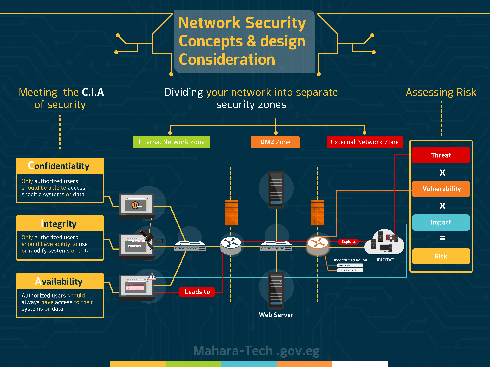
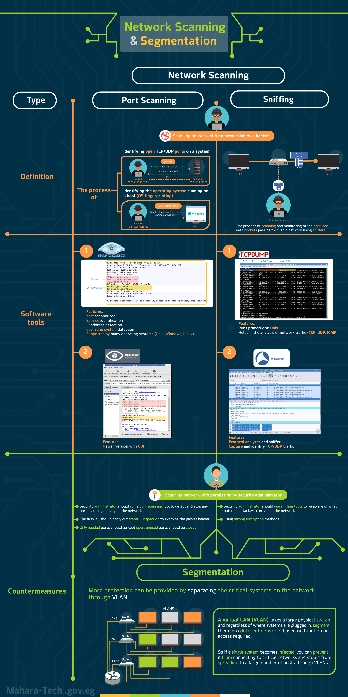
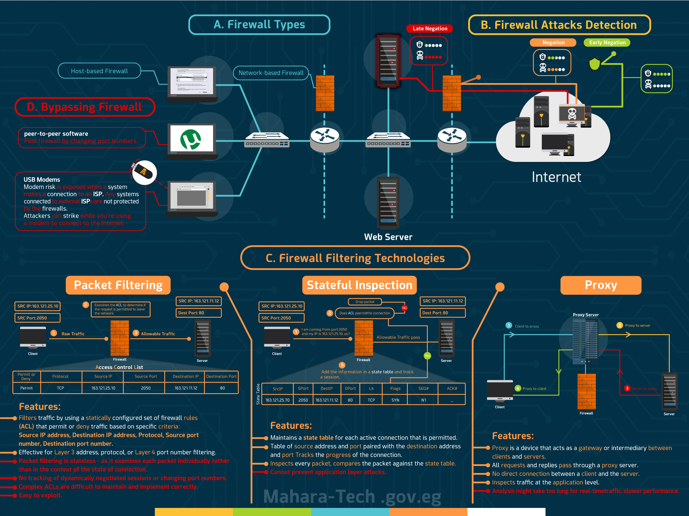

# Security 23a3c74efb3c8057b1d0daa3fd66fe2c

## Security

[owasp top ten android](security/owasp-top-ten-android-2693c74efb3c80269291c00ef28efda0.md)

.png>)

Below is a concise summary of the key points from the provided document on **Network Security Concepts and Design**, tailored for revision before your exam. The summary is organized by the main sections and focuses on essential concepts, definitions, and practical applications to help you retain critical information.

***

#### **1. The CIA of Security**

* **CIA Triad**:
  * **Confidentiality**: Ensures data privacy, restricting access to authorized users only (e.g., password-protected accounts).
  * **Integrity**: Maintains data accuracy and prevents unauthorized changes (e.g., banking systems preventing illegal balance alterations).
  * **Availability**: Ensures data is accessible to authorized users when needed (e.g., backups to restore data after loss).
* **Importance**: All network security measures aim to uphold Confidentiality, Integrity, and Availability.

***

#### **2. Risk Assessment**

* **Role**: IT security professionals protect critical assets (e.g., devices, data, reputation) from risks.
* **Key Terms**:
  * **Asset**: Items needing protection (e.g., routers, servers, data).
  * **Vulnerability**: Weaknesses that can be exploited (e.g., default passwords, unsecured server rooms).
  * **Threat**: Negative actions exploiting vulnerabilities (e.g., accessing a router with default credentials).
  * **Impact**: Damage from a threat exploiting a vulnerability (e.g., financial loss, reputational damage).
* **Risk Calculation**: **Risk = Threat × Vulnerability × Impact**. Higher threats, vulnerabilities, or impacts increase risk.
* **Prioritization**: Focus on high-risk areas first to implement protective measures.

***

#### **3. Designing Network Security (DID)**

* **CIA Importance**: Protecting Confidentiality, Integrity, and Availability is critical for organizational data.
* **Network Segmentation**:
  * **External Public Network**: Untrusted internet, a source of risks.
  * **Internal Private Network**: Trusted network with critical data, isolated from the public internet.
  * **Demilitarized Zone (DMZ)**: Buffer zone for internet-facing services.
* **Defense in Depth (DID)**:
  * Uses multiple security layers (e.g., firewalls, physical barriers) to slow attackers and enhance detection.
  * Proactive measures aim to stop malicious activity before it causes harm.

***

#### **4. Network Segmentation and Monitoring (VLANs)**

* **Risks of Single Broadcast Domain**: All devices on one switch increase unauthorized access risks.
* **Virtual LANs (VLANs)**:
  * Divide networks into virtual segments for security and efficiency.
  * Group users with similar traffic patterns/security needs in the same VLAN.
  * **Inter-VLAN Routing**: Enables communication between VLANs via a router, enhancing security by monitoring traffic.
* **Security Benefits**: Isolates sensitive data, allows traffic inspection, and prevents unauthorized access.

***

#### **5. Port Scanning and Tools**

* **Reconnaissance**: Attackers gather network info (e.g., OS, services) via passive reconnaissance.
* **Port Scanning**: Identifies open/misconfigured ports (e.g., >65,000 ports) for potential exploitation.
* **Proactive Measures**: Security admins should scan their networks to identify and close vulnerabilities.
* **Tools**:
  * **NMAP/ZenMAP**: Scans ports, generates reports on open/closed ports, and flags vulnerabilities.
  * **Well-Known Ports**: Ports like 21, 23, 25 are risky if open on non-server devices.

***

#### **6. Sniffing**

* **Definition**: Capturing and reading network traffic (e.g., eavesdropping).
* **Risks**: Unencrypted data (e.g., passwords) is vulnerable to passive (reading) or active (modifying) attacks.
* **Roles**:
  * Attackers exploit sniffed data; admins use sniffing to identify vulnerabilities.
  * Admins require permission for legal sniffing/port scanning.
* **Objective**: Analyze traffic to ensure encryption and prevent unauthorized access.

***

#### **7. Sniffing Tools**

* **TCP Dump**:
  * Analyzes packets, showing protocols, source/destination addresses, packet sizes, and timestamps.
  * Example: Captures ICMP echo requests with source/destination domains.
* **Wireshark**:
  * Detailed, user-friendly tool for analyzing traffic load, protocols, and detecting malicious activity.
  * Outputs packet number, timestamp, IP addresses, and protocol details.
* **Purpose**: Helps identify issues and implement security measures.

***

#### **8. Introduction to Firewalls**

* **Function**: Filters incoming/outgoing traffic to protect internal networks.
* **Types**:
  * **Host-Based**: Software on a device, filters traffic for that device.
  * **Network-Based**: Hardware device, filters all network traffic.
* **Placement**: Positioned between DMZ and external network, and between DMZ and internal network for comprehensive inspection.
* **Threat Detection**:
  * **Early Detection**: Blocks attacks before reaching the firewall (high security).
  * **Normal Detection**: Firewall blocks attacks directly.
  * **Low Security**: Malicious traffic bypasses the firewall.

***

#### **9. Firewall Filtering Techniques**

* **Packet Filtering**:
  * Uses Access Control Lists (ACLs) to filter based on IP addresses, ports, and protocols.
  * Effectiveness depends on well-defined rules.
* **Stateful Inspection**:
  * Tracks connections in a State Table (source/destination, ports, TCP/UDP).
  * Allows responses matching stored connection info; blocks mismatches.
  * Risk: Exposes internal IPs if direct connections exist.
* **Proxy Firewall**:
  * Acts as an intermediary, hiding internal IPs via Network Address Translation (NAT).
  * Enhances security by masking the internal network.

***

#### **10. Configuring Firewall Rules**

* **Access Control Lists (ACLs)**:
  * Define rules based on protocol, source/destination IPs, and ports.
  * Example: Permit TCP traffic from Computer A (163.121.25.10, port 20.50) to Web Server A (163.121.11.12, port 80).
* **Default Policy**:
  * **Permissive**: Allow all traffic unless explicitly denied.
  * **Restrictive**: Deny all traffic unless explicitly permitted (safer).
* **Implicit Denial**: Blocks traffic not matching any ACL rule.
* **Admin Responsibility**: Write accurate, conflict-free rules to ensure proper filtering.

***

#### **11. Bypassing Firewalls**

* **Misconception**: Firewalls alone are not sufficient for complete security.
* **Risks**:
  * Peer-to-peer apps (e.g., BitTorrent) bypass rules by changing ports.
  * Users bypassing firewalls with personal modems create vulnerabilities.
* **Balancing Configuration**: Allow necessary traffic while blocking risks to maintain availability.
* **Multi-Layered Security**: Combine firewalls with other measures for robust protection.

***

#### **12. IDS vs. IPS**

* **Intrusion Detection System (IDS)**:
  * Monitors traffic, alerts on threats (e.g., port scanning, sniffing).
  * Passive, requires manual response.
* **Intrusion Prevention System (IPS)**:
  * Actively blocks detected threats in real-time.
* **Alert Types**:
  * **True Positive**: Confirms actual attack.
  * **False Positive**: Benign activity flagged as malicious.
  * **True Negative**: Normal activity, no alert.
  * **False Negative**: Missed attack (dangerous).
* **Notifications**: Alerts via email, SMS, or logs.

***

#### **13. IDS & IPS Monitoring Methods**

* **Signature Detection**:
  * Matches traffic against a database of known threat signatures (e.g., ports, IPs, malware strings).
  * Effective for known threats but vulnerable to new attacks until the database is updated.
* **Anomaly Detection**:
  * Establishes a baseline of normal traffic; flags deviations as threats.
  * Detects unknown attacks but may produce false positives during learning.
* **Challenges**: Minimize false positives/negatives for accurate detection.

***

#### **14. NIDS/NIPS Placement**

* **Deployment**:
  * **Host-Based**: Monitors a single device.
  * **Network-Based**: Monitors all network traffic.
* **Placement**:
  * Between Internet and Firewall, and Firewall to DMZ for monitoring incoming/outgoing traffic.
  * Within internal network to detect bypassed malicious traffic.
* **Purpose**: Enhances security by adjusting firewall rules based on IDS/IPS analysis.

***

#### **15. Wireless Security Standards**

* **Vulnerability**: Wireless data is transmitted openly, susceptible to interception.
* **Encryption**:
  * Converts data into unreadable cipher (e.g., Caesar cipher, though weak).
  * Standards: WEP (deprecated, weak), WPA1 (TKIP, improved), WPA2 (AES, strongest).
* **WPA2**: Most secure, uses AES and CCMP; ongoing updates address vulnerabilities (e.g., crack attack in 2017).

***

#### **16. Wireless Threats and Attacks**

* **Attacks**:
  * **Eavesdropping**: Intercepts traffic with packet sniffers.
  * **Spoofing**: Fakes MAC/IP to gain unauthorized access.
  * **DoS/DDoS**: Disrupts access by jamming signals or exploiting defaults.
  * **Rogue Access Points**: Unauthorized devices lacking security.
* **Prevention**:
  * Use WPA2 with strong encryption, strict authentication, updated devices, IDS, and scans for rogue APs.

***

#### **17. Wireless Design Considerations**

* **Signal Coverage**: Confine signals within buildings to prevent leakage.
* **Access Point Security**: Hide SSID, require SSID and password for access.
* **Filtering**: Use ACLs to restrict traffic by MAC, IP, port, or domain.
* **Encryption**: Implement WPA2 with AES for secure data transmission.
* **Segregation**: Separate wireless from wired networks with firewalls/routers.
* **Layered Security**: Combine multiple measures for robust protection.

***

#### **18. Common Attacks**

* **User-Based Attacks**:
  * **Social Engineering**: Deceives users (e.g., phishing, spam) to steal data.
  * **Brute Force**: Guesses passwords using software.
  * **Malware**: Includes spyware, Trojan horses, viruses, worms.
  * **Cookies**: Tracks user activity, potentially exploited.
  * **DoS/DDoS**: Overwhelms targets to disrupt access.
* **Prevention**:
  * User training on threat identification.
  * Policies against personal devices/untrusted downloads.
  * Up-to-date antivirus and regular scans.

***

#### **Key Revision Tips**

1. **Memorize the CIA Triad**: Confidentiality, Integrity, Availability are the foundation of network security.
2. **Understand Risk**: Use **Risk = Threat × Vulnerability × Impact** to prioritize security efforts.
3. **Know Network Segmentation**: External, Internal, DMZ, and VLANs enhance security and efficiency.
4. **Master Firewall Concepts**: Types (host/network), filtering techniques (packet, stateful, proxy), and ACL rule creation.
5. **IDS vs. IPS**: IDS monitors/alerts; IPS actively blocks. Focus on true/false positives/negatives.
6. **Wireless Security**: WPA2 is the gold standard; understand threats like eavesdropping, spoofing, and rogue APs.
7. **Tools**: Familiarize with NMAP, Wireshark, TCP Dump for port scanning and sniffing.
8. **User-Based Threats**: Social engineering and malware require user awareness and technical defenses.

***

This summary condenses the material into key points for quick revision. Focus on understanding definitions, processes (e.g., risk calculation, ACL creation), and practical applications (e.g., firewall placement, VLAN setup). Review the provided images for visual aids on network zones, ACL examples, and tool outputs. Good luck on your exam!

***

***

***

***

***

***

—

## **Network Security Concepts and Design**



## 1- **The CIA of Security**

1. **CIA Security Concepts**: - The CIA stands for **Confidentiality**, **Integrity**, and **Availability**. These are fundamental concepts in IT Security that must be covered when implementing a security solution.
2. **Confidentiality**: - Definition: Refers to privacy or secrecy, protecting data from unauthorized access.

* Key Detail: Access to confidential data should be limited to authorized individuals only.
* Example: The use of passwords to secure online accounts, ensuring that only the account owner can access their information.

1. **Integrity**: - Definition: Involves maintaining the accuracy and consistency of data, preventing unauthorized modifications. -
   * Key Detail: Data should not be tampered with from the moment it is stored or transmitted.
   * Example: In banking, customers can view their balance but cannot alter it illegally, ensuring that the data remains accurate.
2. **Availability**: - Definition: Ensures that data is accessible to authorized users whenever needed.

* Key Detail: Prevents attackers from blocking or deleting access to data, which could make it unavailable.
* Example: Keeping backup copies of data, such as a customer database in a bank, to restore it in case of data loss or corruption.

5. **Overall Importance**: - The video emphasizes that all security measures taken to protect the network aim to uphold the principles of Confidentiality, Integrity, and Availability throughout the course.

## 2- Risk assessment

1. Role of IT Security Professionals : - IT Security professionals are responsible for protecting an organization's critical assets from risks and potential threats.
2. Key Terms for Risk Assessment : - Understanding key terms is essential for effective risk assessment. These terms include: -

* Asset : Important items that need protection, such as devices (routers, computers, servers), data, confidential information, and the organization's reputation.
* Vulnerability : A weakness or security gap that can be exploited by attackers. Examples include unchanged default passwords on routers or unsecured server rooms.
* Threat : A negative action that exploits a vulnerability to harm an asset. For instance, an attacker accessing a router with default credentials or attempting to steal equipment from an unprotected server room. -
* Impact : The damage resulting from a threat exploiting a vulnerability. The severity of the impact can vary; for example, a significant data breach can lead to financial penalties and reputational damage, while a minor breach may have minimal consequences.

3. Calculating Risk : - Risk is calculated using the formula:

* Risk = Threat × Vulnerability × Impact. - A higher threat exploiting a vulnerability that results in significant impact leads to a higher risk, while lower impact or less severe vulnerabilities result in decreased risk.

4. Prioritizing Risk Management : - Understanding and quantifying risk helps security professionals prioritize their efforts. High-risk areas should be addressed first to implement protective measures, while low-risk areas can receive less attention.
5. Importance of Understanding Terms : - Thoroughly understanding the terms discussed is crucial for effectively managing and calculating risks. These concepts will continue to be important throughout the course, and reviewing them will aid in better comprehension of risk assessment practices

.png>)

how to calculate risk

.png>)

## 3- **Designing Network Security(DID)**

1. **Importance of C.I.A.**: - The video builds on previous discussions about the importance of Confidentiality, Integrity, and Availability (C.I.A.) in data protection, emphasizing the need to safeguard materials within the organization.
2. **Network Segmentation**: - The first step in securing a network is to divide it into multiple zones: -

* **External Public Network**: This is the public internet, which is considered a source of potential risks and is not fully trusted. -
* **Internal Private Network**: This is the trusted part of the network that contains critical servers and data. It is essential to isolate this network from the public internet to protect it from external threats. -
* **Demilitarized Zone (DMZ)**: This zone contains internet-facing services and servers that require internet access. It acts as a buffer between the internal network and the public internet.

3. **Limitations of Network Segmentation**: - Simply dividing the network into zones is not enough for security. It is compared to a large organization with separate buildings; isolation alone does not prevent unauthorized access between them.
4. **Defense in Depth**: - To enhance security, a layered approach known as "Defense in Depth" is recommended. This involves: -

* Physically separating network zones using barriers, security guards, or firewalls at each entrance (e.g., Check Point firewalls). -
* Implementing multiple layers of security controls at different points within the network to slow down attackers and make their activities easier to detect.

5. **Proactive Security Measures**: - The goal is to pause and stop any malicious activity before it can cause damage to the network. The video indicates that upcoming content will explore various security measures, tools, and techniques to effectively secure the network. This summary encapsulates the key points discussed in the video regarding network security and the importance of segmentation and layered defenses.

network zones

.png>)

## **Network segmentation and Monitoring**

## **4-Virtual LANs (VLANs)**

1. **Risks of a Single Broadcast Domain**: - When all devices in a large network are connected to the same switch, they are within the same broadcast domain, allowing traffic to pass easily between them. This setup increases the risk of unauthorized access to sensitive data.
2. **Implementation of Virtual LANs (VLANs)**: - VLANs are introduced as a solution to enhance network security by dividing a large network into multiple separate virtual networks. This partitioning allows each VLAN to function as an independent network segment, improving both security and efficiency.
3. **Grouping Users in VLANs**: - Users with similar traffic patterns should be grouped together in the same VLAN. For example, users who frequently communicate should be on the same VLAN to reduce unnecessary traffic through routers, optimizing network performance and enhancing security by isolating traffic.
4. **Inter VLAN Routing**: - To enable communication between different VLANs, traffic must pass through a router, as each VLAN is treated as a separate subnet. Inter VLAN Routing facilitates this communication, allowing data to pass securely and efficiently between VLANs.
5. **Example of VLAN Implementation**: - An example is provided with three switches, each hosting three VLANs for different departments (Marketing, Sales, Support). A Backbone Router connects these switches and manages traffic flow among the VLANs, ensuring efficient communication and security.
6. **Security Considerations in VLANs**: - Users with similar security needs should be grouped in the same VLAN, while potential threat sources can be isolated in separate VLANs. This isolation prevents unauthorized access to sensitive areas of the network, even if users are on the same physical network.
7. **Monitoring and Inspecting Traffic**: - When traffic needs to pass between VLANs, it goes through the router, which allows for monitoring and inspection of the data. This process adds an extra layer of security, enabling the detection and containment of suspicious or malicious activity before it impacts the network.
8. **Conclusion on VLANs**: - VLANs are a powerful tool for enhancing network security by creating isolated networks and controlling communication. Careful consideration of user roles and security requirements is essential when assigning users to VLANs to maintain a safe and efficient network environment. This summary captures the key points discussed in the video regarding the use of VLANs for network security and the importance of proper configuration and monitoring.

.png>)

## **5-Port Scanning and Tools**

1. **Importance of Information Gathering**: - Before launching an attack, attackers perform reconnaissance to gather information about the target. This step is crucial for determining the appropriate attack method. For instance, an attack designed for Unix vulnerabilities would fail against a target running Microsoft Servers.
2. **Passive Reconnaissance Phase**: - This phase involves collecting extensive information about the target network to identify potential vulnerabilities. It is a preparatory step that helps attackers tailor their approach based on the gathered data.
3. **Role of Port Scanning**: - Port scanning is a primary tool used during passive reconnaissance. It allows attackers to gather information about the network, including Operating System Fingerprinting, which helps identify the specific OS and services running on devices.
4. **Identifying Open Ports**: - Port scanning can check over 65,000 ports on devices. If an attacker finds open or misconfigured ports, they can transition from passive information gathering to active exploitation, targeting these vulnerabilities to compromise the device

. 5. **Proactive Security Measures**: - Security Administrators should perform port scans on their own networks (with permission) to identify vulnerabilities before attackers do. This proactive approach enables them to secure or close vulnerabilities using firewalls and other security measures.

6. **Tools for Port Scanning**: - Software tools like NMAP and its graphical interface ZenMAP assist in performing port scans. NMAP is compatible with both Windows and Linux and generates detailed reports on open and closed ports, flagging potentially dangerous open ports.
7. **Understanding Well-Known Ports**: - An example is provided where a port scan reveals multiple open ports (e.g., 21, 23, 25, 79, 98) that are considered "well-known ports." If these ports are open on non-server devices, they represent vulnerabilities that could be exploited by attackers.
8. **Minimizing Vulnerabilities**: - As a network security professional, it is essential to minimize vulnerabilities by closing unnecessary open ports. This reduces the attack surface and enhances the overall security of the network against potential threats. This summary encapsulates the key points discussed in the video regarding the significance of reconnaissance, the use of port scanning for identifying vulnerabilities, and the proactive measures that can be taken to secure networks.
9. in nmap default port scanning is tcp connect scanning (syn , (syn/ack) , ack , rst ) “all firewalls store it in logs because it is a fall connection ” ,, when we scan with sudo then it scan with (stealth/syn scanning ) —> (syn , syn/ack, rst ) some firewalls not store this type of scan
10. in nmap we can identify weather there is firewall or not by sending fin or ack packet 1.

    ```bash
    nmap -sA -sF
    ```

.png>)

## **6-Sniffing**

1. **Definition of Sniffing or Eavesdropping**: - Sniffing, also known as eavesdropping, refers to the practice of capturing and reading network traffic. This concept has historical roots, dating back to landline phone communications where devices could record conversations.
2. **Unencrypted Data Risks**: - When data on a network is unencrypted, it becomes vulnerable to attackers who can easily read and understand the information. This may include sensitive data such as passwords, making it easier for attackers to exploit the information.
3. **Passive vs. Active Attacks**: - Sniffing is classified as a passive attack when the attacker merely reads the data without altering it. If the attacker modifies the data for their own benefit, the nature of the attack shifts to active, which poses a greater threat.
4. **Roles of Attackers and Network Administrators**: - Both attackers and network administrators can engage in sniffing. While attackers aim to exploit the network, network administrators work to secure it by identifying vulnerabilities, such as open ports, and protecting against unauthorized access.
5. **Security Professionals' Objectives**: - Network security professionals analyze traffic on the network to understand its nature and determine the encryption methods in use. Their goal is to prevent attackers from accessing valuable data and to thwart potential attacks.
6. **Legitimacy of Actions**: - A key distinction between attackers and security professionals is that the latter have permission to conduct activities like sniffing and port scanning. This legal authority enables them to perform necessary security measures to protect the network
7. **Upcoming Tools for Network Sniffing**: - The video concludes by hinting at the exploration of tools and software that can assist security professionals in performing network sniffing in the next video, emphasizing the importance of these tools in network security. This summary captures the essential points discussed in the video regarding the concept of sniffing, the risks associated with unencrypted data, the roles of different individuals in network security, and the importance of using appropriate tools for monitoring network traffic.

## **7-Sniffing Tools**

1. **Introduction to Sniffing Tools**: - The video discusses various software tools that assist in performing sniffing or eavesdropping on network traffic, highlighting their functionalities and outputs.
2. **TCP Dump**: -

**Functionality**: TCP Dump is a utility that allows users to analyze network traffic. It helps identify the protocol used in each packet, source and destination addresses, packet sizes, and the data contained within them. -

**Output Details**: The output generated by TCP Dump displays each packet's information, including: - Timestamp of when the packet was captured. - Source domain name (e.g., [ping.net](http://ping.net/)). - Destination domain name (e.g., [myhost.com](http://myhost.com/)), separated by a greater-than symbol (">"). - Protocol used (e.g., ICMP) and type of packet (e.g., echo request). -

**Example Packets**: The video provides examples of packets captured, including responses and various source-destination pairs, illustrating the detailed information TCP Dump can provide.

3. **Wireshark**: -

**Importance**: Wireshark is introduced as a crucial tool for sniffing, offering a more detailed and user-friendly interface for analyzing network traffic. -

**Output Format**: The output from Wireshark includes: - Packet number. - Timestamp of capture. - Source and destination IP addresses. - Protocol used and additional details about the packet's data segment.

**Network Insights**: Running Wireshark allows users to gather significant information about network traffic, including traffic load, types of traffic, protocols in use, and detection of unwanted or malicious traffic.

4. **Network Security Implications**: - The knowledge gained from using tools like TCP Dump and Wireshark enables network security professionals to identify issues and implement effective security measures to protect the network.
5. **Conclusion**: - The video concludes by summarizing the importance of understanding and utilizing these software tools for effective network sniffing and security analysis. This summary encapsulates the key points discussed in the video regarding the tools available for network sniffing, their functionalities, and their significance in maintaining network security

*   TCPDUMB out comes

    .png>)



## **Firewalls and Honeypots**

## **8-Introduction to firewalls**

.png>)

1. **Introduction to Firewalls**: - The video discusses firewalls as a critical security measure for protecting an organization's internal network from external attacks

. 2. **Functionality of Firewalls**: -

* **Traffic Filtering**: Firewalls filter incoming and outgoing traffic based on specific criteria or rules to determine whether to allow or block the traffic. -
* **Traffic Inspection**: The firewall inspects all traffic and stops it at a certain point to prevent it from reaching its intended destination if deemed harmful.

3. **Types of Firewalls**: -

* **Host-Based Firewall**: A software-based firewall installed on a specific device or host that filters traffic for that particular device. -
* **Network-Based Firewall**: A dedicated hardware device that filters all traffic entering or leaving the entire network.

4. **Placement of Firewalls**: - The placement of the firewall within the network is crucial for comprehensive traffic inspection. It should be positioned to allow all inbound and outbound traffic to pass through it.
5. **Network Zones**: - The video illustrates a network design divided into three zones: Internal Network, External Network, and Demilitarized Zone (DMZ). - A firewall is placed between the DMZ and the External Network to monitor traffic between the internet and the DMZ, as well as traffic leaving the DMZ towards the internet.
6. **Protection Mechanisms**: - Another firewall protects the internal servers from the DMZ and vice versa, safeguarding the DMZ from potential attacks originating from the Internal Network.
7. **Types of Threats**: - The video discusses insider threats (from within the network) and external threats. -

* **Early Detection**: Blocking an attack before it reaches the firewall indicates a high security level. - **Normal Detection**: If the firewall blocks the attack directly, it is considered normal detection, providing decent security. -
* **Low Security Level**: If malicious traffic bypasses the firewall, the security level is low, necessitating improved security measures.

8. **Importance of Effective Filtering**: - It is crucial for the firewall to effectively filter all traffic passing through the network, determining whether to allow or deny it to maintain a secure environment.
9. **Conclusion**: - The video concludes by summarizing the general process of traffic filtering by firewalls and mentions that multiple filtering methods will be explored in more detail in the next video. This summary encapsulates the key points discussed in the video regarding firewalls, their functionalities, types, placement, and importance in network security.

## **9-Firewall Filtering Techniques**

1. **Introduction to Firewall Techniques**: - The video builds on the previous discussion about firewalls, emphasizing that different firewalls use various filtering techniques to monitor and filter network traffic.
2. **Types of Firewall Filtering Techniques**: - The video introduces three main types of firewall filtering techniques: Packet Filtering, Stateful Inspection, and Proxy Firewall.
3. **Packet Filtering Firewall**: -

* **Functionality**: Uses an Access Control List (ACL) to filter traffic based on specified rules, including IP address ranges, port numbers, and protocols. -
* **Process**: The firewall examines each packet's header and compares it against the ACL criteria to determine whether to permit or deny the packet. -
* **Example**: It might allow web traffic on Port 80 while blocking Telnet traffic on Port 23 based on the ACL rules. -
* **Limitations**: The effectiveness of this method heavily relies on the clarity and accuracy of the rules set by the network administrator. Poorly defined rules can lead to performance issues.

4. **Stateful Inspection Firewall**: -

* **Functionality**: Tracks all connections passing through the firewall and stores their information in a State Table, which includes source and destination addresses, port numbers, and connection types (TCP or UDP). -
* **Process**: When a request is sent, the firewall stores the connection information. Upon receiving a response, it checks if the incoming traffic matches the stored information. If it matches, the traffic is allowed; if not, it is blocked. -
* **Advantages**: Provides a more advanced filtering method compared to Packet Filtering, as it maintains context about active connections. -
* **Risks**: There is a risk of exposing internal IP addresses when direct connections exist between internal devices and external systems, which could be exploited by attackers.

5. **Proxy Firewall**: -

* **Functionality**: Acts as an intermediary between internal network devices and the Internet. Requests from the internal network are sent to the Proxy Server, which forwards them to the Internet. -
* **Benefits**: This setup hides the internal network and protects it from external threats. It also uses Network Address Translation (NAT) to mask internal IP addresses with different external IP addresses. -
* **Protection**: By hiding real IP addresses, the Proxy Firewall adds an extra layer of security against potential attacks from the public Internet.

6. **Conclusion**: - The video summarizes the various techniques that firewalls use to filter traffic and enhance network security, highlighting the importance of understanding these methods for effective network protection. This summary encapsulates the key points discussed in the video regarding different firewall filtering techniques and their implications for network security.

## **10-Configuring Firewall Rules**

1. **Introduction to ACLs for Firewall Rules**: - The video discusses the process of implementing firewall rules using Access Control Lists (ACLs) to filter network traffic effectively.
2. **Default Traffic Policy**: - The first consideration when creating an ACL is whether to permit or deny traffic by default. - Two approaches are highlighted: -

* **Permissive Approach**: Allow all traffic except for specific cases that meet certain conditions.
* **Restrictive Approach**: Deny all traffic by default unless explicitly permitted, ensuring tighter control.

3. **Parameters for Defining Rules**: - When creating ACL rules, several parameters must be specified:

* **Protocol**: The type of protocol used (e.g., TCP, UDP).
* **Source IP Address**: The IP address of the originating device. -
* **Source Port Number**: The port number from which the traffic originates. -
* **Destination IP Address**: The IP address of the target device. -
* **Destination Port Number**: The port number on the target device.

4. **Example of an ACL Entry**: - The video provides a practical example of writing an ACL entry: -

* **Scenario**: Allow traffic from Computer A in the internal zone to Web Server A in the DMZ using HTTP. -
* **ACL Entry Details**: - Action: permit - Protocol: TCP - Source IP: 163.121.25.10 (Computer A) - Source Port: 20.50 (example port) - Destination IP: 163.121.11.12 (Web Server A) - Destination Port: 80 (HTTP port) - This entry allows Computer A to communicate with Web Server A over HTTP. 5.
* **Implicit Denial of Other Traffic**: - The video explains that if multiple entries are added to the ACL, the firewall will implicitly deny all other traffic that does not match any specified rules. - This ensures that any packet not explicitly permitted will be blocked, maintaining strict control over network traffic.

6. **Responsibility of Security Administrators**: - As a security administrator, it is crucial to write ACL rules accurately and without conflicts to ensure the firewall functions correctly. - The goal is to allow authorized traffic while blocking unauthorized traffic based on the defined rules.
7. **Additional Resources**: - The video mentions that accompanying documentation includes a list of important port numbers and key services to assist in writing effective ACL rules. This summary captures the essential points discussed in the video regarding the implementation of firewall rules through ACLs and the considerations involved in traffic filtering.

* permit example

.png>)

## 11-**Bypassing Firewall**

1. **Misconception About Firewalls**: - Many people mistakenly believe that a firewall alone is enough to protect their network. - While firewalls are essential security tools, they can be bypassed or compromised.
2. **Risks of Peer-to-Peer Applications**: - Applications like BitTorrent allow file sharing directly between devices over the internet. - These applications can dynamically change port numbers, which can help bypass firewall rules.
3. **Bypassing Firewall Rules**: - If traffic from the internet attempts to modify the network, it can evade existing firewall configurations by changing to a permitted port. - This poses a risk as it allows unauthorized access to the network.
4. **Data Vulnerability**: - Sharing files through peer-to-peer applications exposes data on devices and networks to other internet users, increasing vulnerability.
5. **Overly Restrictive Firewall Configurations**: - Firewalls can be configured too restrictively, blocking necessary traffic for users' work. - This conflicts with the principle of data availability, which is part of the CIA triad (Confidentiality, Integrity, Availability).
6. **Circumventing Firewall Restrictions**: - Users may connect their own modems directly to their PCs, bypassing the organization's firewall and its rules. - This method allows traffic to pass without being filtered, creating significant security risks.
7. **Balancing Firewall Configuration**: - It is crucial to strike a balance when configuring firewalls: allowing necessary activities while blocking potentially dangerous traffic. - Proper configuration prevents users from resorting to personal modems, which can compromise network security
8. **Multi-Layered Security Approach**: - The video concludes that while firewalls are a key component of network security, they should not be the only solution. - Organizations must implement additional security measures for comprehensive protection. - A multi-layered approach is necessary to ensure robust network security. This summary captures the essential points discussed in the video regarding the limitations of firewalls and the importance of a comprehensive security strategy.



## **Intrusion Detection and Prevention Systems**

## **12-IDS Vs IPS**

1. **Role of Intrusion Detection System (IDS)**: - IDS monitors network traffic and analyzes it for potential threats or attacks. - It issues alerts when violations or attacks are detected, indicating a possible threat to the network.
2. **Types of Attacks Detected**: - IDS can identify activities such as port scanning, which may lead to exploitation of vulnerabilities. - It can also detect sniffing activities, where information like IP addresses is extracted, potentially indicating a prelude to a larger attack.
3. **Functionality of IDS**: - The IDS acts like a surveillance camera, observing and recording network activity. - While it does not prevent attacks, it helps security analysts respond appropriately to alerts.
4. **Introduction of Intrusion Prevention System (IPS)**: - IPS is a more advanced version of IDS that actively defends against detected attacks. - Unlike IDS, which only alerts, IPS takes necessary actions to stop attacks in real-time.
5. **Types of Alerts Generated**: -

* **True Positive Alert**: Confirms an actual attack has occurred. -
* **False Positive**: An alert triggered by benign activity mistakenly classified as malicious. -
* **True Negative**: No alert issued, indicating normal network activity. -
* **False Negative**: A dangerous scenario where an actual attack goes undetected, posing significant risks.

6. **Preference for True Alerts**: - Network security professionals prefer True Positives and True Negatives as they accurately reflect the network's status. - Minimizing False Positives and False Negatives is crucial to avoid unnecessary alarms or missed threats.
7. **Alert Notification Methods**: - Alerts can be sent via email, logged into a file, or sent via SMS to security administrators for timely responses. - IDS requires manual responses from the security team, while IPS can automatically block malicious traffic.
8. **Traffic Classification Methods**: - IDS and IPS classify network traffic to determine if it is normal or potentially harmful. - Legitimate traffic is allowed to pass, while risky traffic triggers alerts. - Detailed exploration of these classification methods will be covered in upcoming videos. This summary encapsulates the key points discussed in the video regarding the functions and importance of IDS and IPS in network security.

## 13-**IDS\&IPS Monitoring Methods**

1. **Methods for Monitoring Traffic**: - IDS and IPS utilize various methods to monitor and identify unwanted traffic, including signature detection and anomaly detection.
2. **Signature Detection**: - This method relies on a database of known threats and attacks, functioning like a blacklist. - Each attack has a specific signature that describes its nature, and traffic is compared against these signatures. - If a match is found, the IDS triggers an alert.
3. **Types of Signatures**: - Signatures can be specific to port numbers, IP addresses, protocols, or content strings associated with malware. - Traffic flow signatures monitor significant changes in traffic volume, helping to detect attacks like denial of service (DoS).
4. **Advantages of Signature Detection**: - Allows for the identification of various attack types and continuous updates to the signature database. - However, there is a vulnerability period between the emergence of a new threat and the update of the signature database.
5. **Anomaly Detection**: - This dynamic method establishes a baseline of normal traffic behavior on the network. - Traffic deviating from this baseline is classified as unwanted and triggers an alert. - The IDS or IPS learns normal activity by observing the network over a set period (e.g., 24 hours).
6. **Benefits of Anomaly Detection**: - Capable of identifying new or unknown attacks not yet in the signature database, making it effective against emerging threats. - However, it requires careful tuning to minimize false positives, especially during the learning phase.
7. **Challenges of Anomaly Detection**: - During the learning mode, it is crucial to prevent unwanted traffic from passing through. - Increased false positives can occur, leading to normal traffic being mistakenly flagged as malicious.
8. **Summary of Strengths and Limitations**: - Signature detection is effective for known threats and allows for updates but may be slow to respond to new threats. - Anomaly detection can identify new attacks early but requires careful monitoring to reduce false positives. This summary encapsulates the key points discussed in the video regarding the methods used by IDS and IPS to monitor and identify unwanted traffic.

*   signature based detection types

    .png>)

waf

***

* بيبقي شكله علي الشبكة شبة ال proxy
* Learning mode <--- بيبدأ يتعلم ازاي ال web app بتاعي شغال ازاي واانواع ال inputs +etc
* Passive mode <---- يشوف اي نشاط مش طبيعي او حد بيعملل inject او شئ ضار بيبدأ يسجل كل النشطات غير الطبيعية بس من غير يعمل اي action ضد الحاجة الي بتحصل لكن ال admin يقدر يشوف ال logs ويعمل هو ال action

في البنوك مشهور فكرة انهم بعد ما يجمع كل ال logs يبعتهم علي seim solution server <---  qradar

* Active mode بياخد action ضد ال upnormal activity
* Regex based detection بتبقي شروط معينة لل input
* Signature حاجة معروفة عند معظم الشركات ان هية ضارة ممكن تكون ip or malicious header or string like eicar
* Challenge /response مثل are robot challenge عشان يكتشف انك script ولا real browser

***

## **14-NIDS, NIPS Placement**

1. **Deployment Levels of IDS/IPS**: - IDS (Intrusion Detection System) and IPS (Intrusion Prevention System) can be deployed at two levels: host-based (monitoring a specific device) or network-based (inspecting all traffic across the network).
2. **Importance of Placement**: - The placement of a Network-Based IDS or IPS is critical as it determines the data or traffic being monitored and analyzed. - The system's role is to allow legitimate traffic and generate alerts for any traffic that poses a threat.
3. **Example of Network Placement**: - The Network Intrusion Detection System is positioned between the Internet and the Firewall, as well as on the output side of the Firewall leading into the Demilitarized Zone (DMZ). - This setup enables monitoring of both incoming and outgoing traffic from the Firewall, using predefined rules to assess its functionality.
4. **Internal Network Monitoring**: - Another IDS is placed within the internal network to observe traffic coming from the Firewall into the internal network. - This helps evaluate whether the Firewall has effectively protected the internal network from unwanted traffic or if malicious traffic has bypassed it.
5. **Adjustments to Firewall Rules**: - Based on the analysis from the IDS, adjustments can be made to the Firewall rules to enhance security. - This may involve better filtering of traffic entering the DMZ or the internal network.
6. **Enhanced Security Coverage**: - The strategic placement of the Network Intrusion Detection System enhances overall security by covering multiple areas of the network. - It provides additional protection in case the Firewall is compromised or bypassed.
7. **Maximizing Security Effectiveness**: - It is crucial to deploy the Network Intrusion Detection System or Network Intrusion Prevention System (NIPS) in appropriate locations within the network to maximize security effectiveness. This summary captures the key points discussed in the video regarding the deployment and importance of IDS and IPS in network security.

## **Wireless Networks Security**

## **15-Wireless Security Standards**

1. **Transition to Wireless Network Security**: - The video discusses the shift from traditional network security, which focused on securing data transmission over cables, to the more complex security challenges posed by wireless networks.
2. **Vulnerability of Wireless Networks**: - In wireless networks, data travels openly through the air, making it susceptible to interception by attackers nearby who can eavesdrop on the traffic and access shared data.
3. **Importance of Data Encryption**: - To protect data transmitted over wireless networks, encryption is essential. It involves converting data into an unreadable cipher that can only be deciphered by the intended sender and receiver.
4. **Example of Encryption**: - An example is provided using the Caesar cipher, where the message "This is the data" is encrypted to "WKLVLVWKHGDWD." Without the decryption key, an interceptor cannot understand the content.
5. **Limitations of Simple Encryption**: - The Caesar cipher is a simple encryption method that is easy to guess or break. More sophisticated encryption methods are necessary for effective data protection.
6. **Evolution of Encryption Standards**: - Various encryption standards have been developed over the years, including WEP, WPA1, and WPA2, each improving upon the previous one.
7. **WEP (Wired Equivalent Privacy)**: - WEP was the initial standard for IEEE 802.11 networks, using the RC4 algorithm. However, it had significant vulnerabilities, such as a static key, leading to its deprecation in 2003.
8. **WPA (Wi-Fi Protected Access)**: - WPA1 was introduced to address WEP's vulnerabilities, using a stronger pre-shared key and the Temporal Key Integrity Protocol (TKIP) to enhance security. However, it still had some weaknesses due to hardware limitations.
9. **WPA2 and Advanced Security**: - WPA2 replaced WPA1 in 2006, adopting the Advanced Encryption Standard (AES) for stronger security. It introduced protocols like CCMP, which provided better resistance to cracking.
10. **Ongoing Security Improvements**: - Although WPA2 was considered secure, a vulnerability known as the "crack attack" was discovered in late 2017. Despite this, WPA2 remains the most secure standard and continues to receive updates.
11. **Conclusion on Encryption Standards**: - The video concludes that WPA2 is still regarded as the most secure and reliable encryption standard available today, with ongoing efforts to enhance its security features. This summary encapsulates the key points discussed in the video regarding wireless network security and encryption standards.

## 16-**Wireless Threats and Attacks**

1. **Types of Attacks on Wireless Networks**: - The video outlines various attacks that wireless networks are vulnerable to, including Eavesdropping, Sniffing, Spoofing, Mask Raiding, Denial of Service (DoS), and Rogue Access Points.
2. **Eavesdropping**: - Eavesdropping occurs when an attacker uses tools like Packet Sniffers to intercept network traffic and search for sensitive data.

* **Prevention**: Use strong encryption algorithms, avoid WEP, and implement WPA2 with encryption at the Data Link Layer to enhance security.

3. **Spoofing**: - Spoofing, or Mask Reading, involves deceiving the Access Point into thinking the attacker is an authorized user, often through MAC or IP Address spoofing.

* **Prevention**: Implement strict authentication protocols to verify user identities before granting network access.

4. **Denial of Service (DoS) Attacks**: - DoS attacks aim to prevent legitimate users from accessing network resources by jamming signals or exploiting default settings on Access Points.

* **Prevention**: Keep Wi-Fi cards and Access Points updated, change default settings, deploy Intrusion Detection Systems (IDS), and have a response strategy ready for potential attacks.

5. **Rogue Access Points**: - Rogue Access Points are unauthorized devices that can compromise network security, often lacking passwords and encryption.

* **Detection and Prevention**: Use IDS for wireless networks and conduct scans with WiFi-enabled laptops to identify unauthorized access points

6. **Impact of Poor Network Design**: - Many vulnerabilities arise from poor network design that neglects essential security measures, creating exploitable gaps for attackers. - The video emphasizes the importance of considering security measures in network design to avoid these vulnerabilities.
7. **Next Steps**: - The video concludes by indicating that the next video will cover key points to consider when designing a secure wireless network for organizations. This summary captures the key points discussed in the video regarding the vulnerabilities of wireless networks and the measures to protect against various types of attacks.

## **17-Wireless Design Considerations**

1. **Importance of Security in Wireless Networks**: - As organizations increasingly rely on wireless systems for network communication, it is crucial to plan and design effective security solutions to address vulnerabilities and potential attacks.
2. **Wireless Signal Coverage**: - Ensure that the wireless signal coverage is confined within the building to prevent signal leakage outside. - Strong internal coverage is necessary to discourage users from adding their own access points, which may lack security.
3. **Access Point Security**: - Protect access points with multiple security measures, such as hiding the SSID (Service Set Identifier). - This requires users to know both the SSID and the password to connect, enhancing security compared to broadcasting the SSID.
4. **Filtering and Access Control**: - Implement filtering features like Access Control Lists (ACLs) to restrict traffic based on MAC address, IP address, port number, or domain name. - This allows for controlled traffic flow to and from the access point, enhancing security.
5. **Encryption Protocols**: - Use strong encryption protocols, such as WPA2 with AES cipher, to secure data transmission. - This ensures that even if an attacker sniffs the network traffic, they cannot decipher the data contents.
6. **Network Segregation**: - Separate the wireless network from the wired network using security measures like firewalls and border routers. - A segregated switch dedicated to wireless access points can enhance security by isolating wireless traffic from wired devices.
7. **Firewall and Traffic Filtering**: - Place a firewall between the wireless switch and the rest of the network to filter traffic based on predefined rules. - This firewall controls access between the wireless and wired networks, rejecting non-compliant traffic and enhancing overall security.
8. **Layered Security Approach**: - Acknowledge that no system can be 100% secure; however, implementing multiple layers of security can significantly increase the difficulty for attackers. - Use a combination of strategies rather than relying on a single security measure to achieve a robust security posture. This summary encapsulates the key points discussed in the video regarding the design and implementation of security solutions for wireless networks.

## **18-Common Attacks**

1. **User-Based Attacks**: - Unlike previous attacks that exploited vulnerabilities in security design, software, or hardware, user-based attacks rely on mistakes made by users when interacting with systems or sensitive information.
2. **Social Engineering**: - A significant user-based threat that involves deceiving users to obtain confidential information. - Common methods include spam and phishing attacks, where attackers trick users into providing sensitive data by directing them to fake websites.
3. **Brute Force Attacks**: - Attackers use specialized software to guess passwords by trying all possible combinations. - For example, a four-digit password has about 10,000 combinations, which can be tested quickly by the software.
4. **Malware**: - Includes various types of malicious software such as spyware, Trojan horses, viruses, and worms. - Spyware secretly monitors user activities and collects personal data without the user's knowledge.
5. **Cookies**: - Small files downloaded onto devices that track browsing activity and gather user data for marketing purposes. - While often used for advertising, cookies can also be exploited for malicious activities.
6. **Trojan Horses**: - Malicious programs disguised as legitimate software (like games or images) that, when opened, can give attackers remote access to the user's device.
7. **Viruses and Worms**: - Viruses attach to executable files and activate when the file is run, causing damage like deleting files or corrupting data. - Worms can replicate and spread across networks independently, potentially forming botnets for large-scale attacks.
8. **Denial of Service (DoS) and Distributed Denial of Service (DDoS) Attacks**: - A DoS attack originates from a single device, overwhelming a target with requests. - A DDoS attack involves multiple devices flooding a target, making it unavailable.
9. **User Awareness and Security Education**: - Protecting against user-based attacks requires raising user awareness through training programs on identifying threats and best security practices. - Policies should prevent the use of personal devices on company networks and prohibit downloading software from untrusted sources.
10. **Technical Measures**: - Ensure all devices have up-to-date antivirus software and perform regular security scans to detect and eliminate infections early. This summary encapsulates the key points discussed in the video regarding user-based attacks and the importance of user awareness and technical measures in network security.

***

***

***

***

***

***

***

## MORE Readable

## Network Security Notes

### 1. CIA Triad: Core Security Principles

The **CIA Triad**—**Confidentiality**, **Integrity**, and **Availability**—is the cornerstone of IT security, guiding all protective measures.

#### **Confidentiality**

* **What It Means**: Ensures data privacy by restricting access to authorized users only.
* **Key Point**: Protects sensitive information from unauthorized access.
* **Example**: Passwords secure online accounts, allowing only the owner to view data.

#### **Integrity**

* **What It Means**: Keeps data accurate and unchanged by unauthorized parties.
* **Key Point**: Prevents tampering during storage or transmission.
* **Example**: In banking, customers can view their balance but cannot illegally modify it.

#### **Availability**

* **What It Means**: Guarantees data is accessible to authorized users when needed.
* **Key Point**: Prevents disruptions that block or delete data access.
* **Example**: Bank databases have backups to restore data after loss or corruption.

#### **Why It Matters**

All security strategies aim to uphold Confidentiality, Integrity, and Availability to protect networks and data.

### 2. Risk Assessment Fundamentals

#### **Role of IT Security Professionals**

Security professionals safeguard critical organizational assets from risks and threats.

#### **Key Terms**

* **Asset**: Valuable resources like devices (routers, servers), data, or reputation.
* **Vulnerability**: Weaknesses attackers can exploit, such as default passwords or unsecured server rooms.
* **Threat**: Harmful actions targeting vulnerabilities, like using default router credentials.
* **Impact**: Damage caused by a threat exploiting a vulnerability, ranging from minor to severe (e.g., financial losses or reputational harm).

#### **How to Calculate Risk**

* **Formula**: Risk = Threat × Vulnerability × Impact
* **Explanation**: High threats, vulnerabilities, or impacts increase risk; lower values reduce it.

#### **Prioritizing Risk**

* Focus on high-risk areas first for protective measures.
* Low-risk areas need less immediate attention.

#### **Why Terms Matter**

Understanding these terms is essential for accurate risk assessment and effective security management.

### 3. Designing Secure Networks: Defense in Depth

#### **CIA in Network Design**

The CIA triad drives strategies to protect organizational data.

#### **Network Segmentation**

Dividing networks into zones enhances security:

* **External Public Network**: The internet, a potential threat source.
* **Internal Private Network**: Trusted zone with critical servers, isolated from the internet.
* **Demilitarized Zone (DMZ)**: Buffer zone for internet-facing services.

#### **Limits of Segmentation**

Segmentation alone doesn’t stop unauthorized access, like separate buildings in an organization without locks.

#### **Defense in Depth**

* **Concept**: Uses multiple security layers (e.g., firewalls, guards) to slow attackers and improve detection.
* **Example**: Firewalls (e.g., Check Point) separate network zones for added protection.

#### **Proactive Security**

Implement measures to stop malicious activity before it causes damage.

### 4. Virtual LANs (VLANs) for Enhanced Security

#### **Risks of a Single Broadcast Domain**

A single switch connecting all devices allows easy traffic flow, increasing unauthorized access risks.

#### **What Are VLANs?**

* **Purpose**: Splits a network into separate virtual networks for better security and efficiency.
* **Function**: Each VLAN acts as an independent segment.

#### **Grouping Users**

* Place users with similar traffic patterns in the same VLAN to optimize performance and security.
* **Example**: Separate VLANs for Marketing, Sales, and Support departments.

#### **Inter-VLAN Routing**

* **Process**: Traffic between VLANs goes through a router for secure communication.
* **Example**: A Backbone Router connects switches hosting VLANs.

#### **Security Benefits**

* Group users with similar security needs in one VLAN.
* Isolate potential threats in separate VLANs to limit access.

#### **Traffic Monitoring**

* Routers inspect inter-VLAN traffic, detecting suspicious activity for added security.

#### **Key Takeaway**

VLANs improve security by isolating networks and controlling communication flows.

### 5. Port Scanning and Security Tools

#### **Why Information Gathering Matters**

Attackers use reconnaissance to find vulnerabilities before launching attacks.

#### **Passive Reconnaissance**

* Gathers data to tailor attacks (e.g., targeting Unix vs. Microsoft systems).

#### **What Is Port Scanning?**

* **Purpose**: Identifies open ports and services using tools like NMAP and ZenMAP.
* **Details**: Scans over 65,000 ports; open ports signal potential vulnerabilities.

#### **Proactive Defense**

* Admins should scan their networks (with permission) to identify and secure vulnerabilities.

#### **Tools**

* **NMAP/ZenMAP**: Reports open/closed ports, flagging risks.
* **Example**: Open well-known ports (e.g., 21, 23) on non-servers are vulnerabilities.

#### **Reducing Risks**

Closing unnecessary ports shrinks the attack surface.

### 6. Understanding Sniffing

#### **What Is Sniffing?**

* **Definition**: Capturing and reading network traffic, also called eavesdropping.

#### **Risks of Unencrypted Data**

* Unencrypted data, like passwords, is easily read by attackers.

#### **Passive vs. Active Attacks**

* **Passive**: Reading data without changes.
* **Active**: Altering data for malicious purposes.

#### **Roles in Sniffing**

* **Attackers**: Exploit vulnerabilities via sniffing.
* **Admins**: Sniff to identify and secure weaknesses.

#### **Security Goals**

* Analyze traffic to ensure encryption and block unauthorized access.

#### **Legitimate Sniffing**

* Admins have permission to sniff for security, unlike attackers.

### 7. Sniffing Tools for Network Analysis

#### **Overview**

Tools like TCP Dump and Wireshark help analyze network traffic.

#### **TCP Dump**

* **Function**: Captures packet details, including protocols and addresses.
* **Output**: Shows timestamps, source/destination domains, and protocols (e.g., ICMP).

#### **Wireshark**

* **Function**: Offers detailed, user-friendly traffic analysis.
* **Output**: Includes packet numbers, timestamps, IPs, protocols, and data details.
* **Insights**: Reveals traffic load, types, and malicious activity.

#### **Why They Matter**

These tools help admins spot issues and strengthen network security.

### 8. Firewalls: The First Line of Defense

#### **Role**

Firewalls protect internal networks from external threats.

#### **How They Work**

* **Traffic Filtering**: Allows or blocks traffic based on rules.
* **Traffic Inspection**: Stops harmful traffic before it reaches its target.

#### **Types of Firewalls**

* **Host-Based**: Software on a device, filtering its traffic.
* **Network-Based**: Hardware filtering all network traffic.

#### **Placement**

* Positioned to inspect all inbound/outbound traffic.
* **Example**: Between DMZ/External Network and protecting internal servers.

#### **Threat Types**

* **Insider**: Threats from within the network.
* **External**: Threats from outside.

#### **Detection Levels**

* **Early**: Blocks attacks before the firewall (high security).
* **Normal**: Blocks at the firewall (decent security).
* **Low**: Traffic bypasses firewall (needs improvement).

#### **Key Takeaway**

Effective filtering creates a secure network environment.

### 9. Firewall Filtering Techniques

#### **Overview**

Firewalls use three main techniques: Packet Filtering, Stateful Inspection, and Proxy Firewall.

#### **Packet Filtering**

* **How It Works**: Uses Access Control Lists (ACLs) to filter based on IP, ports, and protocols.
* **Example**: Allows HTTP (Port 80), blocks Telnet (Port 23).
* **Limitation**: Depends on clear, accurate rules.

#### **Stateful Inspection**

* **How It Works**: Tracks connections in a State Table (source/destination, ports, type).
* **Process**: Allows matching responses, blocks non-matching traffic.
* **Risk**: Exposes internal IPs in direct connections.

#### **Proxy Firewall**

* **How It Works**: Acts as an intermediary, hiding internal IPs via NAT.
* **Benefit**: Shields internal network from external threats.

### 10. Configuring Firewall Rules

#### **Access Control Lists (ACLs)**

ACLs define rules to filter network traffic.

#### **Default Policy**

* **Permissive**: Allows all traffic except specific cases.
* **Restrictive**: Denies all unless explicitly allowed.

#### **Rule Parameters**

* Protocol, Source/Destination IP, Source/Destination Port.

#### **Example Rule**

* **Scenario**: Allow HTTP from Computer A (163.121.25.10) to Web Server A (163.121.11.12).
* **Rule**: permit, TCP, 163.121.25.10, port 20.50, 163.121.11.12, port 80.

#### **Implicit Denial**

Non-matching traffic is automatically blocked.

#### **Admin Role**

Write accurate, conflict-free rules to ensure proper filtering.

### 11. Bypassing Firewalls: Risks and Solutions

#### **Common Misconception**

Firewalls alone cannot fully secure a network.

#### **Peer-to-Peer Risks**

* Apps like BitTorrent bypass rules by changing ports.
* File sharing exposes data to external users.

#### **Overly Restrictive Firewalls**

* Blocking necessary traffic reduces availability.
* Users may bypass firewalls with personal modems, creating risks.

#### **Balancing Act**

Allow essential traffic while blocking threats to avoid bypass attempts.

#### **Multi-Layered Security**

Combine firewalls with other measures for comprehensive protection.

### 12. Intrusion Detection vs. Prevention Systems (IDS vs. IPS)

#### **IDS Role**

* Monitors traffic and alerts on threats like port scanning or sniffing.

#### **IPS Role**

* Actively blocks attacks in real-time, unlike IDS’s alert-only approach.

#### **Alert Types**

* **True Positive**: Confirms an attack.
* **False Positive**: Benign activity flagged as malicious.
* **True Negative**: Normal activity, no alert.
* **False Negative**: Undetected attack (risky).

#### **Alert Methods**

* Sent via email, logs, or SMS; IPS auto-blocks threats.

### 13. IDS & IPS Monitoring Methods

#### **Monitoring Techniques**

* **Signature Detection**: Matches traffic to known threat signatures.
* **Anomaly Detection**: Flags deviations from normal traffic.

#### **Signature Detection**

* **Details**: Uses signatures for ports, IPs, protocols, or malware.
* **Pros**: Effective for known threats; database updates improve coverage.
* **Cons**: Slow to address new threats.

#### **Anomaly Detection**

* **Details**: Learns normal traffic patterns (e.g., over 24 hours).
* **Pros**: Detects unknown attacks.
* **Cons**: High false positives during learning phase.

### 14. Network IDS/IPS Placement

#### **Deployment Types**

* **Host-Based**: Monitors a single device.
* **Network-Based**: Inspects all network traffic.

#### **Placement Strategy**

* **Example**: Between Internet/Firewall and at DMZ/Internal Network boundaries.
* Ensures comprehensive traffic monitoring.

#### **Internal Monitoring**

* IDS inside the network checks for bypassed malicious traffic.

#### **Firewall Adjustments**

* IDS data informs updates to Firewall rules for better protection.

### 15. Wireless Security Standards

#### **Wireless Challenges**

* Data travels openly, vulnerable to interception.

#### **Why Encryption Matters**

* Converts data to unreadable ciphers for secure transmission.
* **Example**: Caesar cipher (simple but weak).

#### **Encryption Standards**

* **WEP**: Used RC4, deprecated in 2003 due to vulnerabilities.
* **WPA1**: Stronger keys, TKIP; limited by hardware.
* **WPA2**: Uses AES, CCMP; most secure despite 2017 vulnerability.

### 16. Wireless Threats and Attacks

#### **Common Attacks**

* Eavesdropping, Spoofing, DoS, Rogue Access Points.

#### **Eavesdropping**

* **Details**: Packet sniffers capture traffic.
* **Prevention**: Use WPA2 with Data Link Layer encryption.

#### **Spoofing**

* **Details**: Deceives Access Points via MAC/IP spoofing.
* **Prevention**: Strict authentication protocols.

#### **DoS Attacks**

* **Details**: Jams signals or exploits default settings.
* **Prevention**: Update devices, use IDS, plan responses.

#### **Rogue Access Points**

* **Details**: Unauthorized, unsecure devices.
* **Prevention**: Scan for and block unauthorized points.

### 17. Wireless Network Design

#### **Signal Coverage**

* Confine signals to the building to prevent leakage and unauthorized access points.

#### **Access Point Security**

* Hide SSID, requiring SSID and password for access.

#### **Filtering**

* Use ACLs to control traffic by MAC, IP, port, or domain.

#### **Encryption**

* Use WPA2 with AES for secure data transmission.

#### **Network Segregation**

* Separate wireless from wired networks with firewalls/routers.

#### **Layered Security**

* Combine multiple measures for robust protection.

### 18. Common User-Based Attacks

#### **Overview**

These attacks exploit user errors, not system flaws.

#### **Social Engineering**

* **Details**: Phishing/spam tricks users into sharing data.
* **Prevention**: Train users to identify threats.

#### **Brute Force**

* **Details**: Software guesses passwords (e.g., 10,000 combinations for 4-digit).
* **Prevention**: Use strong passwords, enable lockouts.

#### **Malware**

* **Types**: Spyware, Trojans, viruses, worms.
* **Prevention**: Install antivirus, avoid untrusted downloads.

#### **Cookies**

* **Details**: Track browsing; can be exploited.
* **Prevention**: Clear cookies, use privacy tools.

#### **DoS/DDoS**

* **Details**: Overwhelm targets with requests.
* **Prevention**: Use IDS, monitor traffic.

#### **Security Measures**

Train users, enforce policies against personal devices, and maintain updated antivirus software.
