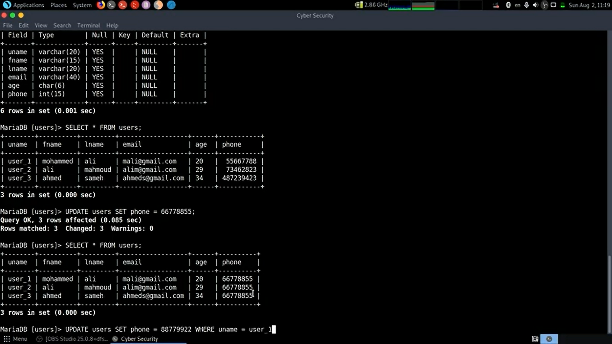

# MySql cyber guy

> mysql queries is’t case sensitive but databases names is case sensitive

```sql
seLeCT vErsion() ;
select version() ;   //all the same 
SELECT VERSION() ; 
-------------------------------------------------------------------
USE mysql;   
										//not the same 
USE MySql; 
```

> we can show multiple built in functions at the same query at the same table

```sql
SELECT VERSION().NOW().CURRENT_DATE().USER() ;

	// NOW() TO show the time now 
	// CURRENT_DATE to show the date now 
 // USER to show the current user and the server 

```

> we can show multiple built in functions at the same query at different tables

```sql
SELECT VERSION();SELECT NOW(); SELECT CURRENT_DATE(); SELECT USER();

```

> using multiple line query

```sql
MariaDB [(none)]> SELECT 
    -> USER().
    -> NOW();
```

NOTE!: to cancel the current query use ( \c )

DATABASES

```sql
SHOW DATABASES; //to show all available databases 
USE DATABASE_NAME; //to get control of specific database //(;) isn't required 

------------------------------------------------------------
//to show the Tables of specific database
USE DATABASE_NAEME ; SHOW TABLES ;
```

CHAR \&varCHAR

```sql
VARCHAR(10); // if we add 5 bits the rest is 5 bits 
CHAR(10);  // if we add 5 bits the rest is zero because it fills the rest with spaces 
```

> NOTE!!! FIELD = COLUMN

DTABASE creation and modification

```sql
CREATE DATABASE_NAME; 

-------------------------------------------------------------
//to create table with specific fields and each field have Datatype and {length}

//syntax      TABLE_NAME   FIELDS NAME     DATATYBE 
CREATE TABLE TABLE_NAME (FIELD_NAME VARCHAR(5) ,FIELD_NAME CHAR(5) FIELD_NAME DATE);

DESCRIBE TABLE_NAME; //TO SHOW TABLE FIELDS 
```

Insert to data base

```sql

//                              VALUES OF FIELDS 
INSERT INTO TABLE_NAME VALUES ('FIELD1','FIELD2','FIELD3');

```

Loading data from file

```sql
LOAD DATA INFILE 'FILEPATH' INTO TABLE TABLE_NAME 
```

Showing all table date

```sql
SELECT * FROM TABLE_NAME;
```

Updating and delete data in tables



```sql

	//                                      TO SPECIFY THE USER TO UPDATE 
UPDATE TABLE_NAME SET FIELD_NAME= NEW_VALUE WHERE THE_REQUIRED_USER ;

--------------------------------------------------------------------
//deleting table
DELETE FROM TABLE_NAME ;
---------------------------------------------------------------------
//SHOWING SPECIFIC USER DATA (ROW)
SELECT * FROM TABLE_NAME WHERE uname='USER_NAME';

----------------------------------------------------------------------
//SHOWING SPECIFIC COLUMN 
SELECT FIELD_NAME,FIELD_NAME FROM TABLE_NAME;
```

Sorting table

```sql
SELECT * FROM TABLE_NAME ORDER BY FIELD_NAME ;
SELECT * FROM TABLE_NAME ORDER BY FIELD_NAME DESC; //TO REVERSE THE SORTED FIELD 
```

**Pattern Matching**

it is to search on database about particular data that contain a particular (letters , numbers , signs)

```sql
SELECT * FROM TABLE_NAME WHERE FIELD_NAME LIKE 'PATTERN %'; //SEARCH FOR EVERY THING STATRT WITH THE PATTERN
SELECT * FROM TABLE_NAME WHERE FIELD_NAME LIKE '% PATTERN'; //SEARCH FOR EVERY THING END  WITH THE PATTERN 
SELECT * FROM TABLE_NAME WHERE FIELD_NAME LIKE '% PATTERN %'; //SEARCH FOR EVERY THING CONTAIN THE PATTERN 
SELECT DISTINCT FIELD_NAME FROM TABLE_NAME WHERE FIELD_NAME LIKE '% PATTERN %'; //SEARCH FOR EVERY THING CONTAIN THE PATTERN IN SPECIFIC COULMN and 
//and if there is redundant data it won't be repeated 
SELECT ALL FIELD_NAME FROM TABLE_NAME WHERE FIELD_NAME LIKE '% PATTERN %'; //SEARCH FOR EVERY THING CONTAIN THE PATTERN IN SPECIFIC COULMN and 
//and if there is redundant data it would be showed  
SELECT * FROM TABLE_NAME WHERE FIELD_NAME LIKE '__'; //SEARCH FOR EVERY THING CONTAIN TOW LETTERS
```

Regex

```sql
SELECT * FROM TABLE_NAME WHERE FIELD_NAME REGEXP '^pattern'; //start with pattern 
SELECT * FROM TABLE_NAME WHERE FIELD_NAME REGEXP 'pattern$'; //end with pattern 
SELECT * FROM TABLE_NAME WHERE FIELD_NAME REGEXP 'pattern'; //contain the pattern  
SELECT * FROM TABLE_NAME WHERE FIELD_NAME REGEXP '^...$'; //contain 3 letters  
SELECT * FROM TABLE_NAME WHERE FIELD_NAME REGEXP '^.{3}$'; //contain 3 letters  
```

LOGICSL OPERATORS ARE KNOWN

```sql

//UNION TO ACHIVE TOW COMMAND AT ON LINE 
SELECT * FROM TABLE_NAME WHERE STATMENT UNION  SELECT * FROM TABLE_NAME WHERE STATMENT

SELECT * FROM TABLE_NAME WHERE NOT FIELD_NAME='VALUE' ; //NOT SYNTAX 

==========================================================================
//COMMENT IN SQL  
-- COMMENT 
#  COMMENT
```
