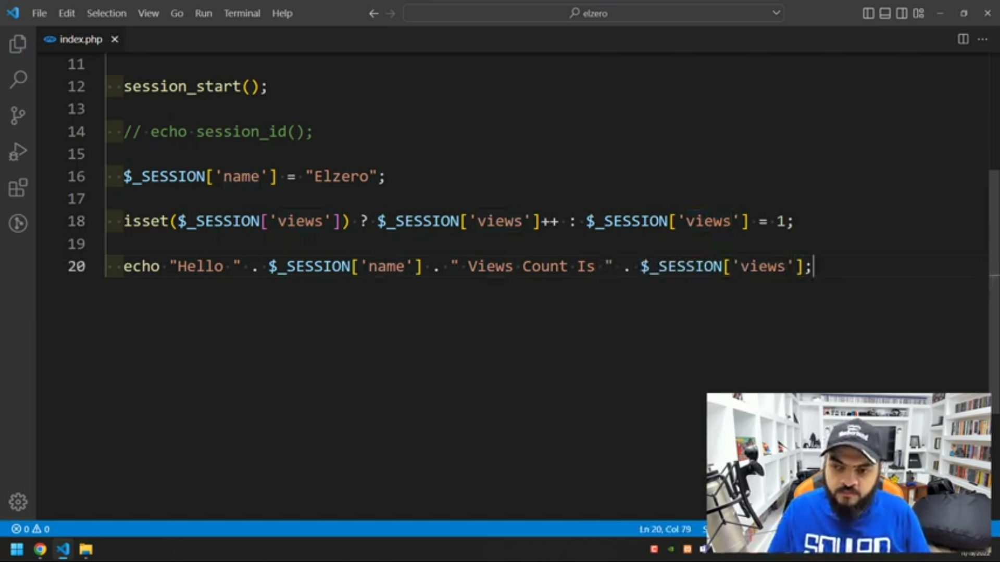
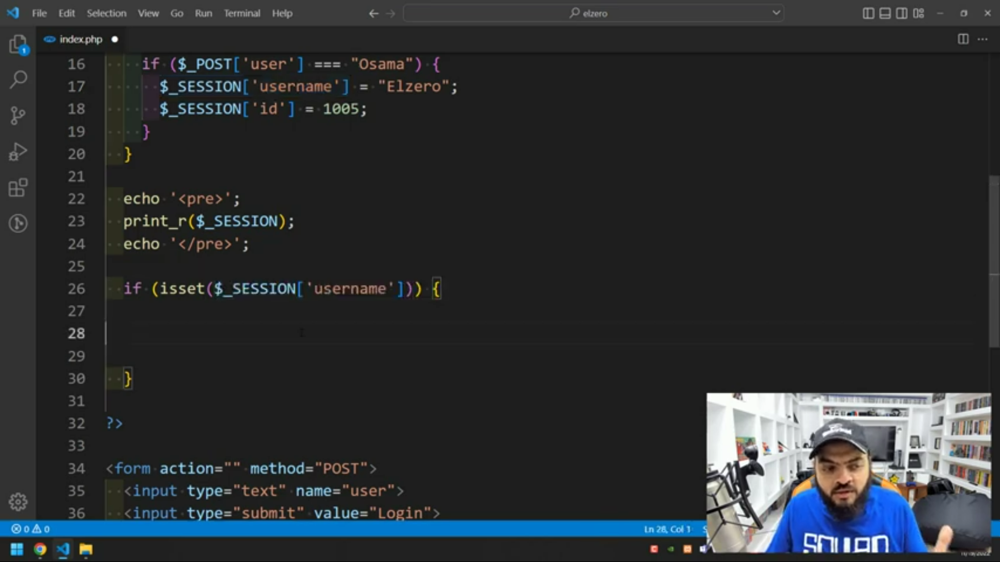
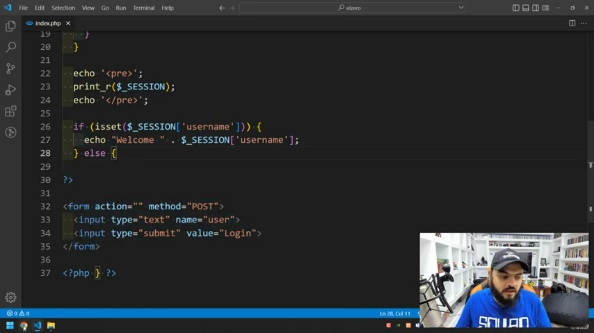

# PHP language

## PHP

external res : https://dull-pink-4ba.notion.site/PHP-for-nour-7f54a67e38c442ed9e174033fbbdcb48

## Syntax

***

#### for write a php code

```php
<?php

//code body

?>
```

***

#### for print a string

the string can include a Html code

the PHP is insensitive for

```php
<?php
echo "the string";
echo "<br>";

print "the string";
PRInt "the string";
<?=" the string";?>

?>
0
```

***

#### comments

```php
//comment
#comment
/*multi 
comment
*/
```

***

### operations on types

*   Data Types

    ```php
    echo gettype(true); // to get the type

    array("d","5");
    ["d","5"];
    						//array syntax
    ```
*   Type conversion

    automatic type conversion done on the result not on the data

    ```php
     echo gettype(true+true); //2 integer 
    ```
*   Data type casting

    ```php
    echo 5 + (int) 5.5 ;
    ```

***

### **Built In Functions**

*   var\_dumb

    show in detail info about the given data

    ```php
    var_dumb((bool)"") //false
    var_dumb((bool)"0") //false
    var_dumb((bool)"56 xa") //true
    ```
*   n2lbr

    ```php
    echo n2lbr("the 
    							multi     // to print multipul lines 
    						line ");
    ```
*   function\_exist

    to insure if the function exist or not

    ```php
    function_exist("function name");
    ```
*   array\_map

    used to loop on array and excute a function on each element

    ```php
    	array_map("function_name",$array_variable);

    //application on anonymous function
    array_map(function($item){return "hello";},$array_variable);
    //application on arrow function
    array_map(fn($item) =>"hello $item",$array_variable);
    ```

***

#### Escaping technics

```php
echo "hello 'PHP' ";
echo 'hello "PHP" ';
echo "hello \"PHP\" ";

```

Escaping block of code using (Herdoc , Nowdoc)

```php
 //Here doc 
$name=5;
echo <<<"He" 
Hello                                  //escape the code with analyzing (print the variable)
9
PHP **SD/\\                          
MY NAME IS $name
He;

//Nowdoc
$name=5;
echo <<<'NO' 
Hello                       //escape the code without analyzing (doesn't print the variable)
9
PHP **SD/\\                          
MY NAME IS $name
NO;

```

***

#### Array

every index in array have a key or number

```php
["a"=>"Ahmed ,"m"=>"Mohamed"]   //a,m are the keys
```

***

#### Variables

PHP is loosely Typed Language : means that a [programming language](https://www.computerhope.com/jargon/p/programming-language.htm) that does not require a [variable](https://www.computerhope.com/jargon/v/variable.htm) (Data type) to be defined

Variables in PHP are case sensitive

```php
$user="mohamed";
echo "hello $user"; //output will be hello mohamed  

echo 'hello $user'; //output will be hello $user
```

**Variable variable**

```php
$m="moahemd";
$$m="M0lex51a";   /* $$m means take the value of $m and make it a variable 
										and so on */	 
echo $m;
echo $$m;

//tricks 
echo "my name is $m";
echo "but my user name is ${$m}";
```

**Super Variable (Global )**

```php
$GLOBALS
$_SERVER
$_REQUEST
$_POST
$_GET
$_FILES
$_ENV
$_COOKIE
$_SESSION
```

**Assign by value ,reference**

```php
//by value 
$m="mohaemd";
$x = $m;
$x="elzzero";

// By reference 
$m="mohaemd";
$x = &$m;
$x="elzzero"; 
```

***

#### Constant

**how to define a constant**

Note: we can’t change the constant value on running time but it can be changed from the config file

```php
define("constant name","value of constant ")

echo "constant name";
```

Predefined Constants

```php
// can get all builted in Constants by searching "predefind Constants"

 echo php_uname; //to get the server operating sys  
 echo "<br>";
 echo __LINE__;  // to get the line number 
 echo "<br>";
 
 echo __FILE__; // to get the file path 
 echo "<br>";
 echo __DIR__; // to get the current directory
```

***

#### Operators

```php
echo gettype(+"50") //integer
echo -"50" // -50 
```

**Comparison Operators**

```php
var_dump("10.0"==10); //true cos == test only the value could represent with"<>" 
var_dump("10.0"===10); //false cos === test the value and data type"!=="=>not identical

//Spaceship "<=>"

var_dump(100<=>50); // (1) 
var_dump(100<=>100);// (0)
var_dump(100<=>200);// (-1)
```

L**ogical operators**

```php
var_dump(100>50 xor 100>200) // one is true but not both \

echo 10 or false; // 10 
echo 10 || false;// true  
```

**String Operators (concatenation)**

```php
define("user","molex");
$a="mohaemd";
$b="ahemd";
$c="tarash";

echo "$a $b $c"; // not the best choice

echo "$a $b $c" ." " . user; // the best because of the constant ,fun  analyize 

/////
$a="mohamed";
$a.="taha";   // will concatenate 
$a.="tarash";
echo $a; // mohamed taha tarash 
```

**Array Operators**

```php
$arr1=["a"=>"4","b"=>"5"];
$arr2=["x"=>"3","c"=>"6"];   //concatenate both 
print_r($arr1+ $arr2);

var_dump($arr1==$arr2); // true if both have the same keys and values
var_dump($arr1===$arr2); //identical //true if both have the same keys,values,order(arrangement),type 
```

**Error control operator (Exception) “@”**

```php
$a=@$b or die("the variable is'nt defined ")

```

***

#### Conditions

```php
if(condition )
		{
				block of code	
		}
	elseif(another condition)
			{ 
				block of code
			}
	else
			 { 
					block of code
		   }
```

**using IF within html code**

```php
<?php if(condition){?>

// Html code
<?php}?>
```

**practical way using IF within html code (Alternate syntax)**

```php
<?php if(condition):?>

// Html code
<?php endif; ?>
```

**Ternary conditional**

```jsx
echo $a >5 ? "good" : "bad"; //if true print good ,if false print bad
```

**Switch**

```php
$nums=5;
switch(nums)
{
	case "5" :
			echo "the number is 5";
			break;
	case "2" :
	case "tow":
				echo "the number is 2";
		break;
	default:
			echo "error";
}
```

***

#### Loops

**While loop**

```jsx
$i=1;
while($i<3)

{
		echo $i;
		i++;
}

//alternate while

$a=1;
while($<3) :

		echo $a;
		a++;
endwhile;
```

**Do while**

```php
$i=0;
do 
	{
			echo $i;
			i++;
	}while($i<3)
```

**For loop**

```php
for($i=0;$i<5;$i++)
{
	echo$i;
}

//another way 
$i=0
for(;;;)
	{
		if($i<5)
			{
				break;		
			}
		$i++;
	}

//Alternte syntax 
for($i=0;$i<5;$i++) :
				echo$i;

endfor;

```

**Foreach loop**

```php
$countries=["eg"=>"50","sy"=>"30", "sa"=>"60"]
forech($countries as $country => $discount ){
		echo $country ." ".$discount;
}

//alternate syntax
$countries=["eg"=>"50","sy"=>"30", "sa"=>"60"]
forech($countries as $country => $discount ):
		echo $country ." ".$discount;
endforeach;

**//continue**

$countries=["eg"=>"50","sy"=>"30", "sa"=>"60"]
forech($countries as $country => $discount ){
		if ($country == "sy")
	{
			continue;   //to skip the current itteration 
	}
		echo $country ." ".$discount;

}

```

***

#### Include & Require

are used for import a file

```php
<?php $a=5 ?> // for ex the file name is " test.php "
 
<?php
include("test.php");
echo $a;          //if there is an error the script will continue//printing continue              
echo "continue";
?>

<?php
require("test.php");
echo $a;             //if there is an error the script will die   
echo "continue";    //so it's used when the script wouldn't done without the file 
?>
```

**includeonce & requireonce**

```php
<?php
includeonce("test.php");
echo $a;                 // to import file one time               
echo "continue";
?>

```

***

#### Function

```php
//syntax

function fun_name($parameters,$parameters)
	{
					echo $parameters;                 //return value=null
	}

//using function
fun_name("argument","argument");

//return test
function fun_name($parameters,$parameters)
	{
		return  $parameters;  
			echo "hello";                   //return value= parameters value
																			//hello wouldn't printed       
	}
```

Parameters

```php
function test_paramter($name,$number,$country="eg") //eg the default value of paramter
																									//used when the user didn't input it 
	{  
		echo $name.$number.$countrey
	}
test_paramter("mohamed","5")

//default parameter rules
//1-it should writed at the end 
//to access one parameter from alot of def values of parameters
//following 
function test_paramter($name="mohamed",$number,$country="eg") 
	{  
		echo $name.$number.$countrey
	}
test_paramter($number:"5");

```

Arguments

```php
function calc(){

		echo func_num_args() //print the arguments numbers
		echo func_get_arg(3) //make the args in array and get the elements by inde
		echo func_get_args() // get all elemnts of array of args
	}
calc("mohamed","6","12","molex")

//Spread syntax

function calc(...$elements){ // means that we don't know the args numbers 
															//same above idea 	
															//... means unpacking the (array,etc)
	}
calc("mohamed","6","12","molex")
```

**Variable function**

```php
function one($arg){}

$fun="one";
echo $fun("arg");  //it's like **echo one("arg");**
```

**Passing by reference\&value**

```php
$n=10;
//passing by value
function  add($num)
	{
	$num +=5;
	return $num;
	}
	echo add($n); //print 15
  //n value =10

//passin by reference 
function  add(&$num)
	{
	$num +=5;
	return $num;
	}
	echo add($n); //print 15
 //n value =15

```

**Return type declaration**

```php
function calc($n1) : int //means cast the return type to integer 
{
}
```

**Anonymous Function**

function do only one task and the application on it is (array map)

```php
$anon_fun=function($name){return "hello $name"}; //defining the anon function

echo $anon_fun("mohamed");    //using the anon function

//scope
$msg="hello";   //in that case the variablr is out of function scope 
$anon_fun=function($name)use ($msg) {return "$msg $name"}; //use keyword to iherit the var
echo $anon_fun("mohamed");  

```

Arrow Function

```php
$fun_name=fn($item)=>"hello $item "; //in arrow doesn't need iherit from out of scope
```

***

#### String

**Array of characters**

**Built in string Functions**

*   strlen

    to get character numbers of string

    ```php
    $name="mohamed";
    strlen($name);
    echo $name[strlen($naem)-1]; // to get the index of  last element 
    ```
*   lcfirst

    ```php
    $name="Mohamed";
    lcfirst($name); //make the first char lower case
    ```
*   ucfirst

    ```php
    $name="mohamed";
    ucfirst($name); //make the first char upper case
    ```
*   strtolower

    ```php
    $name="MohAMED";
    strtolower($name); //turn into all char to lower
    ```
*   strtoupper

    ```php
    $name="MohAMED";
    strtoupper($name); //turn into all char to upper
    ```
*   ucwords

    ```php
    $name="MohAMED taha tarash";
    ucwords($name); //turn into all first char of words to upper case

    echo ucwords("mohamed taha|tarash","|")//ouput is "Mohamed taha |Tarash
    ```
*   str\_repeat

    ```php
    $name="MohAMED";
    str_repeat($name,5); // to repeat the string  
    ```
*   implode

    ```php
    $name=["mo","ha","med"];
    echo implode("separator",array_name); //to turn into the array to one string
    ```
*   explode

    ```php
    $name="moahemd";
    print_r(explode("separator",$name,limit_number)); //to turn into the string to array  
    //limit number the number of elements that return 
    ```
*   str\_shuffle

    ```php
    $name="moahemd";
    str_shuffle($name); //to random arrange the string at every refresh
    ```
*   strrev

    ```php
    $name="moahemd";
    strev($name); //to reverse the string 
    ```
*   trim

    ```php
    $name="  moahemd  "  ;
    $name="###moahemd ##"  ;
    trim($name,"#"); // remove the special character(#) at the front and at the  end  
    ```
*   ltrim

    trim from the right
*   rtrim

    trim from the lift
*   chunk\_split

    ```php
    $name="mohamed taha ahmed"
    echo chunk_split($name,5,"@") // used to split the string 

    ```
*   str\_split

    ```php
    $name="moahemd";

    print_r(str_split($named,2"lenght of each element ")); // to turn into string char to array of elements  
    ```
*   strip\_tags

    ```php
    echo strip_tags("<h3>mohaedm<b>taha</b><h3>","tags wouldn't strip")
    //used to strip or skip tha tags 
    ```
*   strpos

    ```php
    echo strpos("string","substring that needed  ",start position);
    // to search in string (case sensitive) and show the first result
    ```
*   strrpos

    ```php
    echo strrpos("string","substring that needed  ",start position);
    // to search in string (case sensitive) and show the last  result
    ```
*   stripos

    same idea of strpos but it (case insensitive )
*   strripos

    same idea of strrpos but it (case insensitive )
*   substr\_count

    ```php
    substr_count("string","substring that needed  ",start position,length counted from start)
    // used to count how much the substring exist in string  

    ```
*   parse\_str

    ```php
    pasre("name=moahamaed&email=mo@gmial&os=mac,$array_name);
    //to store the user info in array and each value have it's key
    ```
*   quotemeta

    ```php
    echo quotemeta("*ads@#");to skip the unregular characters
    ```
*   str\_pad]

    ```php
    str_pad("string ",length,turned character,pad flag);
    /* to make a fixed wieght to string 
    the flags
    STR_PAD_BOTH   
    STR_PAD_RIGHT   position of add turned character
    STR_PAD_LEFT
    */
    ```
*   strtr

    ```php
    strtr("string","changed char","changed to char");
    //to replace char by another char 

    //ex on translition by array 
    $trasn=["#"=>"M","@"=>"L"]
    strtr("#hamed @arg",$trasn);
    ```
*   str\_replace

    ```php
    echo str_replace("find char ","replace with","string you search in ",variable )
    // used to replace chars with another //variable to store times the replace done
    //to replace with more than char we used array with keys
    //the function case sensivtive 

    ```
*   str\_ireplace

    same of str\_replace but case insensitive
*   substr\_replace

    ```php
    echo substr_replace("string","repalce with",startposition,length);
    //default length is all the string after the start position 
    //if length =0 means it insert not replace 
    ```
*   wordwrap

    ```php
    echo wordwrap("multi line string",width,"cut words"(true or false));
    //used to break lines into new line after spacific width
    //cut words if true the word it self will breaked  
    ```
*   ord

    ```php
    echo ord("a"); // to get the ASCII code of characters
    ```
*   chr

    ```php
    echo char(97); //to get the character of an ASCII code 
    ```
*   similar\_text

    ```php
    echo similar_text("string","stringgg",$variable ); 
    //return how much is there a same characters at tow strings 
    //$variable used to store the string is similar in percent 
    ```
*   strstr(strchr)

    ```php
    echo strstr("string you search in ","search char","before search (true,fasle )");
    //to search in string //case sensitive
    //if before search true will print the string that before searched char 
    ```
*   stristr

    same as strstr(strchr) but case insensitive
*   number\_format

    ```php
    echo number_format ("10_000_000.511546",3,"@","#");//res=10#000#000@511
    //used to format numbers
    ```

**count method**

```php
$name="mohamed";
echo $name[0]; //m
echo $name[-1]; //d //get last element 
echo $name[-2]; //e
```

String update

```php
$name="mohamed";
$name[0]="h";
$name[7]="t"; 
```

***

#### Array

**Built in array Functions**

*   array\_chunk

    ```php
    print_r(array_chunk(arrray_name,chunk length,preserv_keys (true,false)));
    //used to divide the array into pieces or chunks 
    //if true will index the new multi array with it's values 
    //if fasle will reindex with (0,1,2,etc)' 
    ```
*   array\_change\_keys\_case

    ```php
    array_change_keys_case(array_name,(CASE_LOWER,CASEUPPER));
    //used to change the array keys to lower or to upper
    ```
*   array\_combine

    ```php
    array_combine(array_of_keys,array_of_values);
    //used to combine or connect tow array one of keys and one of values
    ```
*   array\_count\_values

    ```php
    arra_count_values(array_name);
    //to count the array vlues and how much it is repeated 
    ```
*   array\_reverse

    ```php
    print_r(array_reverse(array_name,true));
    //to reverse array elements //true to keep it's key values when reverse
    ```
*   array\_flip

    ```php
    array_flip(array_name);//to replace each elment value with it's key 
    ```
*   count

    ```php
    count(array_name, ,mode(0,1));
    //to count all element in array 
    //1 to count the mulidimention array elements  
    ```
*   in\_array

    ```php
    in_arrya(key,array_name,type(true,false))
    //checks if value is exist in array or not
    ```
*   array\_key\_exist

    ```php
    array_key_exist(key,array_name);
    //check if there is akey exist or not
    ```
*   array\_keys

    ```php
    array_keys(array_name,spacific_value,type(true,fasle));
    //return the array keys in array 
    ```
*   array\_values

    ```php
    //return the array values in array with reindex it  
    ```
*   array\_pad

    ```php
    array_pad(array_name,size, char pad with)
    //fill the array with spacific cha
    ```
*   array\_product

    ```php
    array_product(arrat_name);
    //calcluate the product of array
    ```
*   array\_sum

    ```php
    array_sum(array_name);
    //calcluate the sum of array
    ```
*   array\_merge

    ```php
    array_merge(array_name1,array_name2);// merge tow arrays
    ```
*   array\_replace

    ```php
    array_replace()
    //replace elements from passed array to first array 
    ```
*   array\_rand

    ```php
    array_name[array_rand(array_name,number of random ele)];
    //to get an random element 
    ```
*   shuffle

    ```php
    shuffle(array_name);
    //oe arrange the array randomly
    ```
*   array\_shift

    ```php
    array_shift(array_name);
    //shift off the element of the  beginning of array 
    ```
*   array\_pop

    ```php
    array_pop(array_name);
    //shift off the element of the last of array 
    ```
*   array\_puch-

    ```php
    array_puch(array_name,"value","value",etc);
    //to add elements at the end of array
    ```
*   array\_unshift

    same as push but it add at the beginning of array
*   array\_slice

    ```php
    array_slice(array_name,start_position,length,presrve_keys(true,false));
    // take a slice from the array and without change the main array 
    //if true keep the keys don't reindex
    ```
*   array\_splice

    ```php
    array_splice(array_name,start_position,length,slice_of_array)
    ```
*   sortig functions

    ```php
    sort(arr,flag(a,0,A)); //sort in ascending order 
    rsort(arr,flag(a,0,A));//sort in descending order
    asort(arr,flag(a,0,A)); //same as sort but associated array depend on value
    arsort(arr,flag(a,0,A)); //same as rsort but associated array  depend on value 
    ksort(arr,flag(a,0,A));//same as sort but associated array depend on key
    krsort(arr,flag(a,0,A));//same as rsort but associated array  depend on key
    natsort(arr); //natural sorting
    ```

**Array Pointer**

```php
current(array_name); //current element
next(array_name);
prev(array_name);
reset(array_name);  //to reset the main element 
end(array_name); // get the last element
```

**Array map**

```php
prin_r(array_map("call back fun","array_name")); //  one parameter 
//used to excute the function on each element in array 

prin_r(array_map("call back fun","array_name1","array_name2")); //  tow parameter 
//array_name2 point to the second argument 
```

**Array filter**

```php
print_r(array_filter("array_name","function",flag)));
//check a condition that in the function on every element value to filter the elements
// THE FLAG 
//ARRAY_FILTER_USE_KEY =>to check the function on keys
//ARRAY_FILTER_USE_BOTH =>to check the function on keys and values
```

**Array reduce**

```php
echo array_reduce("array_name","call back function ", "intial value");
//used to reduce the array to one value using the call back function + the 
//intial value 

```

***

#### Math Functions

```php
abs($n); //get absolute of number
rand(min,max); //get a random number of spacific range
intdiv(dividend,divisor); //get a division of tow numbers and cast result it to integer 
fmod(dividend,divisor);//get the reminder of division in double 
```

```php
ceil($n); // round up to integer
floor($n); // round down to integer 
round(number,precision,mode); //round but have rules
```

```php
sqrt($n);//get the squre root of number
min(array_name,array_name);// get the lowest array by sequence 
min(n,n,n,n);// get the lowest value
max(n,n,n,n) // get the hieghst value 
```

***

#### Filters Validates Functions

used for filter or validate the returned data to the backend

**filters information**

```php
filter_list();// return the supported filter list 
filter_id(filter_name); //return the filter id 
filter_var($value,filter_name or filter_id)

```

**FILTER VALIDATE BOOL**

```php
filter_var($value,FILTER_VALIDATE_BOOL,FLAG); //TO GET TRUE OR FALSE
//FLAGS
FILTER_NULL_ON_FAILURE // NOT TRUE&NOT FALSE WILL RETURN NULL

//TRUE | 1|YES|ONE
//FALSE|0 |NO| OFF
```

**FILTER VALIDTAE URL**

```php
filter_var($urL,FILTER_VALIDE_URL,FLAG)

//FLAGS
FILTER_NULL_ON_FAILTURE //NULL IF THE URL IS'T TRUE
FILTER_FLAG_PATH_REQUIRED //TO CHECK IF THERE IS A PATH EX=>"WWW.EX.COM/PATH"OR "/"
FILTER_FLAG_QUERY_REQURED//CHECK IF THERE IS A QUERY STRING EX=>"WWW.EX.COM?ID=100"
filter_var($urL,FILTER_VALIDE_URL,["FLAGS"=> FILTER|FILTER])// TO USE MANY FILTERS

```

**FILTER VAIIDATE IP**

```php
filter_var($IP,FILTER_VALIDE_IP,FLAG);//IN DEFULAT VALIDATE IPV4,IPV6

//FLAGS 

FILTER_NULL_ON_FAILTURE // RETURN NULL IF NOT IPV4 OR IPV6
FILTER_FALG_IPV4 //TO VALIDATE ONLY IPV4 
FILTER_FALG_IPV6 // VALIDATE ONLY IPV6 
```

**FILTER VALICDATE MAC**

```php
filter_var($MAC,FILTER_VALIDE_MAC,FLAG)//TO CHECK THE MAC ADDRESS
//FLAGS'
FILTER_NULL_ON_FAILTURE

```

**FILTER VALIDATE EMAIL**

```php
filter_var($EMAIL,FILTER_VALIDE_EMAIL,FLAG)
//FLAGS
FILTER_NULL_ON_FAILTURE //TO CHECK THE EMAIL

```

**FILTER VAILDATE INT**

```php
	filter_var($NUM,FILTER_VALIDE_INT,["flags"=>FILTER_NULL_ON_FAILTURE,"options"=>["min_range"=>50,"max_range"=>100]])
//FLAGS
FILTER_NULL_ON_FAILTURE

```

**FILTER VALIDATE FLOAT**

```php
filter_var($urL,FILTER_VALIDE_FLOAT,["flags"=>FILTER_NULL_ON_FAILTURE,"options"=>["min_range"=>50,"max_range"=>100]])
//FLAGS
FILTER_NULL_ON_FAILTURE
```

#### Filters Sanitize Functions

to remove all unwanted characters

**FILTER SANITIZE EMAIL**

```php
filter_var($email,FILTER_SANITIZE_EMAIL,FLAG)
// REMOVE ALL BUT NOT (LETTERS,DIGITS,!#$%&*+"'-+^_{}|~@.[])
```

**FILTER SANITIZE NUMBER INT**

```php
filter_var($num,FILTER_SANITIZE_NUMBER_INT,FLAG)
//REMOVE ALL BUT NOT DIGITS,+,-
```

**FILTER SANITIZE NUMBER FLOAT**

```php
filter_var($num,FILTER_SAINTIZE_NUMBER_FLAOT,FLAGS);
//FLAGS
FILTER_FLAG_ALLOW_THOUSAND // TO STILL SHOW (,) BETWEEN NUMBERS
FILTER_FLAG_ALLOW_FRACTION // STILL SHOW THE Decimal fractions
```

**FILTER SANITIZE URL**

```php
filter_var($url,FILTER_SANITIZE_URL,FLAGS)
//REMOVE ALL(" ","") BUT NOT SPEACIAL CHARS
```

**FILTER INPUT**

```php
filter_input(type,VALUE,FILTER,FLAG)
//TYPES
INPUT_GET
INPUT_POST
INPUT_COOKIE
INPUT_SERVER
INPUT_ENV
 
//EXAMPLE
echo filter_input(INPUT_GET,"num",FILTER_VALIDATE_INT,FILTER_NULL_ON_FAILURE);
<form action="" method="GET">
<input type="text" name="num">
<input type="submet" value="send">
</form>
```

***

#### File System Functions

```php
disk_total_space();//get total space of file in bytes
disk_free_space();||diskfreespace();// get free space of file 
file_exist(path);//check if the file exist
filesize(file_name);//get file size
	
```

**DIR Process**

```php
is_dir(file_name); // check if the file is directory 
mkdir("path/file_name","permissions=0777",recursive,)

//permissions
0   7      7        7 
  admin    group    others
7=> rwx  , 1=> x , 2=> w , 3=>rx , 4=> r , 5=> rx , 6=> rw
 //recursive => true,false
//if true means to create a recursive file with the given path

remdir(directory_name);//to remove an empty directory  
  
chmode(file_name,new_permissions);//to change dir permissions
//after changing dir permissions i should clear cash 
clearstatcash(); // to clear cash 
fileperms(file_name); // get the file permissions 
```

**DIR INFORMATIONS**

```php
basename(path,suffix)//to return content of path and can remove the suffix of file 
dirname(path,levels)//return aparent  dir'path
realpath(path);//if value = _FILE_ IT returns the currnet dir's path
pathinfo(path),flags) //return info in array such as the flag 
//flags 
PATHINFO_DIRNAME
PATHINFO_BASENAME
PATHINFO_EXTENTION
PATHINFO_FILENAME
//USING THE FUN TO RETURN SPACIFIC INFO 
echo pathinfo(_FILE_)[info_name]
  
```

**Fopen Functions**

```php
fopen("file_name",mode);
//modes
//r => for write and give warining if the file not exist |bointer at the beggining 
//r+ =>write&read 
//w => write | remove all data and start with input data|create the file if it not exist
//w+ => write&read|remove all data and start with input data|create the file if it not exist
//r => for write |pointer at the end |create if not exist
//r+ =>write&read |pointer at the end | create if not exist 
//x => create new file|open for write
//x+ => create new file|open for write&read
//c => write |create if not exist|no trunction |pointer in the begining  
//c+ =>  write&read |create if not exist|no trunction |pointer in the begining 
	fwrite("opend_file_name","data",length[optional]) 
fget("opend_file",length);//get lines of file with spacific length
fread("opend_file",max length);//get all data of file
fclose("file_name")//close opend file 
file("file_name",Flag);//return an array each line in one element 
feof("File_name");//test for end of file  on a file pointer 

//to loop on file to get it's data using while
while(! feof("file_name"))
{
echo fget("file_name") ."<br>" ;
} 
//using for
for($i=0,$i<count(file("file_name")),$i++)
{
	echo fget("file_name") ."<br>" ;
}
```

**Pointer Functions**

```php
ftell("File_name"); // return the pointer position
rewind("File_name"); // back the pointer to the 0 position 
fseek("File_name",offset,whence) // to go to spacific position 
//offset => start position in bytes 
//whences 
SEE_SET// position = offset 
SEEK_CUR // pointer position + offset in bytes
SEEK_END //pointer at the end + offset // offset =negative value  
```

**MV functions**

```php
glop(pattern,Flags)//return array of files that mach the pattern //pattern=> *.txt
rename("sdir_name/old_file_name","sdir_name/new_file_name") //rename at same dir
rename("dir_name/old_file_name","new_dir_name/new_file_name")//rename and move to another dir 
rename("sdir_name/old_file_name","sdir_name/sfile_name") //move to another name 
copy("odl_dir/file_name","new_dir/file_name")//copy in another dir 
copy("odl_dir/old_file_name","new_dir/new_file_name")//copy with rename
unlink("path/file_name")
```

**Contents Functions**

```php
get_include_path();// return the current path 
file_get_contents("file_name",include_path,null,start_position,max_lenght)// return file content in string
//include_path true|faslse //to search the file in the current path
//start_position pointer position in bytes 
//max lenght number of bytes should read  
file_put_contents("file_name","new data",FLAGS) 
//IN default remove the current data and add the new one |create the file if not exist
//flags
FILE_APPEND // to add the new data on the old one 
//did the open and close operation 

```

***

#### Date And Time Functions

**date and time zone**

```php
echo date_default_timezone_get();//return the time zone of the server 
date_default_timezone_set("new time zone")//to change the time zone 
$obj= date_create("date/time","timezone");//to create an object that carry date/time and timezone
//if the parameters is emptey it will be default values (current date/time,timezone)
 //can add the timezone_open("time zone") function to timezone parameter 
check_date(M, D, Y);// to validate the date   
```

**date format**

```php
echo date_format($obj,"format")
//format 
//year => 
	"Y" //show four digits ex =>1982
	"y" //show tow digits ex  => 82
//month
	"m" //show the month number
	"M" //show month text 3 letters only ex =>novb
	"F" //show month full text  ex => novamber 
	"t" //show number of this month days 

//day 
	"d" //show the day of the month followed by zero ex => 08
	"j" //show the day of the month not followed by zero ex => 8
	"D" //show the day text //only 3 letters 
	"l" //show the day full text 
	"z" //show day of the year  ex => 342  
	"S"// show on the third and second format ex => st ,fth,nth 
//time
	"a" //show small am/pm
	"A" //show capital AM/PM
//hour
 "g" //show in 1-12 format //should use time with to know the am or pm 
 "h" //show in 01-12 format followed by zeros//should use time with to know the am or pm 
 "G" //0-23
 "H" //00-23
//minutes ,seconds , microseconds 
 "i" // 00-59
 "s" //00-59
 "u" 

//application 

date_format($obj,"Y -M t-D  ga/i")
```

**Operation on date and time**

```php
date_interval_create_from_date_string("string");//to create dtae interval from string 
//ex =>
date_interval_create_from_date_string("1 year 2 months 3 days ")
date_add($obj,date_interval)//to add an date to obj 
date_sub($obj,date_interval)//to subtract an date from obj
date_moify($obj,"+1 year -3 months")//to control the date with operators   
 
```

**Unix Timestamp**

```php
time();//return the number of seconds since 01 Jun 1970 //unix timestamp
getdate(timestamp);//return an array of all informations of date
date_parse("date"); // used to analyis the date and discover the error  

date_diff("first date","second date ")//return an array or object that carry 
//the time between tow date 
strtotime("operation","base")// to count the time after or before spacific time 
```

***

#### Network

**Cookies**

```php
setcookie(c_name,value,expire,path,domain,secure,HTTP_only);
//expire the ,time that the browser keep cash the cookies (session time ) =>time()+expire time 
//domain => if it's value = example.com the cookie will be available to every subdomain
//secure default value fasle //if true the cookies set only when there is a secure connection
//HTTP_only default value false //if true the cookie will set if the prtocol is only http not https 
//i can set more than one cookie 
//path has the current path as default value //used to limit which dir can access the cookies 
//cookie stored in browser
print_r($_COOKIE);// return the cookie in array 
if(isset($_COOKIE)){echo $_cookie}// to check if the cookie is exist 
setcookie("cookie_name","value", time()-1)// to delet the cookie 
setcookie("cookie_name[setting_name]","value_of_setting")//to store setting in array in cookies
```

application on cookies

.png>)

Session Management

```php
//stored in random file on the server
//server generate a key for session and store it in cookie 

session_start(); // to be accessed to the session and modify it

//modifing session
$_SESSION["name"]="ahemd";
$_SESSION["id"] ="1521";
//to generate the key manualy 
//writing the following before the session_start();
session_id("the key ");
//to print the key 
echo sessin_id();
session_unset();//to remove session variables
session_destroty();//to remove the session it self
```

**Application on session** to count the views number



simulation login and logout





**Header And Redirection**

```php
header(header,replace,Response_code);
//heade => header value
//replace => if true if there is aprevious header it will be replaced with the new one
//Response_code => if i need to send a response code (ex=>404) with header 
header("expires: sat,01 jan 2022");//cashe expire date
header("cashe-control: no cash ,must-revalidate");//to stop using cashe 
header("Location:new_page.php");//redirect to new_page.php
header("Refresh:5; url=new_page.php");//redirect to new_page after 5 seconds 
exit; //should writed after redirection 
```

## security

#### ssrf

```php
he curl_init() function will initialize a new session and return a cURL handle.
curl_exec($ch) function should be called after initialize a cURL session and all the options for the session are set. Its purpose is simply to execute the predefined CURL session (given by ch).
curl_setopt($ch, option, value) set an option for a cURL session identified by the ch parameter. Option specifies which option is to set, and value specifies the value for the given option.
curl_setopt($ch, CURLOPT_RETURNTRANSFER, 1) return page contents. If set 0 then no output will be returned.
curl_setopt($ch, CURLOPT_URL, $url) pass URL as a parameter. This is your target server website address. This is the URL you want to get from the internet.
curl_exec($ch) grab URL and pass it to the variable for showing output.
curl_close($ch) close curl resource, and free up system resources.
```
