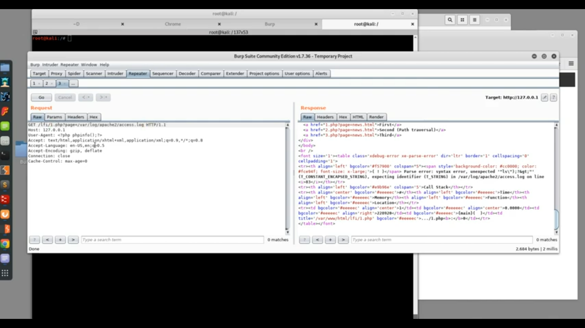

# LFI,LFD,PATH TRAVERSAL 9c8ef4f0f7334159a3683e59448b70cb

## LFI,LFD,PATH TRAVERSAL

Tags: In progress Status: In progress

## local file inclusion

### what is LFI

The File Inclusion vulnerability allows an attacker to include a file, usually exploiting a “dynamic file inclusion” mechanisms implemented in the target application. The vulnerability occurs due to the use of user-supplied input without proper validation.

### Mechanisms

in php there are functions called “include() ,include\_once(),requrie() ,requrie\_once() ” that allow to developer to include file (php ,html ,css) and run it on page

then the LFI occur when the developer trust user and pass him to input some thing in current scenario he pass him to input in “file system operation function“ without filter like “include() ,include\_once(),requrie() ,requrie\_once() ” functions

so we can read a sensitive files in system by replacing file name with the file we want to read in system and if it vulnerable to LFI the file will appear and we can excute the file

## local file disclosure

### what is LFD

it is as same as LFI but all LFI it can be LFD not the opposite

### Mechanism

it is as same as LFI but the difference that is the LFD it enable me to show (disclose) the source code of file and we can’t excute (include) it

### how to find (LFI,LFD)

**when we see user input that require a file name we should try it**

1. try in language=en
2. use burp scanner to find path traversal
3. use “j2EEScan”plugin in burp

## Attack Escalations

### LFI to LFD

***

#### demo

**php wrappers** **and protocols** —-> (a way to read files ) PHP comes with many built-in wrappers for various URL-style protocols for use with the filesystem functions

such as

* [file://](https://www.php.net/manual/en/wrappers.file.php) — Accessing local filesystem
* [http://](https://www.php.net/manual/en/wrappers.http.php) — Accessing HTTP(s) URLs
* [ftp://](https://www.php.net/manual/en/wrappers.ftp.php) — Accessing FTP(s) URLs
* [php://](https://www.php.net/manual/en/wrappers.php.php) — Accessing various I/O streams
* [zlib://](https://www.php.net/manual/en/wrappers.compression.php) — Compression Streams
* [data://](https://www.php.net/manual/en/wrappers.data.php) — Data (RFC 2397)
* [glob://](https://www.php.net/manual/en/wrappers.glob.php) — Find pathnames matching pattern
* [phar://](https://www.php.net/manual/en/wrappers.phar.php) — PHP Archive
* [ssh2://](https://www.php.net/manual/en/wrappers.ssh2.php) — Secure Shell 2
* [rar://](https://www.php.net/manual/en/wrappers.rar.php) — RAR
* [ogg://](https://www.php.net/manual/en/wrappers.audio.php) — Audio streams
* [expect://](https://www.php.net/manual/en/wrappers.expect.php) — Process Interaction Streams —-> can lead to rce like that **expect://id**

***

1. using wrappers like that [file://etc/passwd](file://etc/passwd)
2.  using php wrapper php://filter to make the browser and web server not to excute the file and show it only by the filter like that

    **vulenrablepage.php?file=php://filter/read=convert.base64-encode/resource=../..config.php**

## PATH TRAVERSAL TECHNICE (directory traversal, dot dot slash)

### what is path traversal

it aims to access files and directories are outside of the web root folder

### how it works

when we want to make operation outside the current folder to access another

so it will be like that

```jsx
 **vulenrablepage.php?file=../../../../../config.php**
```

the “../” mean that we back 1 directory

### Path traversal Exploiting technics

try to spot the images fetching parameters

```jsx
filename=/etc/passwd  //using an absolute path from the filesystem root
filename=../../../../etc/passwd 
filename=....//....//....//....//etc/passwd
filename=....\/....\/....\/....\/etc/passwd
filename=double-url encoding
filename=/var/www/images/../../../../../etc/passwd
```

## LFI to RCE

### technics

*   using file uplode forms /functions

    if the page vulnerable to LFI when we upload file (include) the file will be auto executed so we can merge php file contain the exploitation code
* using php sessions -in php5 the path is /var/lib/php5/sess\_\[phpsessid]
* including from the temporary files
* using php wrappers —→ expect://(command) non common case
*   using php://input in post request

    i intercept the request and change the vulnerable parameter to php://input

    and writing php code in the request like that

    ```php
    <?php phpinfo();?>
    ```

    it works when the request in post
*   using log files with controllable input like

    

    i make the file include from /var/log/apache/access.log

    and i write my exploitation code in “user agent”

    i can use more paths like

    * /var/log/apache/error.log
    * /var/log/sshd.log
    * /var/log/mail.log
* using poc/self/environ
*   using poc/self/fd/(fid)—> number

    in linux when there is a process on file system (file system operation ) and all operations

    have a pointer called (file descraptore) and it have number (fid) if the linux did operation in

    access.log file and the operation have number (8) so i can access it with

    **poc/self/fd/8**
