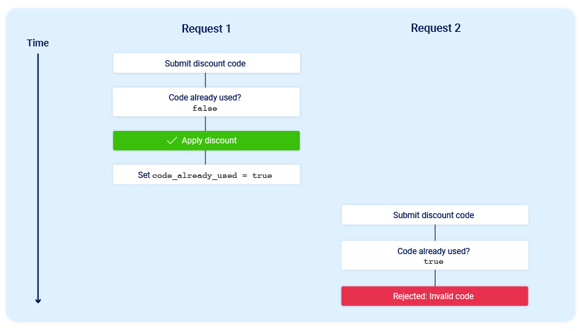
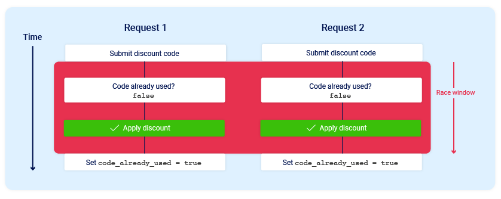

# Race Condition cb226a0640f94a33b8f2f85b5f4b325a

## Race Condition

Tags: Not started Status: Not started

## What is Race Condition Vulnerability?

Race conditions are a common type of vulnerability closely related to business [logic flaws](https://portswigger.net/web-security/logic-flaws) , They stem from simple programming mistakes developers often make ,They occur when websites process requests concurrently without adequate safeguards .

## Mechanisms

Before diving into Race Condition Vulnerability we should understand some concept in processing process.

#### **Concurrency** :

is the ability to execute different parts of a program simultaneously without affecting the outcome of the program , it can drastically improve the performance of programs because different parts of the program’s operation can be run at once

_Concurrency have two types :_

_**Multiprocessing :**_ refers

to using multiple central processing units (CPUs)

to perform simultaneous computations.

_**Multithreading :**_ is the ability of a single CPU to provide multiple threads, or concurrent executions.

threads don’t actually execute at the same time , but they take turns using the CPU’s computational power .

for example —>

when one thread is suspended while waiting for user input, another can take over the CPU to execute its computations, it happens depending on “_Scheduling Algorithms_”

**Scheduling :** Arranging the sequence of execution of multiple threads

Some of scheduling algorithms :

_Highest priority_ : execute the process firstly which has the highest priority.

_SJF (Shortest job first)_: execute the process firstly which has less computational time.

so starting from this point we can say that a “race condition” happens when two sections of code that are designed to be executed in a sequence get executed out of sequence.

it because of developers don’t adhere to certain safe concurrency principles.

so we can predict from previous demo that the sequence of requests the biggest factor that can lead to race condition.

so To see why the sequence of execution matters and how it can affect the business of application let’s consider an example —>

online store that lets you enter a promotional code during checkout to get a one-time discount on your order. To apply this discount, the application may perform the following high-level steps:

1. Check that you haven't already used this code.
2. Apply the discount to the order total.
3. Update the record in the database to reflect the fact that you've now used this code.

in ordinary case there no problem which sending requests in different time

But what if we can send the same request with the same data twice at almost exactly the same time:

in this case the problem arise since the attacker can send many requests with same data at the same time leading to get many discounts for the same order with only one promotional code.
